# Важный дисклеймер:
Управление и ввод данных с использованием быстрых клавиш, нажимаемых на клавиатуре является оптимальным способом взаимодействия с Системой. Но, следует учесть, что **клавиша [Enter] является самой опасной из клавиш**. Её нажатие в момент внесения данных в Документ выполнит сохрание (проводку) документа. В случае некоторых документов (Отгрузка\\Продажа, Поступление\\Закупка, Платёж, Списание со склада, Поступление на склад) это действие необратимо и потребуется создание отменяющих документов.  
**Клавижа [Enter] не является в SAP кнопкой перехода между строками\\полями. Эта функция назначена на клавижу [Tab]**  
По запросу пользователя, имеется возможность отключить подобное поведение клавиши [Enter]. Для изменения поведения клавиши обратитесь в SAP поддержку.  
При этом, **клавиша [Enter] является одновременно и самой полезной клавишей в SAP**.  
Грань между опасностью и пользой находится в ежесекундном осознании текущего состояния Form Mode (см.ниже в разделе Form Mode).

# Рабочее пространство
В данном разделе используются стандартизированные название элементов с их близким переводом на русский язык. Пожалуйста, запомните их. Они будут использованы в дальнейшем по тексту инструкции, при обучении и поддержке.

Внешний вид рабочего пространства SAP Business One:

 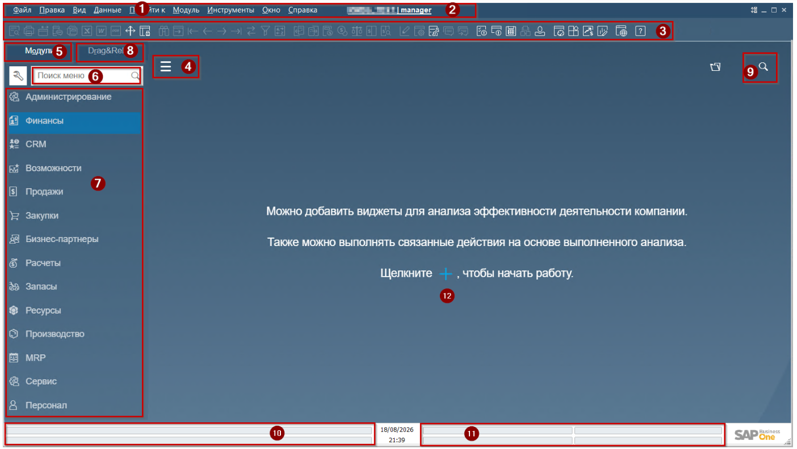

(1) Horizontal menu \\ Горизонтальное меню  
(2) Company Name|User \\ Название Компании|Пользователь. Является кнопкой!  
(3) Tool Panel \\ Панель инструментов  
(4) Hamburger \\ Гамбургер. Кнопка скрытия\\отображения Главного меню  
(5) Modules \\ Модули. Кнопка перехода к модулям Главного меню  
(6) Main Menu Search \\ Поиск Главного меню. Поиск по разделам Главного меню.  
(7) Main Menu \\ Главное меню. Разделы Главного меню.  
(8) Drag&Relate. Кнопка перехода к разделам отчётности Drag and Relate  
(9) Corporate Search \\ Корпоративный поиск. Поиск по данных в Системе  
(10) Status bar \\ Строка состояния.  
(11) User info bar \\ Пользовательская информационная строка  
(12) Fiori Desktop \\ Рабочий стол Fiori  

## (1) Horizontal menu \\ Горизонтальное меню
Привычное для Windows приложений меню. Состоит как из стандартного набора Файл, Вид, Правка, Помощь так и специфичных для SAP разделов Данные, Модуль, Инструменты, Окно.  
Состав элементов отображаемых в выпадающих вниз меню зависит от того какой объект открыт в Рабочем пространстве. Раздер Модуль - дублирует разделы Главного меню, что позволяет использовать его для открытия различных форм без его использования.  
Важные элементы:  
*Вид - Пользовательские поля*. Позволяет управлять отображением дополнительной панелью Формы на которой содержатся пользователькие поля.  
*Вид - Скорректировать ширину столбца*. Позволяет оптимизировать отображение колонок в таблицах, расширив их под содержание  
*Инструменты - Журнал изменений*. Открывает лог изменений выполненных в открытом документе\\карточке справочника  
*Инструменты - Горячие клавиши пользователя*. Позволяет выполнить назначение действий на клавиши F2-F12 клавиатуры.  
*Окно-Закрыть все*. Закрывает все открытые на рабочем пространстве окна.  
*Окно-Закрыть все другие*. Закрывает все открытые на рабочем пространстве окна, оставляя открытым только то окно, которое активно в данный момент.

## (2) Company Name|User \\ Название Компании|Пользователь
Кнопка индикатор, нажатие открывает список доступных SAP баз данных.

## (3) Tool Panel \\ Панель инструментов
Горизонтальная полоса с расположенными на ней кнопками-иконками. Активность кнопок зависит от того, какая форма\\документ в настоящий момент открыта и активна. Помимо самой формы, активность зависит от состояния формы (Режим поиска\\Режим добавления записи\\Режим просмотра)  
Иконки сгруппированы по смыслу использования

### Файл
 

**Превью** - предпросмотр печатной формы. Для просмотра открывается формат, который установлен по-умолчанию для документа  
**Печать** - печать печатной формы. Также как и для превью, на печать отправляется формат, который установлен по-умолчанию для документа  
**SAP Business One Mailer** - отправка документа по внутренней почте SAP.  
**SMS** - модуль отправки документов по СМС для Roin World не активирован  
Факс - модуль отправки документов факсом для Roin World не активирован  
**MS Excel** - экспорт данных из открытого окна в файл Microsoft Excel. Важно, перед сохранением файл необходимо изменить расширение файла на .xls или .xlsx  
**MS Word** - экспорт печатной формы в Microsoft Word  
**PDF** - экспорт печатной формы в PDF файл. Для экспорта будет использован формат установленный по-умолчанию для данного документа  
**Запустить Приложение** - запуск приложения, предопределённого при настройке Системы. Для Roin World не активирован  
Блокировать экран - кнопка для блокировки экрана на случай если пользователь планирует отойти от компьютера

### Данные
 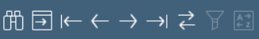

**Поиск** - переключение открытого документа в режим поиска  
**Добавить** - переключение открытого документа в режим добавления новой записи  
Для понимания как работают следующие кнопки необходимо представить, что все документы расположены слева направо от номера 1 до номера N. Следующие иконки позволяют переходить между документами **внутри одного типа документов**  
**Перейти к первой записи** - переход к документу с минимальным номером  
**Предыдущая запись** - переход к документу с номером документа меньше, чем у открытого  
**Следующая запись** - переход к документу с номером документа больше, чем у открытого  
**Перейти к последней записи** - переход к документу с максимальным номером (последний созданный документ)  
**Фильтрация таблицы** - установить фильтр для документов табличного вида и отчётов  
**Сортировка таблицы** - отсортировать данные в табличного вида документах и отчётах

### Перейти к
 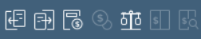

**Предыдущий документ** - переход к базовому документу, кнопка активна при наличии базового документа. Например, для документа Отгрузка базовым документом является Заказ на продажу  
**Последующий документ** - переход к целевому документу при его наличии.  
Например, для документа Отгрузка целевым документом является Продажа (Инвойс)  
**Валовая прибыль** - переход к окну просмотра и настройки расчёта валовой прибыли по документу  
**Методы платежа** - Переход к окну ввода реквизитов платежа. Кнопка активна для документов, подразумевающих проводку платежа (Закупка\\Продажа, инвойсы и Платежи)  
**Расчёт объёма и веса** - переход к окну расчёта общего объёма и веса товаров, содержащихся в документе. Условием наличия данных в этой форме является заполнение данных о весе в карточке товара.  
**Журнал проводок** - переход к окну просмотра бухгалтерских операций  
**Предварительный просмотр бух.операции** - переход к просмотру бухгалтерской операции, которая будет создана (если документ ещё не сохранён) в режиме предпросмотра. Эта опция является очень полезным инструментом. При генерации предпросмотра, система проверяет не имеет ли документ ошибок. При этом, проводка в системе не создаются, что даёт шанс внести изменения до проводки.

### Инструменты
 

**Редактор печатных форм** - технический инструмент настройки печати и выбора форматов, для пользователей системы настройка недоступна  
**Параметры настройки формы** - переход к настройке отображения полей. В документах табличного вида позволяет скрыть\\отобразить или переместить колонки  
**Менеджер запросов** - переход к хранилищу пользовательских запросов (отчётов). Это основной инструмент пользователя для запуска отчётов.  
**Live collaboration** и **Отправить в чат** - кнопки внутреннего чата Colaboration. Для Roin World не активен

### Окно
 

**Обзор сообщений Workflow** - для Roin World не активен  
**Обзор сообщений \\ предупреждений** - переход в почтовый ящик пользователя (SAP Business One Mailer)  
**Календарь** - переход к календарю пользователя  
**Выбор филиала по умолчанию** - для Roin World не активен  
**Мои личные настройки** - переход к настройкам пользователя. В этом окне могут быть изменены шрифт, язык интерфейса, и активация сервисов SAP

### Extreme Apps
 

**Проверка доступного количества** - переход к инструменту АТР, для Roin World не активен  
**Управление графиком поставок** - переход к инструменту АТР, для Roin World не активен  
**Прогноз движения денежных средств** - переход к SAP HANA инструменту просмотра прогноза кассовых разрывов и ликвидности  
**Сквозная аналитика** - переход к SAP HANA инструменту аналитики. Инструмент позволяет создавать дашборды рабочего пространства Fiori  
**Web Client** - запуск web клиента SAP Business One

### Справка
 

**Справка** - переход к справочной системе SAP Business One

## (8) Drag&Relate
Функциональный раздел Главного Меню, позволяющий получать отчёты на лету. Для использования данного функционала потребуется раскрыть в Drag&Relate интересующий пункт и также открыть источник данных для формирования отчёта. В примере ниже используется карточка БП. В карточке БП необходимо зажать кнопкой мыши поле до появления чёрной рамки вокруг поля и затем - перетащить рамку на пункт Drag&Relate и сбросить. В примере Название БП сброшено на отчёт по продажам на уровне строк заказа

 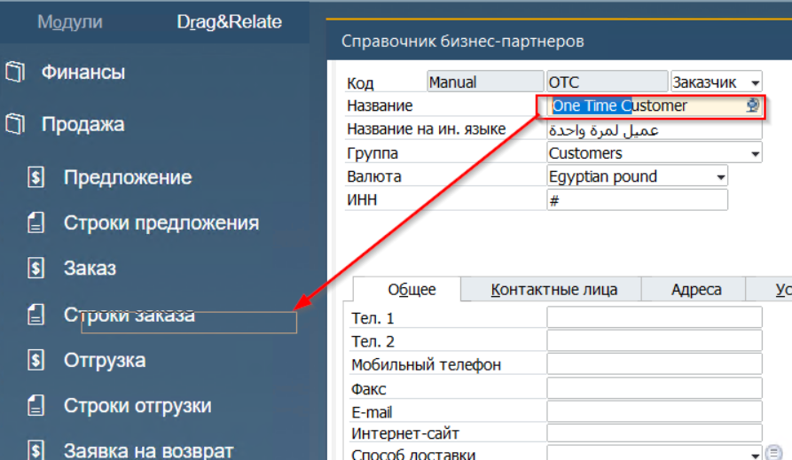

\

\

\

\  
Поскольку в строках заказа содержатся товары, то будет сформирован отчёт по товарам для выбранного БП использованных в Заказе на продажу:  
 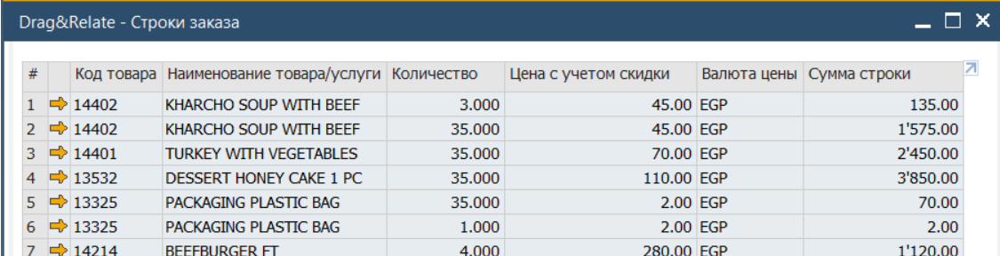

## (9) Корпоративный поиск
Google-like поиск по документам и мастер данным, сохранённым в базе данных

## (10) Строка состояния
Область интерфейса в которой отображаются сообщения от SAP

## (11) Пользовательская информационная строка
Область интерфейса, разделённая на 4 поля. В каждое из полей пользователь может перетянуть поле из документа или мастер данных (например с вкладки Логистика). После этого данные из этого поля будут показываться для активного документа, а пользователю не надо будет заходить на отдельную вкладку чтобы узнать что содержится в поле

## (12) Рабочий cтол Fiori
Область рабочего стола SAP Business One, предназначенная для вывода текущей информации в виде дашбордов и KPI показателей. Сам рабочий стол Fiori имеет два режима:

* Рабочий стол пользователя
* Преднастроенная шаблон с дашбордами
В режиме рабочего стола пользователя, для добавления дашборда на рабочий стол необходимо нажать символ '+' и выбрать дашборды для размещения на рабочем столе. Дашборды относящиеся к Roin World имеют названия начинающиеся с RW.  
В режиме шаблонов, необходимо нажать на символ Папки и выбрать один из преднастроенных шаблонов

 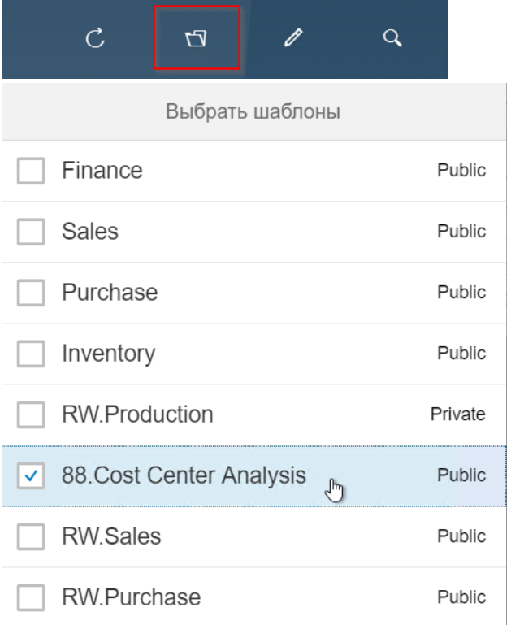

\

\

\

\

\

Система обновит содержание рабочего стола и отразит преднастроенные в шаблоне дашборды

 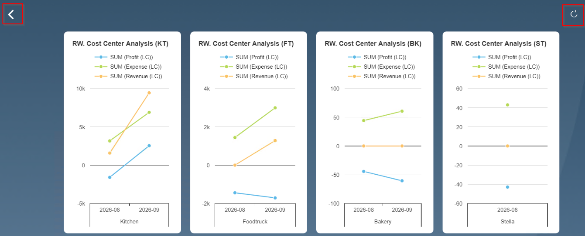

\

\

\

\  
Для возврата к рабочему столу пользователя необходимо нажать на символ Назад [<]  
Для обновления данных в графиках - символ Refresh. Без нажатия на Refresh - данные в дашбордах будут обновлены раз в 3 минуты.

# Form Mode \\ Состояние формы.
Любой объект SAP Business One имеет несколько режимов. Система подсказывает пользователю текущее состояние посредством подсветки полей формы, а также текстом, отображаемом на кнопке формы.

Поля жёлтого цвета и текст на кнопке по-умолчанию [Поиск] означают, что форма находится в режиме [Find Mode] \\ [Режим поиска записи] :

 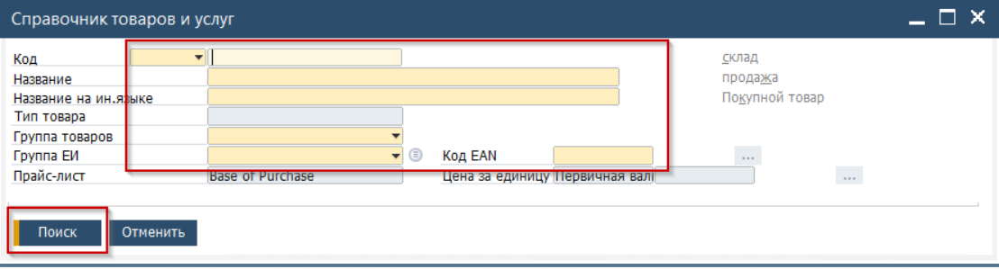

Поля белого цвета и текст на кнопке по-умолчанию [Добавить] означают, что форма находится в режиме [Add Mode] \\ [Режим добавления новой записи] :

 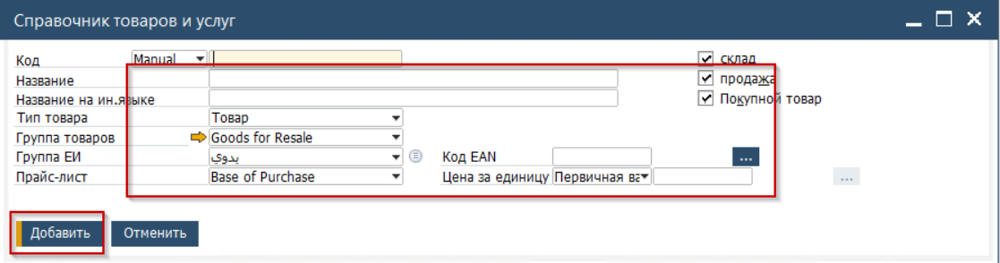

Поля белого цвета и текст на кнопке по-умолчанию [Добавить] означают, что форма находится в режиме [Update Mode] \\ [Режим обновления записи] :

 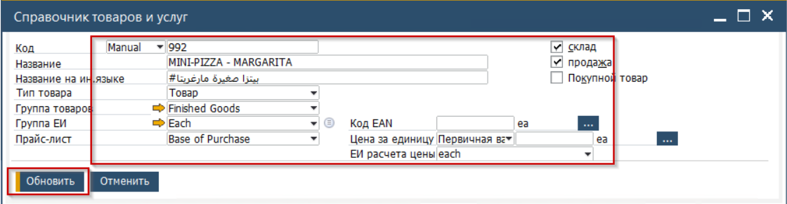Оранжевый ярлык на кнопке Формы означает, что именно эта кнопка будет нажата при нажатии кнопки [Enter] на клавиатуре.

## Переключение между режимами формы
Для переключения между режимами может быть выполнен двумя способами:

* Клавиатура.
Для активации режима [Find Mode] \\ [Режим поиска записи] необходимо нажать комбинацию клавиш [Ctrl] + [F]  
Для активации режима [Add Mode] \\ [Режим добавления новой записи] необходимо нажать комбинацию клавиш [Ctrl] + [A] (англ.раскладка)  
* Мышь
Для переключения Режима формы необходимо нажать (1) для переключения в [Find Mode] \\ [Режим поиска записи] и (2) для переключения в [Add Mode] \\ [Режим добавления новой записи]

 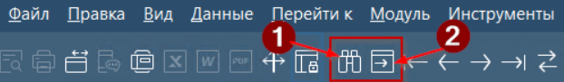

Переключение в режим [Update Mode] \\ [Режим обновления записи] происходит автоматически, если пользователь внёс изменение в поля Формы.

### [Find Mode] \\ [Режим поиска записи]
Находясь в режиме поиска записи пользователь имеет возможность уточнить критерии для осуществления поиска. Для ввода критериев доступны любые из полей закрашенных жёлтым цветом. В качестве критериев могут быть использованы значения из Выпадающих списков или свободный ввод, со следующим подходом: (на примере названия товара)

* pi\* - для поиска записей начинающихся с pi (**pi**zza with tomato, **pi**nk pizza)
* \*za - для поиска запискей заканчиващихся на za (big fat piz**za**, pink piz**za**
* \*pa \* - для поиска записей содержащих pa в названии ( lovely **pa**sta meals)
* \*pi%za \* - для поиска записей где один символ неизвестен (big lovely **pi**z**za**)

При заполнении нескольких полей они работают как совокупность критериев.

Например:

Результат - все карточки товаров где в составе названия используется сочетание **za**:

 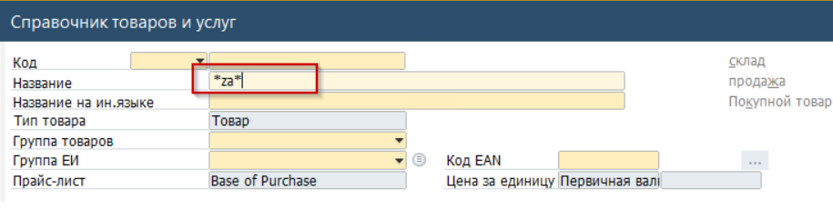

Результат - все карточки товаров где в составе названия используется сочетание **za**, группа товаров которых Finished Goods\\Готовая продукция и Группа Единиц измерения - Each\\Штучные:

 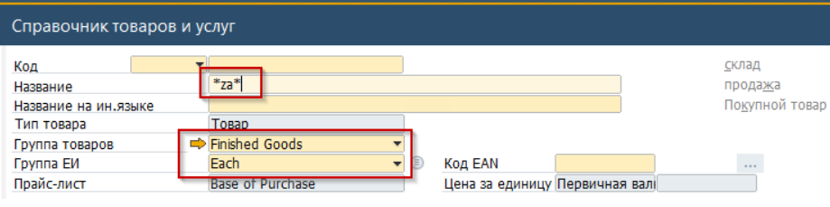

Для запуска поиска необходимо нажать кнопку формы [Поиск]. Нажатие этой кнопки может быть выполнено мышью или нажатием клавиши клавиатуры [Enter]

**Обратите внимание!** Система фиксирует действия пользователя и воспринимает взаимодествие с полем как критерий. Например, если пользователь поставит курсор в поле Название, внесёт туда что-то и потом удалит (и нажмёт поиск) то система будет пытаться найти запись с пустым полем Название.

### [Add Mode] \\ [Режим добавления новой записи]
Добавление новой записи выполняется всегда в определённой последовательности. Слева-направо, и сверху-вниз. Первым заполняется Заголовок, затем заполняются Вкладки. Вкладки заполняются от левой к правой. Нумерация на скриншоте условная последовательность.

 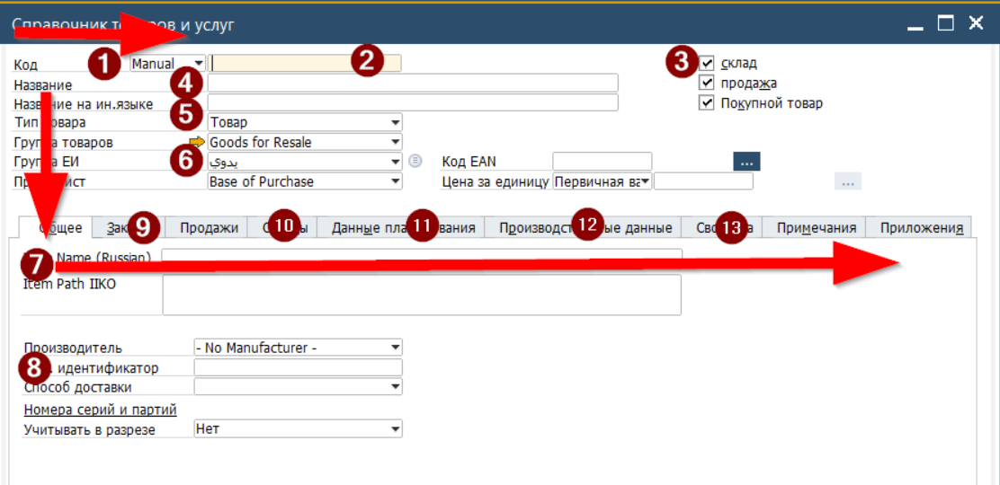Подобный подход к заполнению документа обусловлен тем, что на формах (как правило в Документах) расположены зависимые поля.
Например зависимость полей Склад - Счёт - Департамент.  
Так как при изменении Склада система выполнит изменение счёта, а Департамент в свою очередь зависит от счёта. То при преждевременном заполнении поля Департамент с последующим изменением Склада, Система очистит поле Департамент.

### [Update Mode] \\ [Режим обновления записи]
Режим обновления записи активируется автоматически если в режиме [View Mode] \\ [Режим просмотра записи], пользователь выполнит изменение какого либо из полей. Для сохранения внесённых данных необходимо нажать кнопку формы [Update] или клавишу [Enter]  
Для возврата в режим просмотра при этом (если изменение записи не требуется) необходимо нажать кнопку Обновить, расположенную на панели инструментов (см.ниже в разделе Панель инструментов).

### [View Mode] \\ [Режим просмотра записи]
Стандартный режим для документов в статусе Закрыт и записей Справочников. Значение кнопки формы - [OK]. Если будет нажата клавиша [Enter] то Форма будет закрыта.
