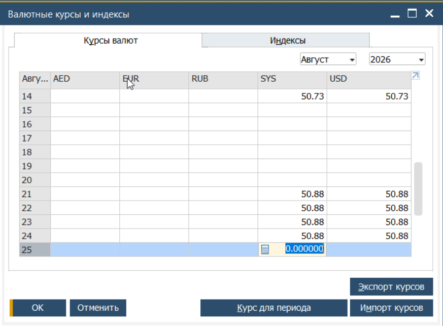
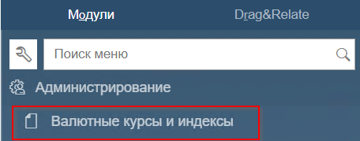
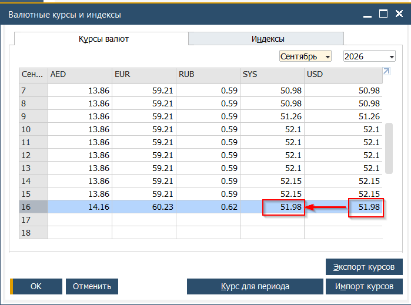

Все проводки в Системе выполняются параллельной записью с использованием локальной валюты (EGP) и системной валюты (SYS), которая ассоциирована с USD.  
По этой причине, начало работы невозможно без ввода курса на текущий день.  
При открытии любого документа, предполагающего возможность создания бухгалтерской операции, пользователю будет показано окно ввода Валютные курсы и индексы. Для продолжения работы, пользователю необходимо ввести курс для валют.

Источник курса валют: [https://www.cbe.org.eg/en/economic-research/statistics/cbe-exchange-rates/historical-data](https://www.cbe.org.eg/en/economic-research/statistics/cbe-exchange-rates/historical-data)

**(!) Важно указать корректный курс так как в противном случае будет необходимо отменить и ввести по-новой все проводки созданные за день с ошибочным курсом**

 

##  
Концепция ввода курсов валют

Курс вводится ежедневно в начале рабочего дня. После этого, курс уточняется в таблице курсов в 14:30

## Ввод курсов валют

1. Из Главного меню отрыть →Администрирование → Валютные курсы и индексы

2. В открывшемся окне указать актуальные курсы для всех валют в строке с текущим днём
При наличии пробелов (выходные дни) курсы для этих дней также необходимо заполнить.  
Для валюты SYS указать курс USD к EGP  

3. Сохранить изменения нажав кнопку [Обновить]
