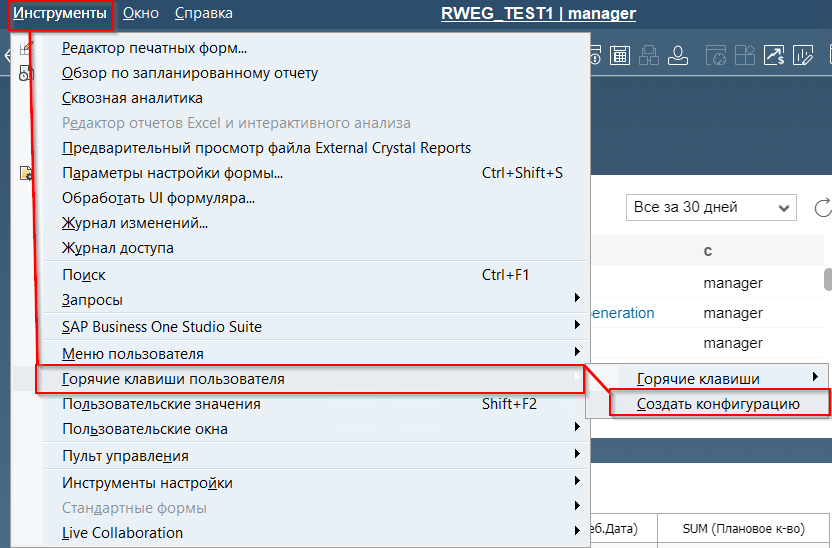
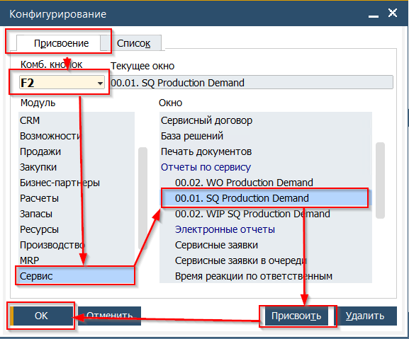

Динамический отчёт - форма пользовательского отчёта, разработанного для Roin World. Критерии запуска (фильтры) для отчёта, Система получает из активного документа.  
Особенности использования:

* Отчёт будет сгенерирован только если форма документа активна и документ добавлен в базу данных
* Запуск отчёта может быть назначен на клавиши с F2 по F12
* При работе на ноутбуке с функциональными клавишами, в зависимости от настройки операционной системы, помимо клавишы Fx может требоваться нажатие клавиши FnKey

## Назначение комбинации для запуска отчёта

Для настройки комбинации необходимо

1. Перейти по пути из горизонтального меню Инструменты→Горячие клавиши пользователя→ Создать конфигурацию

 

2. В открывшемся окне выбрать клавишу на которую будет назначен запуск отчёта

   

## Запуск Динамическогого отчёта

1. Открыть документ сохранённый в базе данных (например Коммерческое предложение)
2. Убедиться что документ активен (после открытия документа не производилось нажатий мышкой в другие формы и приложения)
3. Нажать комбинацию клавиш Fx на которую назначен отчёт
