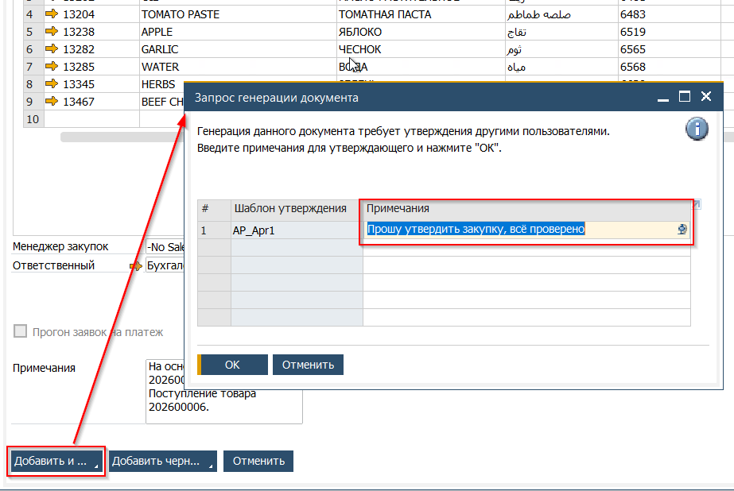
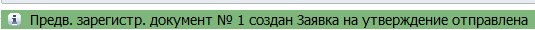
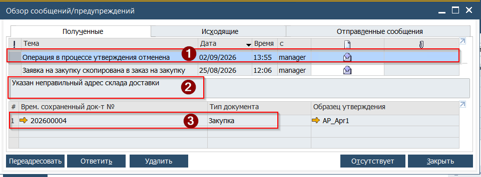
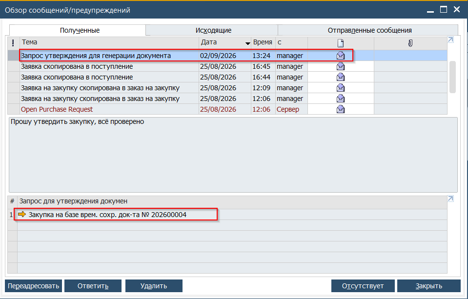
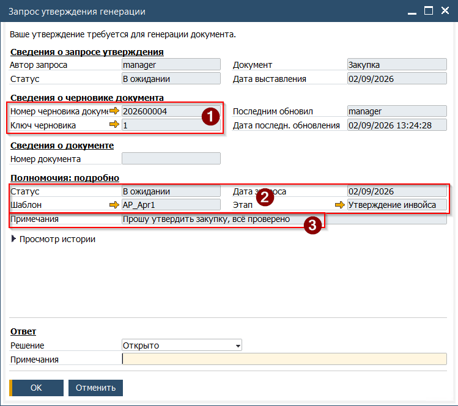
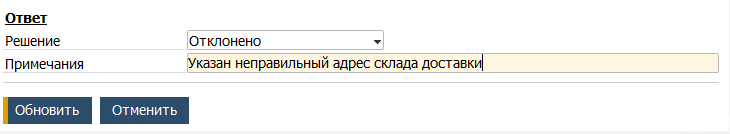
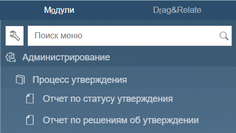
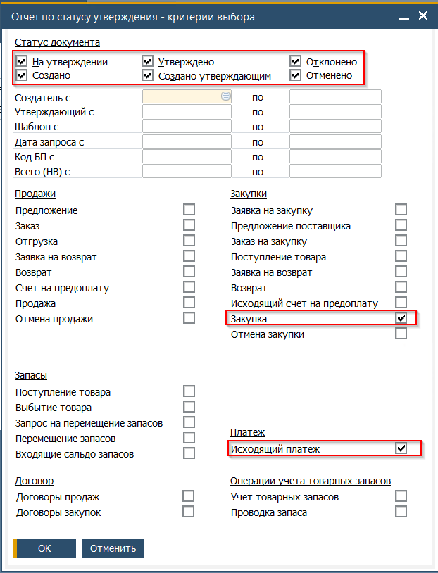
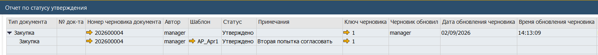

В Системе активирована процедура утверждения документов. На момент написания данного документа утверждение активировано для следующих типов документов:

* Закупка
* Исходящий платёж

Система обработки запросов на утверждение работает циклами с периодичностью - 5 минут. Это означает, что в зависимости от момента когда документ отправлен на утверждение, и до получения уведомлений об этом может пройти от 1 до 5 минут.

## Действия создателя документа

1. При нажатии кнопки [Добавить], система откроет форму Запрос генерации документа - формы которая является сопровождающей отправку документа на утверждение.

 

2. Опционально, в качестве объяснения можно добавить свободный текст в поле Примечания. Это текст будет доставлен утверждающему

3. Нажать кнопку [ОК] для отправки документа на утверждение.

Система уведомит об отправке в строке состояния

 

4. Если документ не был утверждён, то по внутренней почте поступит сообщение об его отклонении (1).

В теле сообщения будет содержаться сообщение от Утверждаюшего сотрудника, если оно было им добавлено (2). Для перехода в документ необходимо нажать золотую стрелку (3)

 

5. После доработки документа, повторить шаг 3 для повторной отправки документа на согласование.

6. При получении сообщения с положительным решением по согласованию, необходимо перейти в документ, нажав золотую стрелку в теле сообщения и нажать кнопку [Добавить].

   > Если после утверждения, но до создания документа, в документ были внесены правки - то он будет повторно отправлен на согласование

## Действия утверждающего

1. Уведомление о поступлении документа для утверждения поступит по внутренней SAP почте. Прозвучит звуковой сигнал оповещения о новом сообщении и будет открыт почтовый ящик

 

1.В. Для самостоятельной проверки наличия писем в почтовом ящике, необходимо открыть Обзор сообщений находящийся на панели инструментов

2. Для перехода к рассмотрению документа необходимо нажать на золотую стрелку, размещённую в теле сообщения

3. Система откроет форму обработки запроса

(1) Для перехода в сам документ, необходимо нажать золотую стрелку в разделе Сведения о черновике документа  
(2) Сводная информация о том, какие шаблоны согласования были применены и текущем статусе согласования  
(3) В поле Примечания отражается сообщение от Создателя документа  

 

4. Здесь, в качестве примера будут приведены шаги отправки документа на доработку. После ознакомления с документом (Внимание - любые изменения, внесённые Утверждающим пользователем, не будут сохранены в черновике), Утверждающий пользователь указывает своё решение относительно судьбы документа в поле Ответ. Опционально, можно добавить сообщение в свободной форме, которое будет доставлено Создателю документа.

 В этом случае, Создатель получит уведомление об отклонении документа с указанной причиной

5. Если был выбран ответ Утверждено, то Создатель получит сообщение, позволяющее продолжить процесс создания документа. При этом, если документ был утверждён, то внесение новых данных в него будет недоступно

## Отчёты по процессу утверждения
Все доступные отчёты по Утверждениям расположены в разделе Главного меню -> Администрирование -> Процесс утверждения

 

### Отчёт по статусу утверждения
Отчёт запускается с предварительным определением критериев. На этом шаге определяется, информация по каким документам будет отражена в отчёте. Критичными на данный момент являются документы Закупка и Исходящий платёж, они должны быть выбраны в качестве критериев

 

По окончании выбора критериев, нажать кнопку [OK]  
Будет открыт отчёт, содержащий информацию по актуальному статусу согласования

 
