## Код товара, нумерация

Код товара - уникальный идентификатор товара внутри SAP Business One. Существует два подхода к формированию кода:

* ручной, используется для товаров из iiko. В качестве кода товара используется код iiko, для таких товаров используется серия нумерации Manual
* автоматический, используется для товаров, существующих исключительно в SAP. На момент написания инструкции к таким относятся сервисные товары (Admin, Selling и Utilities затраты)

| Серия нумерации | Префикс | Описание | Пример кода |
|-----------------|---------|----------|-------------|
| AdmExp          | S22x    | Административные (общие) затраты | S220 Audit fees - Услуги аудита |
| SellExp         | S11x    | Затраты на продажу | S110 - Freight, услуги доставки |
| UtilExp         | S21x    | Затраты на коммунальные услуги | S210 - Electricity - Электричество |

 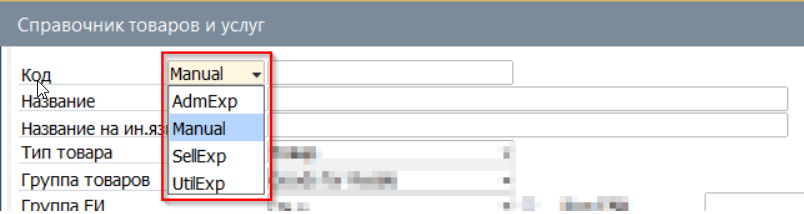

## Группа товара

Группа товара - свойство объединяющее товары по подходу к проводкам и правилам использования. На уровне группы товара в SAP назначены правила подбора счетов Главной книги и проверки на качество заполнения карточки товара. Ниже основные принципы

| Название группы | Описание группы | Склад\\Продажа\\Закупка | Особые условия | Счета |
|-----------------|-----------------|-----------------------|----------------|-------|
| Finished Goods  | Готовая продукция | Да\\Да\\Нет           | Для активации карточки обязательно наличие спецификации | Inventory Production Item, COGS Production, Revenue Production Exempt\\Taxable |
| Semi-Finished Goods | Полуфабрикаты   | Да\\Нет\\Нет          | Для активации карточки обязательно наличие спецификации | Inventory Semi-Finished, COGS Production, Revenue Exempt\\Taxable |
| Raw Materials   | Сырьё, ингредиенты | Да\\Нет\\Да           | Для активации карточки обязательна установка учёта НИД | Inventory Raw Materials, COGS Goods for Resale, Revenue Goods for Resale Exempt\\Taxable |
| Package and Tableware | Упаковка и посуда | Да\\Да\\Да            | Для активации карточки обязательна установка учёта НИД | Inventory Package, COGS Goods for Resale, Revenue Goods for Resale Exempt\\Taxable |
| Goods for Resale | Товары для перепродажи | Да\\Да\\Да            | Для активации карточки обязательна установка учёта НИД | Inventory Good for Resale, COGS Goods for Resale, Revenue Goods for Resale Exempt\\Taxable |
| Non-Trade Inventory | Товары внутреннего потребления | Да\\Нет\\Да           | Для активации карточки обязательна установка учёта НИД | Inventory Non-Trade |
| Services        | Услуги, S-айтемы | Нет\\Нет\\Да          | Только товары с сервисной серией нумерации | Счета затрат назначаются индивидуально |

## Свойства товара

Свойства товара определяют возможность использования товара в том или ином документе, а также отражение товара в учёте. Склад - товар складируемый, отражается в складских отчётах и документах: поступлении, списании, инвентаризации Продажа - товар для продажи, может быть использован в документах реализации: заказ, отгрузка, продажа Покупной товаро - товар для закупки, может быть испоьзован в документах закупку: заявка, заказ, поступление, закупка  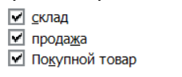

## Минимально требуемый набор информации

Для корректного использования карточки товара необходимо обеспечить наличие минимального набора данных. Данные в карточке не должны противоречить друг другу. Правильно заполненная карточка - гарант тому, что при её использовании система заполнит все необходимые поля в документах, правильно назначит применяемый налог и сформирует правильные проводки в бухгалтерии. К МиНИ относятся:

* Нумерация (невозможно изменить после первого использования товара в документе)
* Название товара на 3х языках
* Группа и тип товара (невозможно изменить при наличии товара на складе)
* Настройка налога
* Настройка единиц измерения и правил конвертации (невозможно при наличии на складе)

Обратите внимание, что для контроля МиНИ внедрены процедуры контроля. Система не позволит сохранить карточку со статусом товара Активно (может использоваться в документах). Для промежуточного сохранения в виде черновика можно сохранить карточку со статусом Неактивно

 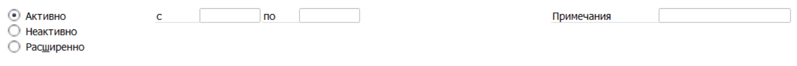

## Создание карточки товара

Если перед вами стоит задача массового создания товаров, обратитесь в поддержку.В этом случае будет необходимо заполнить темплейт OITM и загрузить его через административные инструменты. При этом Сервисные товары в любом случае должны создаваться через поддержку (так как требуется настройка правил использования счетов ГК) Если стоит задача создать +- 10 карточек, то быстрее будет создать эти карточки прямо в интерфейсе. Для создания карточки товара необходимо выполнить следующие шаги:

1. Открыть по пути из Главного меню -> Запасы -> Справочник товаров и услуг

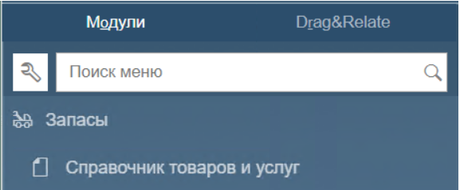

2. Система откроет Справочник в режиме поиска (жёлтые поля). Переключить режим нажав комбинацию клавиш [Ctrl]+[A]

3. Открыть отображение дополнительной панели с пользовательскими полями, нажав [Ctrl]+[Shift]+[U] Будет открыта (или скрыта если была открыта ранее) боковая панель

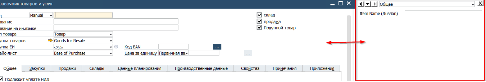

4. Заполнить заголовок карточки (1) Выбрать из выпадаюшего списка серию нумерации [Manual] (2) Ввести код iiko, код должен быть уникальным и не использоваться для другого товара (3) Ввести название на английском ПРОПИСНЫМИ буквами и название на арабском. При отсутствии арабского названия, временно может быть использован символ [#]. Это включит товар в отчёт - уведомление на доработку. (4) Указать тип товара [Товар] и соответствующую товару Группу товара (5) Выбрать из списка Группу единиц измерения (6) Указать свойства товара (7) Создать баркод товара (EGS код, для этого нажать на кнопку [...]

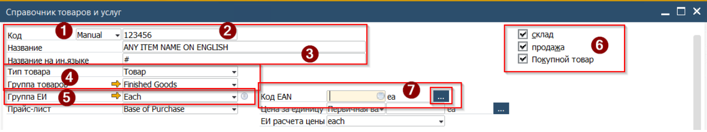4.1. В открывшемся окне укаказть EGS код, в формате EG-xxxx-yyy где EG - постоянный префикс, ххххх - налоговый id Roin World, yyyy - код товара (iiko код) Нажать кнопку [Обновить]

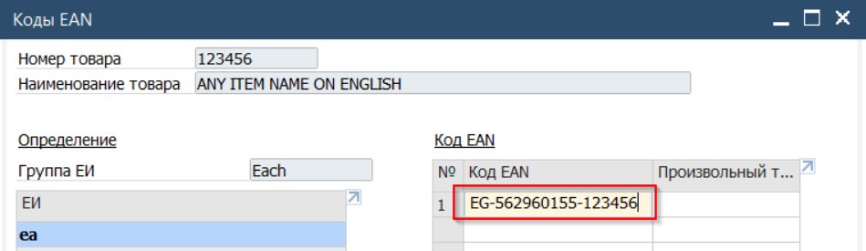

5. Перейти к заполнению полей на вкладке Общее (1) Установить отметку Подлежит уплате НИД (это активирует механизм назначения Witholding tax в процессе закупки (2) При наличии указать доплнительный код товара (3) Проверить, что учёт в разрезе партий или серийных номеров не включен (4) Установить статус карточки. Если минимального набора данных нет под рукой, то система позволит сохранить карточку только в статусе Неактивно (5) В поле Примечание можно ввести комментарий к статусу товара (например - "Требуется перевод названия")

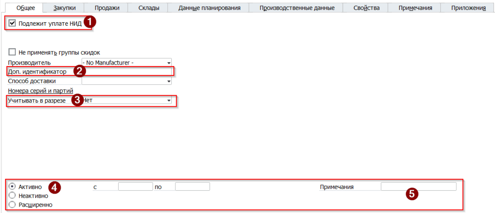

6. Перейти на вкладку Закупки (1) Проверить что установлена корректная единица Закупок. Она будет использоваться по-умолчанию в документах закупок. Эта ЕИ может отличаться от ЕИ на других вкладках. В конкретном документе (при заказе)эта ЕИ может быть изменена на другую, которая обозначена в Группе Единиц измерения (2) Опционально, указать размерные и весовые характеристики товара. Эти данные могут быть использованы позже в отчётах

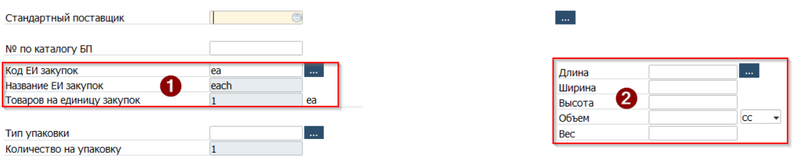

7. Указать ставку налога при закупке

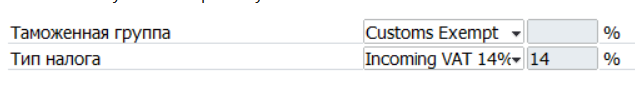

8. Перейти на вкладку Продажи (1) Указать ставку налога при продаже (2) Проверить что установлена корректная единица Продаж. Она будет использоваться по-умолчанию в документах продаж. Эта ЕИ может отличаться от ЕИ на других вкладках. В конкретном документе (при заказе)эта ЕИ может быть изменена на другую, которая обозначена в Группе Единиц измерения (3) Опционально, указать размерные и весовые характеристики товара. Эти данные могут быть использованы позже в отчётах

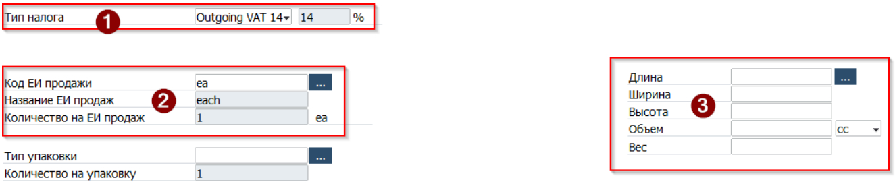

9. Перейти на вкладку Склады (1) Выбрать из выпадающего меню Установить склад инвентаризации (Склад) и выбрать единицу измерения на складе. Эта единица измерения по-умолчанию будет использоваться при вводе начального сальдо товара и в производстве. При вводе веса, система предложит пересчитать вес также на вкладках Закупки и Продажи, для этого расчёта будут использоваться правила конвертации Группы единиц измерения (2) Установить единицу измерения для инвентарного подсчёта (3) Для расширенного планирования наличием запасов на складе снять или установить отметку управления запасами по складу. Пи наличии отметки минимальное количество (4) указывается для каждого из складов, а если отметка снята, то минимальное количество указывается для Компании в целом. Это значение может быть использовано отделом Закупок при планировании закупок товара на склад и обеспечения неснижаемого остатка (5) Метод оценки установить по следующему правилу - производимые позиции (Finished goods и Semi-Finished goods - FIFO) для всех остальных групп товаров - Скользящее среднее

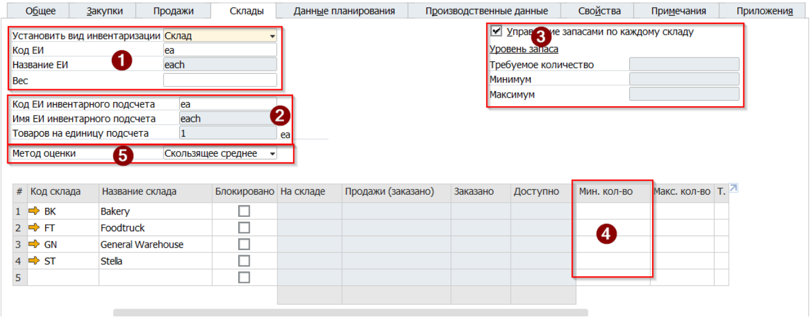

10. Перейти на вкладку Данные планирования (1) Установить, метод планирования - MRP (для всех товаров кроме внутреннего потребления, Метод заготовки - Покупка для товаров закупаемых и Производство для товаров Finished goods и Semi-Finished goods) (2) Кратность заказа- указать значение, которое будет использоваться системой при расчёте потребности в ингредиентах (можно произвести только 16 кусков десерта, или закупить только 24 банки газировки)

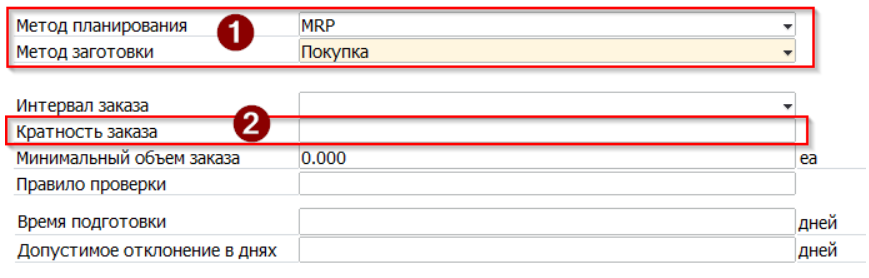

11. Перейти на вкладку Производственные данные Установить отметку Метод списания - Отпуск задним числом (в этом случае товар будет списываться автоматически при выборе пункта Отчёт о завершении - Поступление из производства родительского товара в производственном заказе. Т.е списание со склада будет создано без участия пользователя)

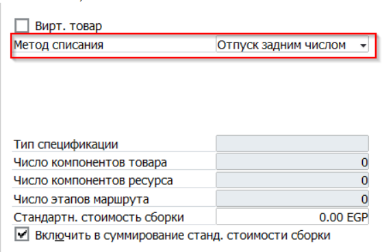

12. Перейти на дополнительную панель и заполнить поля Название на русском, КБЖУ товара

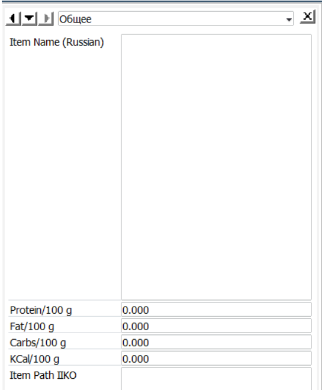

13. Если создаваемый товар - производимая позиция, то установить статус товара Неактивно

14. Проверить что все поля Карточки заполнены и нажать кнопку [Добавить]

15. Для производимых позиций создать Спецификацию и изменить статус товара на Активно.

В результате выполненых действий карточка товара будет добавлена в систему и будет доступна для использования
