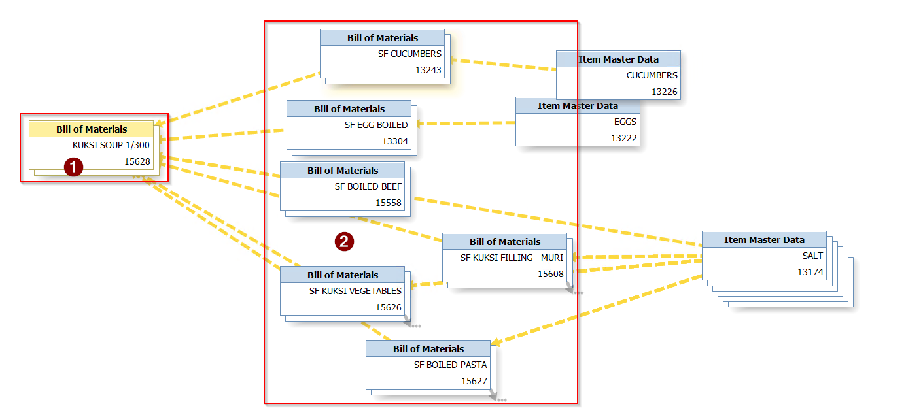
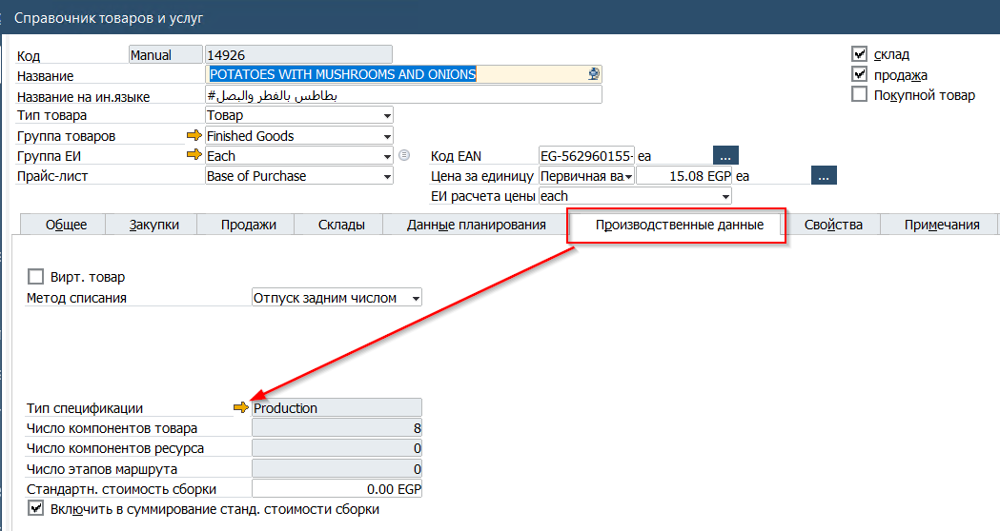
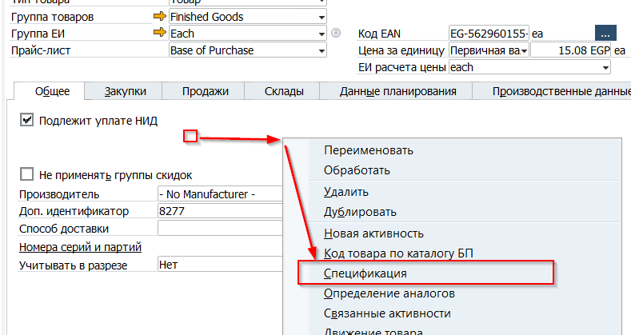
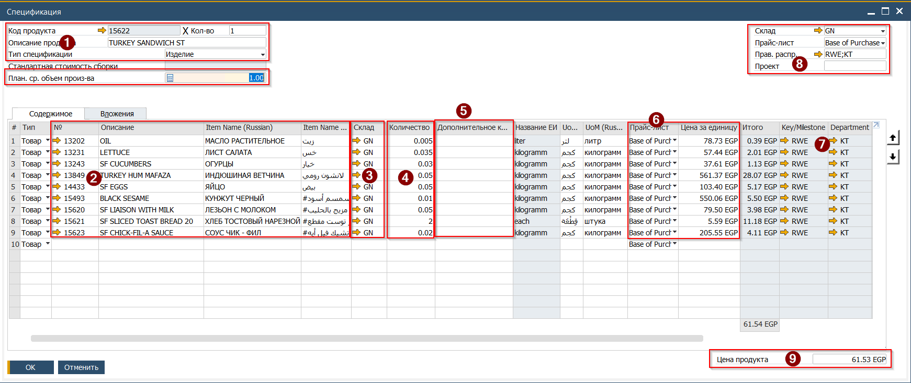

## Типы спецификаций

В SAP Business One существуют следущие типы Спецификаций:

| Тип | Англ.название | Назначение | Особенности |
|-----|---------------|------------|-------------|
| Набор | Assembly      | В проекте Roin World не используется |             |
| Комплект | Sales         | Спецификация используется для товаров, реализуемых через кассу (Foodtruck). Для такой спецификации не запускается процесс производства, а при добавлении Родительского товара в документ продажи - добавляет в него компоненты спецификации. При проводке документа продажи компоненты списываются со склада. | Родительский товар обязательно должен быть нескладируемой позицией.  |
| Изделие | Production    | Спецификация используется для всех производственных позиций - Готовая продукция и Полуфабрикаты. | Родительский товар - складируемый. Проводка производства обязательна |
| Типовой набор | Template      | В проекте Roin World не используется |             |

## Узлы спецификации

Под узлами спецификации понимаются разветвления обусловленные вложением в родительскую спецификацию дочерних спецификаций (полуфабрикатов). Максимальная вложенность спецификаций ограничена только производительностью системы. SAP рекомендует ограничивать вложенность на уровне 10-15 уровней. На практике, для каждого уровня вложенности при производстве потребуется разузлование и проводка отдельного производственного заказа.  
(1) Спецификация первого уровня

(2) Спецификации второго уровня

 

## Просмотр спецификации

Для просмотра, спецификация может быть открыта одним из следующих способов:

* Из главного меню Производство → Спецификация

\  
* Из карточки товара. На вкладке Производственные данные по нажатию золотой стрелки в поле Тип спецификации

  

\

\

\

\  
* Из карточки товара. На любой вкладке нажать правой кнопкой мыши для открытия Контекстного меню, где необходимо выбрать пункт Спецификация

  

\

\

\  
## Дополнительное количество и Планируемый средний объём производства

(!) Использование описываемого механизма опционально. И изначально все спецификации загружены без заполнения этих полей  
Данные поля используются для добавления в Спецификацию Фиксированного расхода сырья на объём производства Х.  
Поле [План.ср.объём производства] - количество родительского товара производимого за один прогон. Например - блинная сковорода на 4 блина.  
Поле [Дополнительное количество] - количество компонента единожды используемое для каждого прогона.  
Другими словами - когда будет создан производственный заказ на 8 блинов, то дополнительное количество будет посчитано\\списано дважды. Заказ на 2 блина включит в себя дополнительное количество единожды.  
(При этом, основное количество будет считаться на каждый новый блин добавленный в заказ).

## Создание Спецификации

Для создания новой Спецификации, необходимо:

1\. Открыть карточку товара и через Контекстное меню открыть форму Спецификации.

 

\

\

\  
2\.Заполнить заголовок и таблицу спецификации  
(1) Указать код\\название производимого товара, тип спецификации и количество производимого товара для которого в таблице будет введён расчёт компонентов  
(2) Указать код\\название компонентов, необходимых для производства  
(3) Указать склад списания компонентов, на этом складе будет формироваться потребность в сырье  
(4) Указать количество компонента, необходимого на количество родительского товара, указанного в пункте (1)  
(5) Указать дополнительное количество с учётом Планируемого среднего объёма  
(6) Проверить источник цены для компонентов (на момент написания - Base of Purchase), при этом цена будет заполнена если для товара в прайс листе указана его стоимость. Это расчётная стоимость, фактическая будет подсчитана в производственном заказе с учётом себестоимости компонента отпущенного к заказу  
(7) Указать построчно Key\\Milestone и Department центры (будут использованы при списании компонентов)  
(8) Указать Key\\Milestone и Department центры в заголовке (будут использованы при списании родительского товара)  
(9) Нажать кнопку Стрелка вниз, для расчёта и записи расчётной стоимости производства по спецификации

 

3. Опционально в спецификацию могут быть добавлены построчные примечания и текстовые строки с указанием технологических особенностей производства.
4. Нажать кнопку [Добавить] для сохранения внесённых изменений
