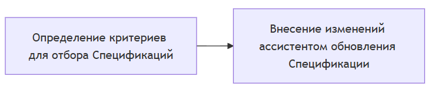
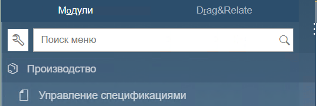
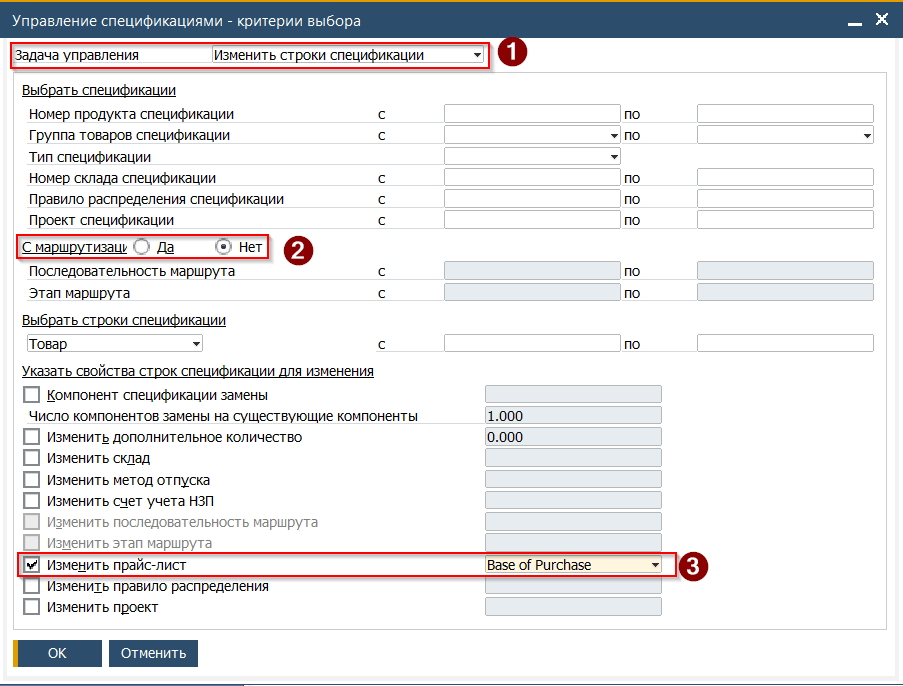
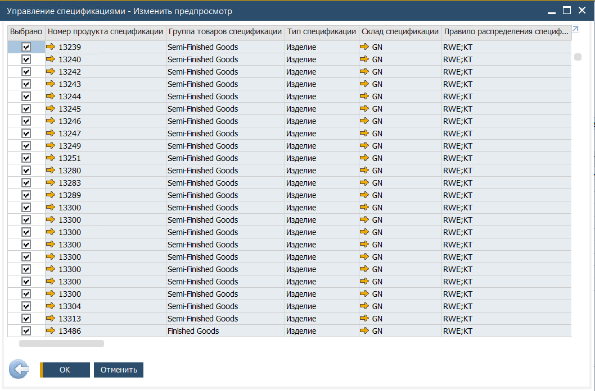
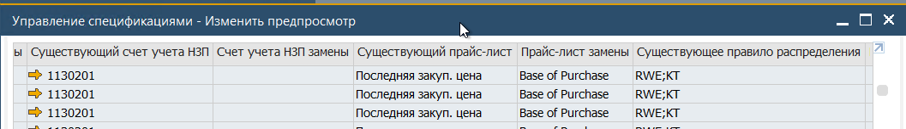
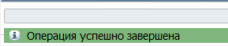

В данном примере описан процесс массового обновления Спецификаций. Описание содержит информацию об изменении расчётного Прайс-Листа с обновлением цен компонентов. Обновление других составляющих Спецификации выполнятся аналогичным способом. Например в спецификации может быть добавлен новый компонент (упаковка) или выполнена замена ингредиента.

Стоит отметить:

* внесение изменений в назначенный прайс-лист изменяет **расчётную** стоимость Продукта. При этом, себестоимость каждого произведённого Продукта собирается не из прайс листа, а из фактической себестоимости использованных в производстве компонентов.
* внесение изменений в Спецификацию не оказывает влияния на уже созднанные, на базе Спецификации, Производственные заказы. Внесённые изменения будут применены в следующем созданном Производственном Заказе.

## Концепция обновления данных в Спецификации
 

Для обновления прайс листа, используемого для расчёта итоговой стоимости Продукта необходимо:

1. Открыть из Главного меню -> Производство -> Управление спецификациями

 

2. Система откроет форму выбора критериев. Для обновления прайс-листа необходимо:
(1) Выбрать тип изменения. Выбор 'Изменить строки спецификации' или 'Изменить заголовок спецификации' зависит от конкретной потребности  
(2) Указать отбор спецификаций без маршрутизации  
(3) Установить отметку и выбрать прайс-лист который необходимо установить в спецификациях  
В качестве дополнительных ограничивающих критериев также могут быть установлены и другие критерии

 

3. Нажать кнопку [OK]
4. Система откроет окно предпросмотра

 

5. Проверить и при необходимости снять отметку с позиций для которых обновление не требуется
(в колонках таблицы выводится информация о текущем значении и том, которое будет установлено)

 

6. Нажать кнопку [ОК]
7. Дождаться выполнения обновления
8. По окончании обновления в Строке состояния будет показано сообщение с результатом

 
