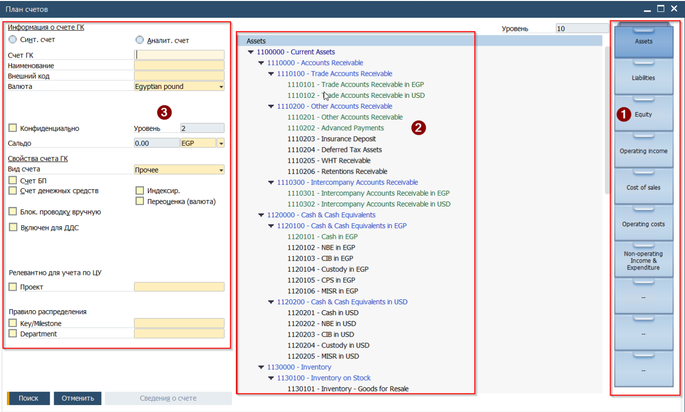

## План счетов
В SAP Business One загружен действующий План счетов Roin World со следующими необходимыми для функционирования SAP счетами:

* Технические счета
* Контрольные счета
План счетов загружен в виде иерархической структуры с размещением активных (postable) счетов на пятом уровне вложенности.

## Внешний вид
Объект План Счетов состоит из трёх секций:  
(1) 'Конторки' выбора раздела Плана счетов (первый уровень счёта)  
(2) Секция отображения \\ выбора счёта из стуктуры (уровни счетов 2-5)  
(2) Секция вывода информации о выбранном счёте

 

## Виды счетов
Системно, в SAP Business One предопределены, следующие виды счетов:

* Доходы: Cчета Выручки \\ Revenue
* Расходы:Счета затрат, себестоимости продаж (COGS \\ Expense)
* Прочее: Все остальные счета

## Настройки счетов
Набор доступных для настройки свойств счёта определяется Видом счёта. Помимо этого, в Плане счетов имеются настройки, которые позволяют автоматизировать заполнение полей документов, связанных со счетами.  
Для Roin World доступны следующие настройки счетов:

### Валюта счёта
настройка определяет в каких валютах на счёт может быть выполнена проводка. По-умолчанию все счета ведутся в двух валютах Локальной (EGP) и Системной (SYS-USD). Если для счёта выбрана валюта, отличная от локальной(Иностранная), то проводки по такому счёту возможны только в этой валюте. Также счёт может быть обозначен как Все валюты, эта опция позволяет выполнять проводку в любой из существующих в Системе валют. Но, на практике, такое совместное использование счёта вносит свои сложности. Стоит отметить, что настройка валюты счёта может быть выполнена до первой проводки по этому счёту. После первой проводки валюта счёта может быть изменена только в сторону расширения списка валют - то есть счёт может быть расширен до опции Все валюты, но не в обратном направлении.

### Конфиденциально
настройка видимости счёта и его баланса для пользователей. Для группы пользователей, а также для каждого из пользователей может быть настроена авторизация на доступ к счетам, имеющих это свойство

### Счёт БП\\Контрольный счёт
свойство счёта Главной Книги, которое связывает аналитический учет расчетов с контрагентами (дебиторами и кредиторами) с общей финансовой отчетностью

### Счёт денежных средств
### свойство для определения кассовых или банковских счетов

**Блокировать ручную проводку**

свойство которое делает невозможным использование счёта в ручных Бухгалтерских Операциях. Что гарантирует наличие документа основания.

### Включен для ДДС
настройка применима для Счетов денежных средств, активирует проверку на заполнение колонки Движение Денежных Средств, расположенную в Бухгалтерской операции, Входящем и Исходящем платежах

### Key\\Milestone и Department
свойство применимое для счетов Доходов и Расходов. Активирует механизм проверки заполнения полей кост-центров в документах, связанных со счётом. Если в дополнение к чек боксу в соответствующем поле свойств счёта указан кост центр, то он будет предзаполнен в документе связанном со счётом
