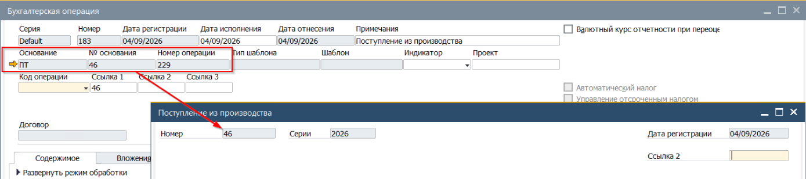
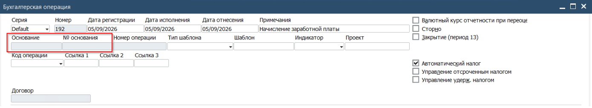
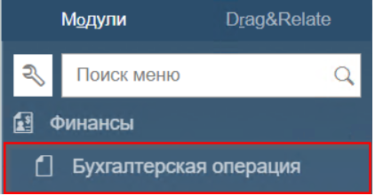
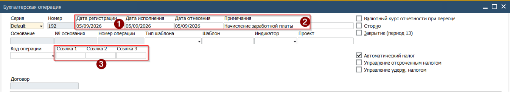
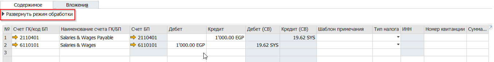
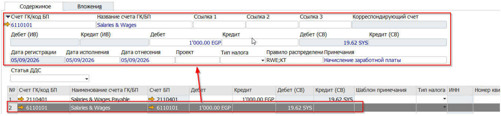
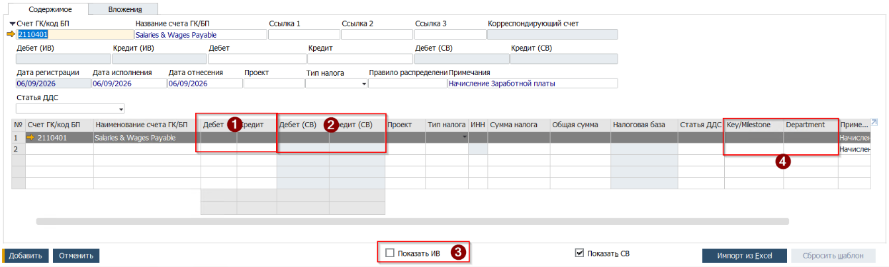
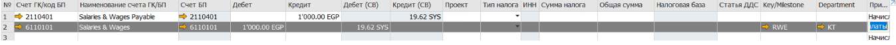

## Нумерация
В отличии от остальных типов документов (имеющих нумерацию с ограничением действия в течении финансового периода - года), Бухгалтерская Операция имеет собственную, условно бесконечную нумерацию от 1 до 2 147 483 647, которая не ограничена действием. Данная настройка позволяет вести сплошную запись проводок вне зависимости от финансового периода.

## Виды бухгалтерских операций
По способу создания Операции разделяются на два типа

* **Автоматическая**. Проводка создаваемая Системой в момент создания Документа, оказывающего влияние на Активы или Пасивы Главной Книги Компании.
* **Ручная**. Проводка созданная пользователем, путём заполнения её полей .

По внешнему виду, эти виды операций отличаются наличием у Автоматических Операций ссылки на Документ Основание.
Автоматическая:
 

Ручная:
 

## Внешний вид
Как и остальные SAP документы, Бухгалтерская операция состоит из Заголовка и матрицы документа - вкладок с таблицами. Внешний вид будет рассмотрен далее, на примере заполнения Операции начисления и выплаты заработной платы.

## Особенности заполнения
В SAP Business One все Операции записываются как минимум в двух валютах - Локальной и Системной. Опционально, Операция может быть записана также в одной из Иностранных валют. При этом, Операция в Иностранной валюте должна быть сбалансирована. Доступность отражения Операции в Иностранной валюте определяется валютой используемого счёта.

## Пример ручного внесения Операции
Для создания ручной Бухгалтерской Операции, необходимо выполнить следующие шаги

1. Открыть документ Бухгалтерская операция из Главного меню -> Финансы -> Бухгалтерская операция

   

2. В открывшейся форме заполнить поля Заголовка

(1) Дата Операции - При необходимости контроля даты исполнения - заполнить поле 'Дата исполнения'
(2) Примечание - поле свободного ввода текста
(3) Ссылочные данные, которые позже могут быть использованы в отчётности

3. Заполнить таблицу на вкладке [Содержание]

При этом, заполнение можно выполнять в Свёрнутом виде - вводя информацию в колонки построчно. Или в Развёрнутом виде - вводя данные в поля:

В развёрнутом виде, отражаемые поля относятся к той строке, которая выбрана в таблице

 

4. Для ввода\\выбора счёта - установить курсор в поле Счё\\Код БП и нажать:

а) для выбора счёта Главной книги - клавишу [Tab]
б) для выбора Бизнес партнура - комбинацию клавиш [Ctrl]+[Tab]
В зависимости от нажатых клавиш, Система откроет (а) Список счетов (б) Список бизнес партнёров

5. Для выбранного счёта ввести

(1) Сумму по Дебету или Кредиту
(2) Система расчитает сумму в Системной валюте с использованием Курса системной валюты на дату Операции
(3) Для отображения полей ввода суммы в Иностранной валюте установить отметку 'Показать ИВ'
(4) Для счетов Затрат указать Key\\Milestone и Department центры

   

 5.1. При использовании полей в Иностранной валюте - сумму вводить с указанием валюты
 в формате [ххх.хх RUB] при этом поля Дебет\\Кредит в локальной валюте должны быть
 очищены от значений. В исключительных случаях - сначала заполняется сумма по Дебету \\
 Кредиту в локальной валюте, а после Дебет \\ Кредит в Иностранной валюте.

6. По окончании ввода в первую строку, нажатием на номере следующей (пустой) строки перейти к её заполнению. По аналогии с заполнением первой строки выбрать счёт, и после этого - нажать на Кредит или Дебет второй строки. Это запустит механизм балансирования проводки и Система заполнит поле, скопировав значение со строки с корреспондирующим счётом. Для счетов Затрат необходимо указать Key\\Milestone и Department центры

 

7. Следующие поля являются опциональными, необходимость их заполнения определяется ситуацией

**Строка ДДС** - для счетов с установленной отметкой 'Включен для ДДС' это обязательное для заполнения поле. Данные из этой колонки используются в отчёте Движение Денежных Средств.
**Тип Налога** - для добавление в Операцию строки проводки по налоговому счёту - указать тип применяемого налога. Опция доступна только при наличии в Заголовки отметки Автоматический налог

8. Для добавления в Операцию Вложений в виде офисных документов, сканкопий - добавить соответствующие документы на вкладке [Вложения]

9. Для выплонения проводки Бухгалтерской операции нажать на кнопку [Добавить]
