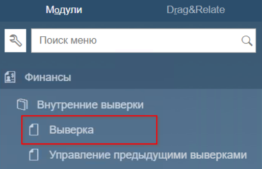
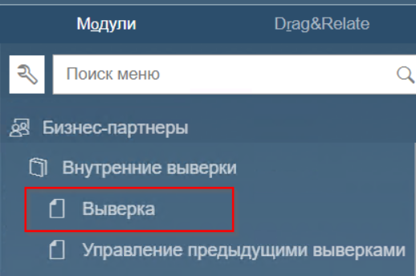
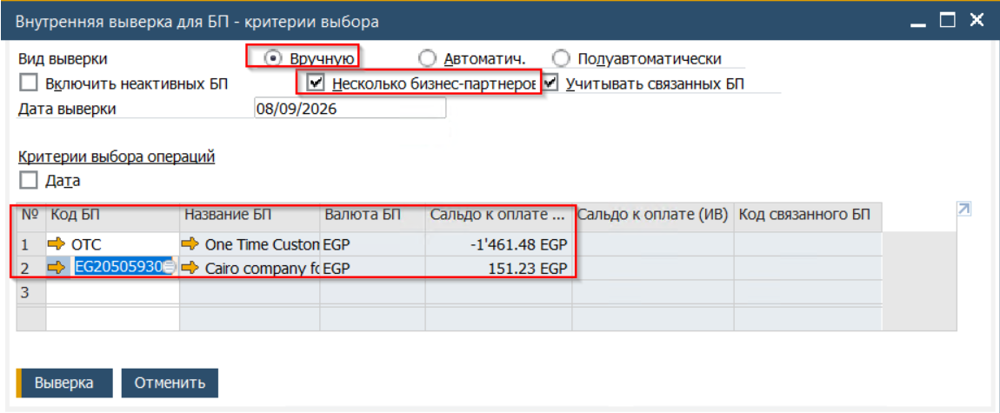
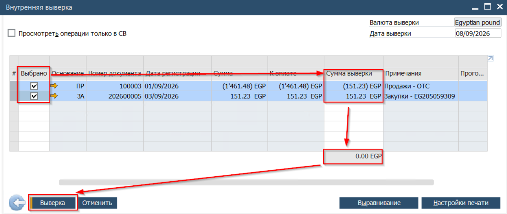
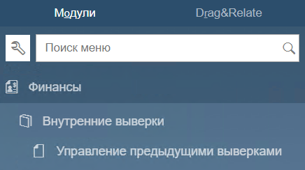
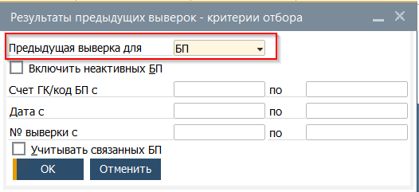
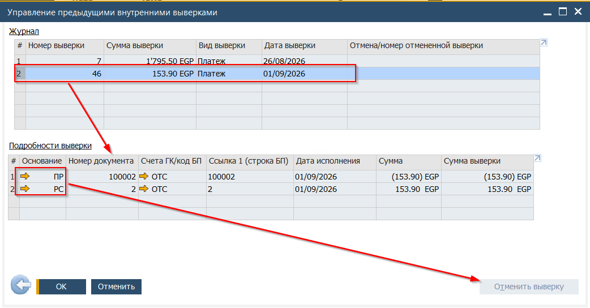

Выверка - процесс сопоставления и закрытия открытых транзакция по Дебету и Кредиту. В SAP Business One различают два вида выверок

* Внутренняя финансовая выверка
* Внутреняя выверка по бизнес партнёрам

По способу создания различают следующие виды:

* Автоматическая выверка - например, платёж закрывающий инвойс будет автоматически выверен Системой
* Ручная выверка - выверка созданная пользователем

## Финансовая выверка
Этот вид выверки позволяет сопоставить и закрыть открытые Дебет и Кредит по выбранному счёту Главной книги.

Выверка между счетами Главной книги. Расположена в модуле Главного меню -> Финансы -> Внутренние выверки -> Выверка

 

## Выверка по бизнес-партнёру
Выверка в рамках одного или нескольких бизнес-партнёров. Этот вид выверки позволяет закрыть открытые балансы между бизнес партнёром Клиентом и бизнес партнёром Поставщиком. Например, при трёхсторонних сделках.  
Расположена в Главном меню -> Бизнес-Партнёры->Внутренние выверки -> Выверка

 

## Пример выверки

В качестве примера, ниже приведена выверка между двумя бизнес партнёрами. По аналогии выполяются и другие виды выверок

1. Открыть Внутренюю выверку для БП

2. Заполнить окно Критерии выбора

   Указать тип выверки - вручную  
Установить флаг - Несколько бизнес-партнёров  
Выбрать выеряемых бизнес партнёров в таблице  
Нажать кнопку [Выверка]  

   \

3. После нажатия кнопки [Выверка] будет открыто окно, в котором необходимо ввести выверяемую сумму по каждой из сторон. В таблице представлены обороты по Кредиторской и Дебиторской задолженностям:

   
(1) Сумма выверки обязательно должна равняться нулю.  
По окончании выбора выверяемых документов нажать кнопку [Выверка]

## Управление предыдущими выверками

В документе Управления предыдущими выверками отражаются автоматические и ручные виды выверок. Но непосредственно управление (отмена) возможна только для выверов созданных пользователем. (Для отмены автоматических выверок необходима отмена документов оснований - платежей, инвойсов..)

1. Управление выверками находится в Главном меню → Финансы → Внутренние выверки → Управление предыдущими выверками

 

2. Перед открытием формы, Система откроет окно выбора критериев, в котором необходимо какой вид выверок будет обрабатываться

3. После определения критериев будет открыто окно управления выверками

Окно состоит из двух зависимых таблиц Журнала и Подробностей о выверке

4. Для того чтобы отменить выверку, необходимо выбрать строку в Журнале, удостовериться что выбрана корретная операция выверки, подлежащая отмене

5. Нажать кнопку [Отменить выверку]

   В результате этого действия выверка будет отменена
