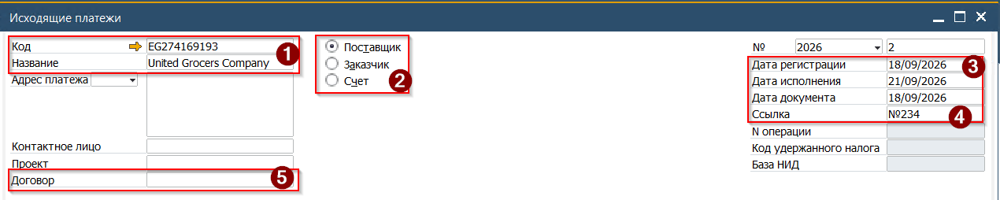
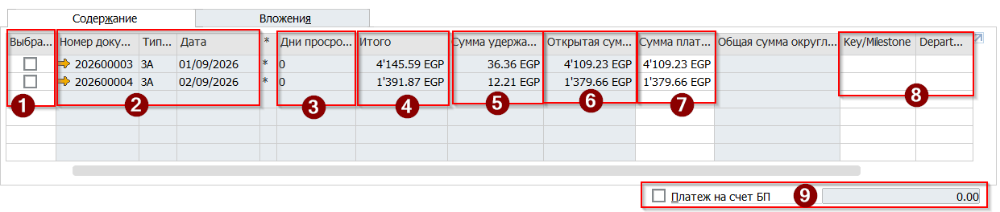
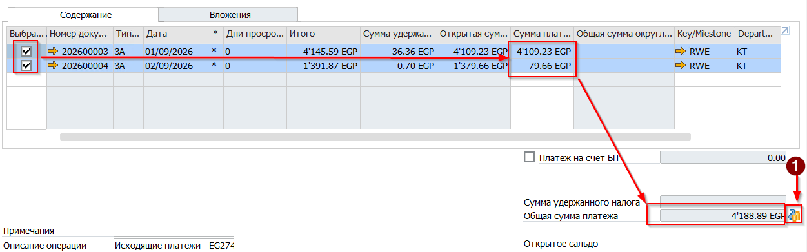
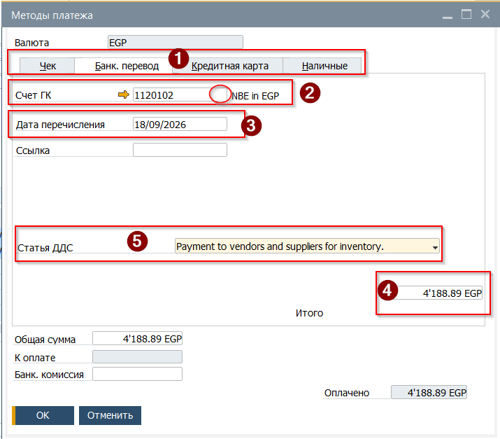
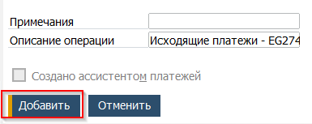
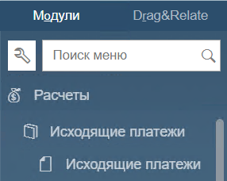
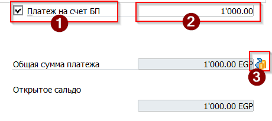
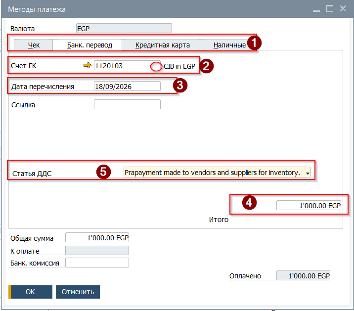

Исходящий платёж в SAP Business One может быть создан

* с привязкой к документу формирующему Дебиторскую задолженность (Счёт на предоплату, Продажа, Бухгалтерская операция)
* с привязкой к документу формирующему отрицательную Кредиторскую задолженность (Корректировка Закупки, Бухгалтерская операция)
* без привязки, Платёж на счёт бизнес партнёра

## Создание платежа с привязкой к документу

Для создания платежа необходимо:

1. Открыть документ Исходящий платёж из Главного меню →Расчёты →Исходящие платежи → Исходящие платёжи

 

2. В открывшейся форме заполнить Заголовок, указав
(1) Код или Название бизнес партнёра

   (2) Тип БП (для оплаты Кредиторской задолженности - Поставщик, для Дебиторской - Заказчик
(3) Дату платежа
(4) Ссылку на платёж (номер платежного поручения в банк клиенте)

   (5) При наличии - выбрать номер Договора из списка

 

3. В табличной части документа будут отражены открытые (неоплаченные) документы и проводки. Отбор и выбор суммы для платежа выполняется в этой таблице

   (1) Для платежа по документу установить отметку. Платёж может быть включать любое количество документов
(2) Номер, тип и дата документа основания
(3) Количество дней просрочки (разница между Датой Исполнения документа и Датой регистрации Платежа)
(4) Изначальная сумма по документу
(5) Сумма НИД | Withholding tax (исходя из настройки налога - будет начислена при проводке платежа)
(6) Неоплаченная сумма по документу
(7) Поле для ввода суммы платежа (требует изменения только при частичной оплате)
(8) Key/Milestone и Department центры
(9) Отметка платежа на счёт БП при платеже с привязкой к документу должна оставаться пустой. Исключение - отнесение остатка платежа по документу на счёт партнёра

 

 4. После выбора документов, сверить сумму платежа по каждому из них. Итоговая Сумма будет отражена в поле [Общая сумма платежа]

 5. Нажать кнопку (1) [Методы платежа], расположенную справа от итоговой суммы
 6. Будет открыта форма выбора метода платежа
 7. В форме выбора метода платежа:
(1) Выбрать необходимый метод платежа
(2) Нажав на иконку лупы в поле Счёт ГК выбрать счёт с которого выполняется оплата
(3) Указать дату платежа
(4) Установить курсор в поле и нажать комбинацию клавиш [Ctrl]+[B]
Или вызвать контекстное меню правым кликом мыши и выбрать пункт [Скопировать Сальдо]

    (5) Выбрать из списка статью ДДС (Cash Flow item)

 8. Нажать кнопку [OK] для возвращения в форму платежа
 9. Нажать кнопку [Добавить] для проводки платежа

10. Платёж будет отправлен на согласование
11. После получения согласования выполнить проводку платежа

## Создание платежа без привязки к документу

Для создания платежа необходимо:

1. Открыть документ Исходящий платёж из Главного меню →Расчёты →Исходящие платежи → Исходящие платёжи

 

2. В открывшейся форме заполнить Заголовок, указав
(1) Код или Название бизнес партнёра

   (2) Тип БП (для оплаты Кредиторской задолженности - Поставщик, для Дебиторской - Заказчик
(3) Дату платежа
(4) Ссылку на платёж (номер платежного поручения в банк клиенте)

   (5) При наличии - выбрать номер Договора из списка

 

3. В поле [Платёж на счёт БП], расположенном под табличной частью установить отметку (1) и ввести сумму в поле (2). Для перехода в окно Методы платежа, нажать кнопку (3)

 

4. В форме выбора метода платежа:
(1) Выбрать необходимый метод платежа
(2) Нажав на иконку лупы в поле Счёт ГК выбрать счёт с на который выполняется оплата

   (3) Указать дату платежа
(4) Установить курсор в поле и нажать комбинацию клавиш [Ctrl]+[B]
Или вызвать контекстное меню правым кликом мыши и выбрать пункт [Скопировать Сальдо]

   (5) Выбрать из списка статью ДДС (Cash Flow item)

 

5. Нажать кнопку [OK] для возвращения в форму платежа
6. Нажать кнопку [Добавить] для проводки платежа
