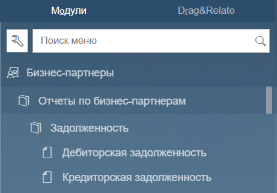
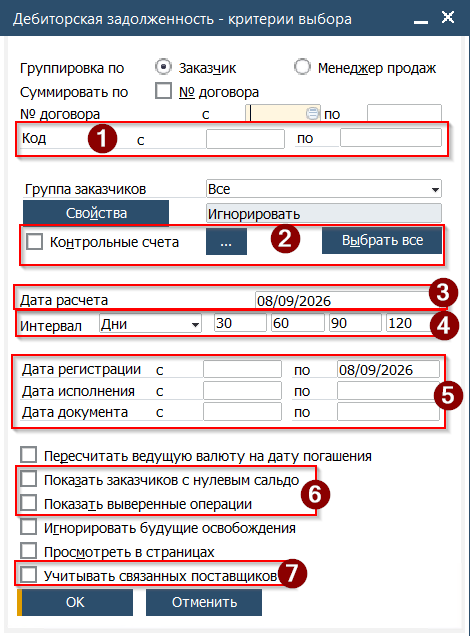
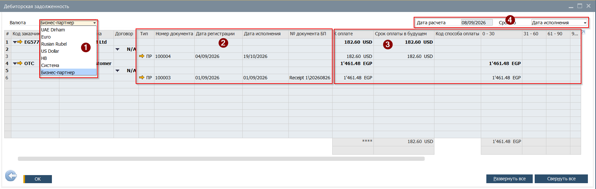

Отчёты по задолжености в расчётах с бизнес партнёрами представлены в SAP двумя отчётами, которые доступны в Главном меню →Бизнес партнёры→Отчёты по бизнес партнёрам→Задолженность

* Дебиторская задолженность
* Кредиторская задолженность

 

Отчёты используют похожую форму выбора критериев запуска:  
 (1) Опционально, очтёт можно запустить для определённого бизнес партнёра
(2) Критерий позволяет выбрать для отчёта транзакции по определённым контрольным счетам  
(3) Дата на которую будет сформирован отчёт  
(4) Настройка визуального отражения задолженности по периодам. В примере таблица будет разбита на периоды Полная задолженность | Оплата в течении 30 | 40 | 90 |120 + дней  
(5) Критерий отбора транзакций по датам проводки  
(6) Настройка показа в отчёте дополнительной информации  
(7) Настройка применима для вывода в отчёт общего сальдо по партнёрам, представленных в системе в виде Клиента и Поставщика. При наличии у этих БП задолженностей в отчёте будет отражён баланс после суммирования дебиторской и кредиторской задолженностей по ним  

После настройки критериев необходимо нажать кнопку [ОК]  
Будет открыт отчёт:  
 
(1) Выбор валюты представления отчёта. Пересчёт происходит на дату расчёта указанную в Критериях  
(2) Информация о транзакции формирующей задолженность  
(3) Сумма задолженности с разбивкой по периодам ожидаемой оплаты  
(4) Настройка источника для расчёта по периодам (Дата проводки, Дата исполнения)  
