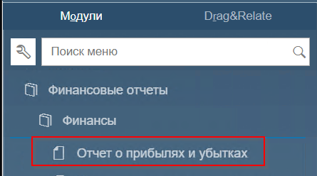
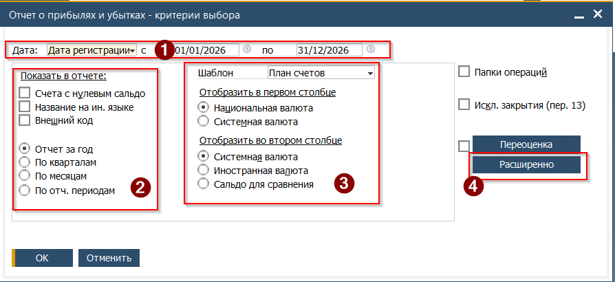
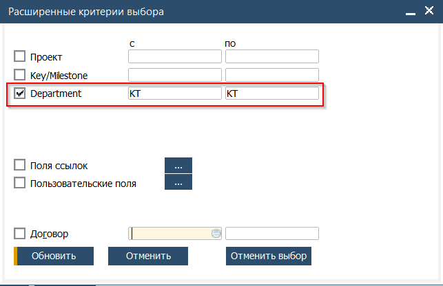
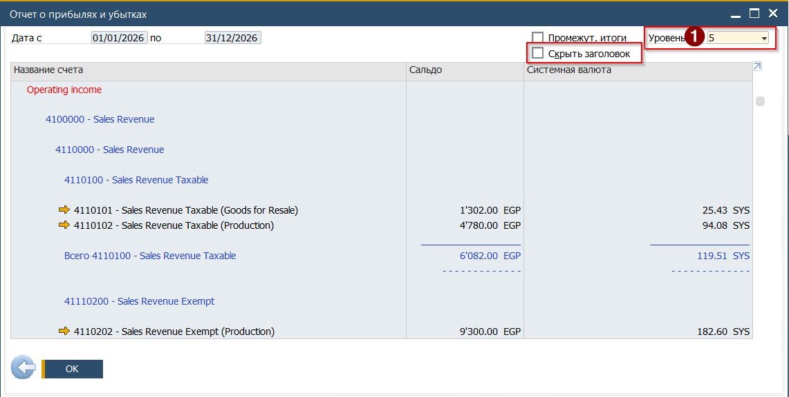
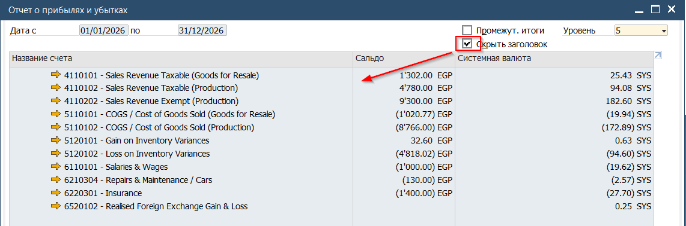

Отчёт о Прибыли и убытках (PnL) расположен в Главном меню по пути  
Главное меню → Финансы→Финансовые отчёты→Финансы→ Отчёт о прибылях и убытках

 

1. Перед открытием отчёта, система откроет форму Критерии выбора в которой необходимо указать правила отбора проводок и определить внешний вид отчёта

(1) Даты проводок для показа в отчёте  
(2) Внешний вид и правила показа счетов и то, в каком виде эти счета будут отражены  
(3) Содержание столбцов отчёта и (при наличии) шаблон отчёта  
(4) Расширенные критерии  
К расширенным критериям относится в том числе - формирование отчёта по определённым кост-центрам. Например PnL может быть сформирован только по определённому кост центру KT-Kitchen  
 (!) Обратите внимание - критерии выбора сохраняются на уровне Системы, а не пользователя. Это означает, что если коллега до этого запускал этот отчёт по определённому кост центру, то при запуске вами отчёта эти настройки изначально будут установлены

2. После установки критериев - нажать кнопку [OK]
3. Будет открыт отчёт о Прибыли и убытках. Стандартно отчёт открывается в виде шаблона с результирующими строками. Для выбора уровня раскладки информации необходимо сменить уровень счетов. Для Roin World все активные счета загружены на 5м уровне

4. Для того чтобы скрыть результирующие строки, необходимо установить флаг [Скрыть заголовок]

В данном примере на этапе выбора критериев выбран вывод сумм в локальной валюте в первую колонку, а для второй колонки выбрана системная валюта (SYS) которая равна Доллару США. Поскольку Система ведёт параллельную запись в двух валютах, то каждая транзакция отражается в EGP и SYS. При этом курс для расчёта SYS берётся на дату документа.
