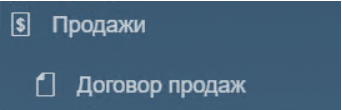
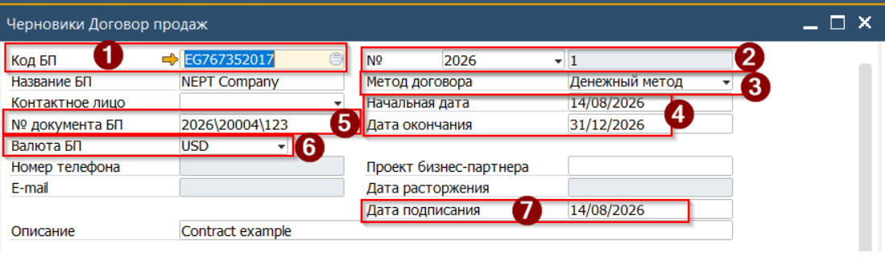
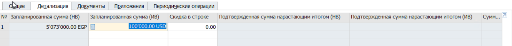
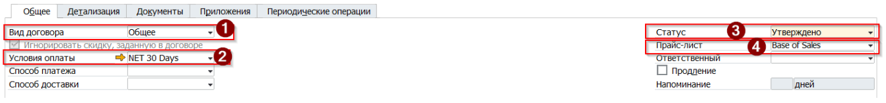
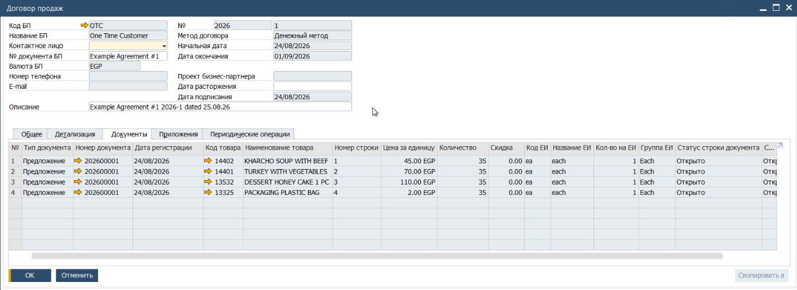

Договор является опциональным документом в цепочке продаж. Но при его фактическом наличии необходимо отразить это в и SAP. Использование Договора позволяет агрегировать данные в рамках одной формы и контролировать исполнение согласованных условий.  
В SAP Business One Договор может имеет два основных метода договора:  
Товарный - соглашение на поставку определённых товаров по согласованной цене в согласованном количестве к определённой дате. При этом, изменение позиций после создания Договора не допускается.  
Денежный - соглашение на поставку неких товаров, в рамках согласованной с Клиентом суммы. Сумма Договора может быть разбита на периоды (например 10000 EGP помесячно в течении года).

## Создание Договора.

Для создания в Системе Договора Продаж необходимо выполнить следующие шаги

1. Открыть из Главного Меню -> Продажи -> Договор продаж

 

2. Система откроет форму Договора в режиме Поиска. Нажать комбинацию клавиш [Ctrl] + [A] (англ.раскладка) для переключения форма в режим Добавления новой записи.

   \  
3. Заполнить Заголовок Договора
(1) Указать Бизнес-Партнёра  
(2) Проверить Серию нумерации Договоров  
(3) Установить [Денежный метод] договора  
(4) Указать Начальную и Конечную дату Договора  
(5) Указать Номер Договора  
(6) Выбрать Валюту Договора. Указанная валюта будет **использоваться для всех последующих документов**  
(7) Проверить и уточнить Дату подписания Договора

 

4. Перейти на вкладку Детализация и указать сумму Договора (сумма указывается в Валюте Договора

 

5. Перейти на влкдаку Общее и заполнить
(1) Вид Договора - Общее  
(2) Условия оплаты - указать согласованные условия оплаты  
(4) Указать согласованный Прайс-Лист  
(3) Изменить статус Договора - Утверждено

   
6. Нажать кнопку [Добавить] для сохранения Договора.

После сохранения Договора со статусом Утверждено, он может быть выбран в документах продаж.  
По мере создания документов продаж других типов, в которых Договор указан - отражаются в Договоре, на информационной вкладке Документы:

 
