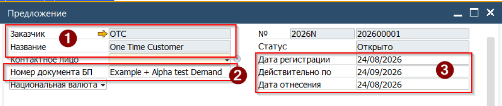
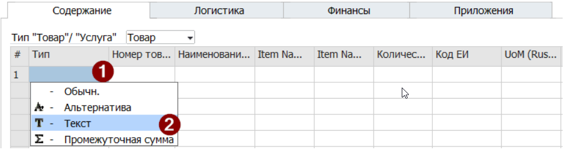
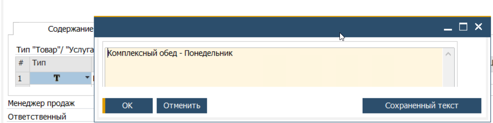
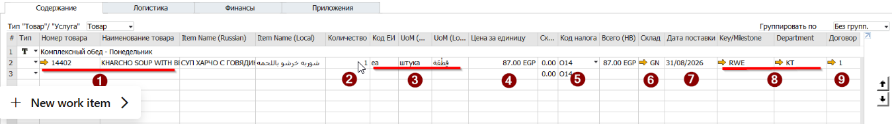
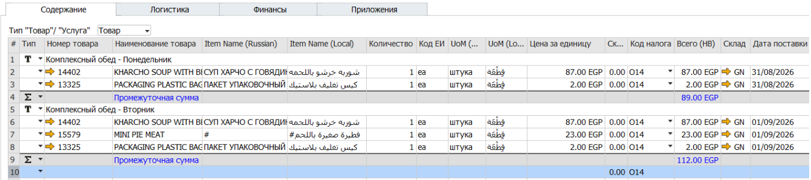
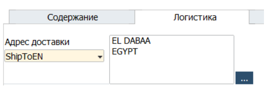
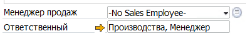

Коммерческое предложение документ планирования. Данный документ не генерирует проводки и потому может быть скорректирован после добавления в систему. Редактирование Предложения возможно до момента создания на его базе Заказа на продажу. Так как Заказ на продажу создаётся построчно, то Система позволяет вносить изменения в строках, которые ещё не были скопированы в Заказ на продажу.

## **Создание документа**

Для создания Предложения необходимо выполнить следующие шаги:

1. Открыть форму документа Предложение, для этого из Главного меню прости по пути Продажи -> Предложение

 

2. В открывшемся документе заполнить Заголовок
(1) Указать Клиента
(2) Опционально ввести ссылочный номер документа. Это или номер в системе Клиента, или внутренний SAP реферес которая будет доступна в последующих документах. Например это может быть "Меню клиента А на август 2026"
(3) Указать дату регистрации (дата создания Предложения) и дату Действительно по (максимальная дата по которую из данного Предложения можно будет генерировать заказы.

   
3. Перейти к заполнению матрицы документа на вкладке Содержание.
4. В первой строке в колонке [Тип] в выпадающем меню выбрать пункт [Текст]
Этот шаг опциональный. Данная строка - разделитель, она позволяет сгруппировать блюда по обозначенному в строке Текст признаку

   \
   

4\.1. Система откроет текстовое поле для ввода свободного текста
4.2. Ввести необходимый текст и нажать кнопку [ОК] для его сохранения

 

5. Заполнить матрицу документа следующим образом:
(1) Указать товар. Заполнение может быть произведено в любом из полей Код или Имя товара. При этом автоматически будут заполнены поля Название на руссом и Название на локальном языке. (Источник этих данных - карточка товара)
(2) Указать количество планируемое к реализации.
(3) Проверить соответствие единиц измерения (Источник этих данных - карточка товара)
(4) Указать цену реализации. Цена указывается до налога. По-молчанию цена указывается в валюте Клиента.
(5) Проверить и скорректировать код VAT налога. (Источник этих данных - карточка клиента)
(6) Указать склад отгрузки. Этот склад будет использован для расчёта Потребности в товарах.
(7) Указать согласованную дату отгруки товара в строке. Если Предложение создаётся с различными данными по одному товару то необходимо создать несколько строк с указанием для каждой строки - своей даты отгрузки.
(8) Указать Key/Department центры.
(9) Проверить и указать корректный Договор, связанный с данной поставкой. При наличии в Системе только одного действующего Договора - поле будет заполнено автоматически.

 

6. Аналогичным образом заполнить остальные строки

 

7. Перейти на вкладку Логистика и проверить \\ Указать адрес доствки по данной отгрузке. **Данная информация относится к документу в целом, но при необходимости в Документе есть возможность настройки для распределения по разным адресам построчно**

 

8. Выбрать свою подпись в поле Ответственный

 
