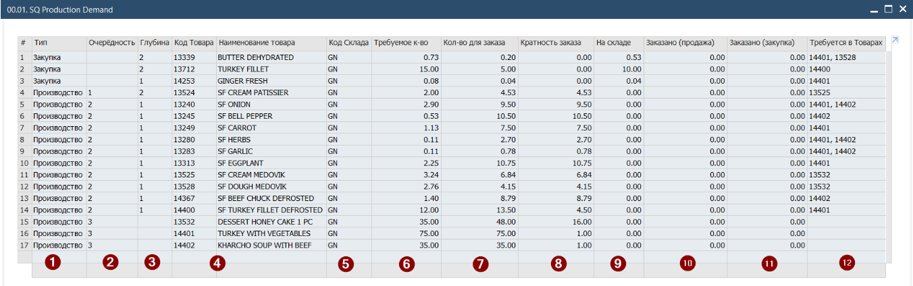
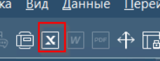
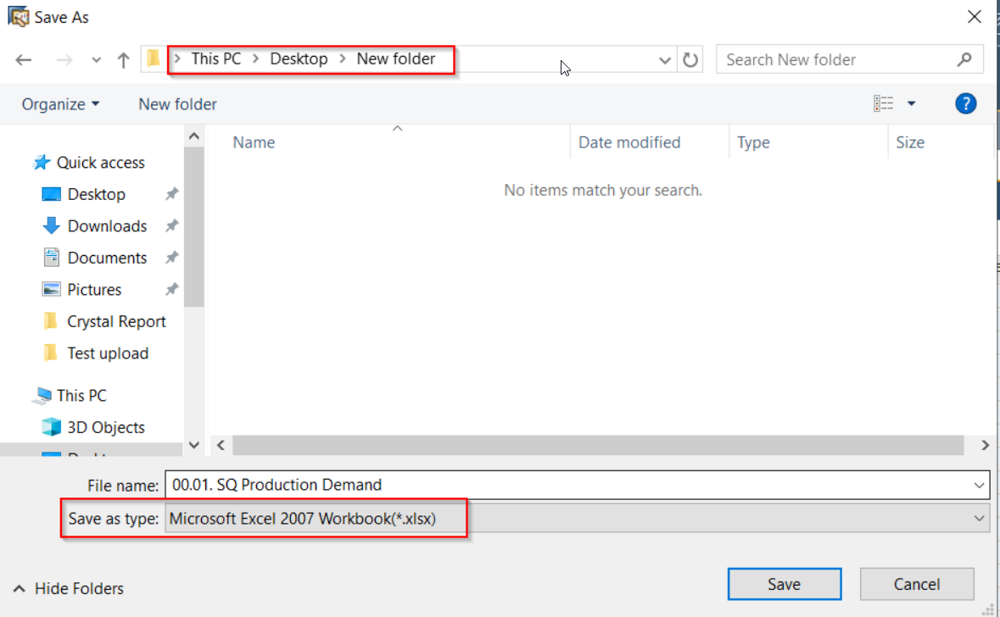

## Запуск расчёта Потребности \\ Demand

1. Открыть ранее сохранённое Предложение (расчёт Потербности возможен только для документа добавленного в базу данных) [Коммерческое Предложение | Sales Quotation](02-Коммерческое-Предложение-Sales-Quotation.md)

2. Нажать комбинацию клавиш запуска Динамического отчёта [F2] -> [F12]

[Назначение Динамического отчёта](../01-General/04-Назначение-Динамического-отчёта.md)
Данная настройка является пользовательской и зависит от того как каждый из пользователей организовал свою работу в системе.

3. Система выполнит расчёт Потребности и отобразит результат в табличном виде. Для работы с таблицей доступны инструменты фильтрации и сортировки, расположенные на Панели инструментов

 

4. Таблица расчёта Потребности формируется следующим образом:

(описание действительно для версии 1.0 процедуры расчёта Потребности, актуальной на момент составления инструкции)
В отчёте отображаются **только позиции с потребностью**.
Например: Если для производства яичницы необходимо 10 яиц, которые имеются на складе то яйцо не будет показано в отчёте как потребность. Но, если в момент расчёта в системе уже будет находиться заказ на другое блюдо требующем яйцо, то яйцо будет отражено в Потребности.
Правило сверки:
Количество на складе - Количество в продажах + Количество в закупках - Количество потребности
Расчёт выполняется от верхней спецификации к низшей и затем до ингредиентов.

 (1) Тип Потребности. Закупка - товары необходимо закупить (не являются спецификациями) для этих товаров необходимо сформировать Зявку на закупку. Производство - позиции со Спецификациями, для этих товаров необходимо сформировать Производственный заказ
(2) Очерёдность создания обработки строк. Техническая особенность SAP - пустое поле означает 0 (это значение не отображается)
(3) Глубина - информационная колонка, отображает степень вложенности спецификаций
(4) Код и наименование товара
(5) Код склада. Наличие товаров, наличие заказов определяется только в рамках указанного склада
(6) Требуемое количество. Количество потребности собранное отчётом со всех уровней спецификаций.
(7) Количество для заказа. Количество которое сформировано из потребности с учётом кратности заказа. Источник кратности заказа - Спецификация для производственных позиций и карточка товара для закупаемых.
Например, десерт можно произвести только в количестве 16 кусков. Следовательно при продаже 35 штук, система скалькулирует требуемое количество как 48
(8) Кратность заказа - информационная колонка отображающая коэффициент кратности использованный при расчёте
(9) На складе - количество товара на складе, указанном в колонке (5)
(10) Заказано (продажа). Количество товара для которого в системе созданы Заказы на продажу, Производственные заказы, Запросы на перемещение (исходящие). Для склада,указанного в колонке (5)
(11) Заказано (закупка). Количество товара для которого в системе созданы Заказы на закупку, Производственные заказы, Запросы на перемещение (входящие). Для склада,указанного в колонке (5)
(12) Используется в товарах. Информационная колонка отображающая, в каких спецификациях **данного расчёта** используется товар из строки

## Экспорт расчёта Потребности \\ Demand
Для упрощения переноса данных в Заявку на закупку и Производственные заказы необходимо экспортировать расчёт Потребности в Excel. Для этого

1. Нажать на кнопку Excel расположенную на Панели инструментов

2. В открывшемся окне укзаать путь для сохранения файла и выбрать формат \*.xlsx и нажать кнопку [Save]

 

3. Система откроет окно выбора подхода к формату числовых полей

Необходимо выбрать ответ Нет. Данный выбор обеспечит совсестимость числового формата полей в Excel

 

4. Файл расчёта Потребности сохранён и может быть использован для создания документов снабжения (Завки на закупку)

В разделе Проводка производства описан альтернативный способ сбора потребности. Альтернативный вариант выполняется на стадии сформированного Заказа на продажу.

[Производственный заказ | Production Order](../06-Production/01-Производственный-заказ-Production-Order.md)
