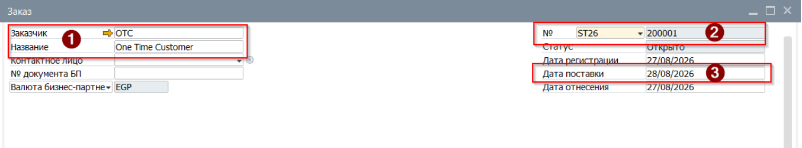
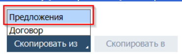
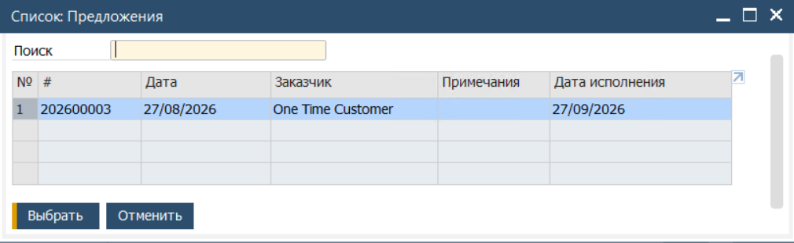
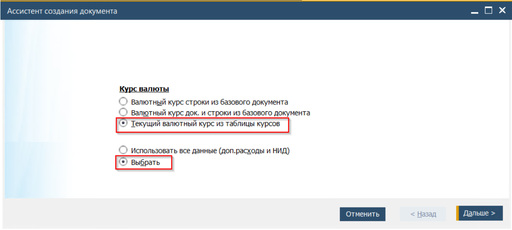
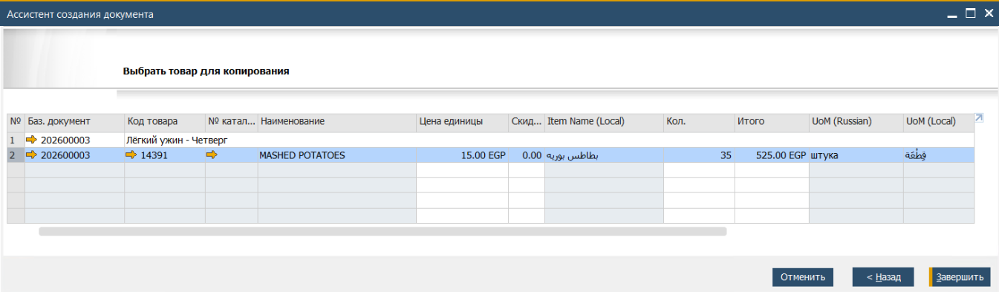
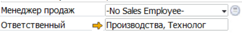
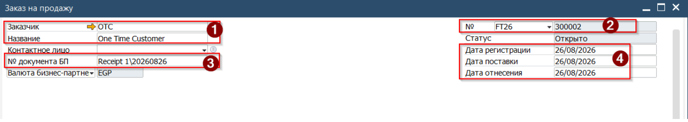
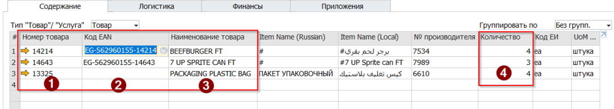
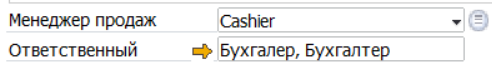

Заказ на продажу является плановым документом. Его добавление в Систему не создаёт складских и бухгалтерских проводок, это даёт возможность вносить изменения до момента, пока из Заказа не будет создан документ Отгрузка. Создание документа Заказ закрывает строки Предложения и делает их нередактируемыми.  
Заказ на продажу является базовым документом в SAP Business One. В процессе реализации может не существовать Коммерческого предложения, но Заказ является обязательным. Документ этого типа отражает переход от планирования Меню к процессу реализации, переход к запуску производства.

## Серии нумерации
Поскольку Заказ является базовым документом процесса реализации, то при его создании формируется и проверяется набор реквизитов, которые в последствии будут использованы при выставлении инвойсов. К таким реквизитам относится Серия нумерации.  
Одномоментно, для каждого типа документа существует несколько параллельных системы нумерации. Каждая серия нумерации диктует Системе подход к формированию номера документа.  
Например, для Заказа на продажу установлены следующие серии, где х это номер заказ по порядку его создания:

| **Серия нумерации** | **Начальный №** | **Последний №** | **Префикс** | **Пример номера** | **Сфера использования** |
|-----------------|-------------|-------------|---------|---------------|---------------------|
| OF26            | 100001      | 199999      | SO2026/ | SO2026/100001 | Meals\\Menu         |
| ST26            | 200001      | 299999      | SO2026/ST/ | SO2026/ST/200001 | Stella              |
| FT26            | 300001      | 399999      | SO2026/FT/ | SO2026/FT/300001 | Foodtruck           |
| BK26            | 400001      | 499999      | SO2026/BK/ | SO2026/BK/400001 | Bakery              |
| LO26            | 900001      | 999999      | SO2026/IC/ | SO2026/IC/900001 | Intercompany        |

В таблице выше, в качестве примера приведены полные форматы номеров. При этом, в пользовательском интерфейсе, системно, пользователю показывается только числовая составляющая номера (200103 - заказ Stella, 499423 - заказ Bakery)

Поскольку каждая серия нумерации ассоциирована с определённым направлением реализации, а направление определяется складом, указанным в Заказе, то система контролирует соответствует ли выбранная пользователем серия нумерации указанному в строках складу. В случае несоответствия, система заблокирует сохранение Заказа.

**Заказ на продажу**

Заказ по-разному используется в процессах:

* Для процесса реализации Meals\\Menu, Заказ является документом следующим за Коммерческим Предложением.
* Для процессов реализации через кассу, Заказ является документом - входной точкой, то есть первым документом в цепочке.

Тип процесса определяется по Серии нумерации. При сохранении Заказа, Система проверяет наличие предшествующего документа Предложение и блокирует созранение если Заказ для Meals\\Menu создан не на основании Предложения. Для документов с Серией нумерации Stella\\Foodtruck\\Bakery наличие предшествующего документа не проверяется  
Процедура создания Заказа на продажу в этих двух процессах отличается. При наличии предшествующего документа Заказ создаётся через копирование данных между Предложением и Заказов. Для регистрации продажи через кассу Заказ создаётся с нуля. Проверка документа перед его сохранением идентична для обоих процессов.

### Meals\\Menu
Для создания Заказа на основании Предложения необходимо:

1. Открыть документ Заказ на продажу из Главного меню -> Продажи -> Заказ на продажу

2. В открывшейся форме заполнить Заголовок

(1) Указать реквизиты Клиента  
(2) Проверить и при необходимости изменить Серию нумерации  
(3) Указать плановую дату отгрузки  

 

3. Нажать кнопку [Скопировать Из] и в открывшемся меню выбрать Предложение

 

4. В открывшемся окне выбрать иточник для переноса данных - Коммерческое Предложение и нажать кнопку [Выбрать]

 

5. Система откроет окно Ассистента создания документа.

На первой странице установить следующие пункты, и затем нажать кнопку [Дальше]

 

6. На второй странице проверить, и при необходимости внести изменения в строках. Выбрать строки для переноса. При необходимости перенести несколько строк - выбор производить с нажатой клавишей [Ctrl]. По окончании выбора нажать кнопку [Завершить]

 

7. Система скопирует выбранные строки в Заказ на продажу

8. Подписать документ, выбрав подпись в поле Ответственный

 

9. Нажать кнопку [Добавить] для сохранения изменений

Это действие

### Foodtruck \\ Bakery \\ Stella
(!) В качестве Клиента для реализации через кассу в обязательном порядке должен использоваться только OTC клиент (One Time Customer)

1. Открыть документ Заказ на продажу из Главного меню -> Продажи -> Заказ на продажу

2. Заполнить заголовок

(1) Указать клиента - OTC  
(2) Указать Серию нумерации, соответствующую точке продаж (в примере - Foodtruck)  
(3) Указать ссылочный номер (смена, дата или z-чек)  
(4) Указать даты документа. С системе указывается реальная дата реализации  

 

3. Перейти к заполнению таблицы на вкладке Содержание

4. Указать реализованные товары. Для этого скопировать и вставить одно из следующих значений в колонки

(1) Код товара или (2) EGS код товара или (3) Наименование товара  
(4) Скопировать и вставить в колонку количество реализованных товаров  

 

5. Проверить и скорректировать данные в следующих полях:

Итого по документу - должна совпадать с итоговой суммой в чеке  
Цена за единицу - по умолчанию, в поле подтягивается цена из связанного с ОТС прайс-листа  
Код налога - по умолчанию в поле подтягивается налог настроенный для ОТС и товара  
Склад - должен соответствовать точке продаж  
Key\\Milestone и Department - кост центры должны соответствовать Складу и Серии нумерации  
Договор - для продаж через кассу поле должно быть пустым

6. Подписать документ, указав

Менеджер продаж - кассира  
Ответственный - подпись сотрудника создавшего заказ в SAP

 

7. Нажать кнопку [Добавить] для сохранения изменений
