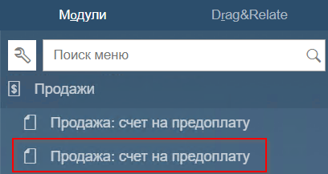
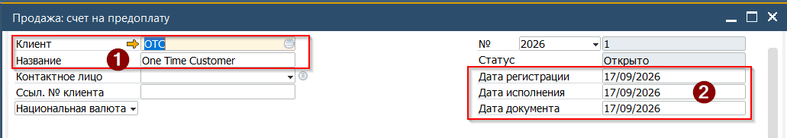
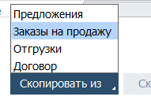
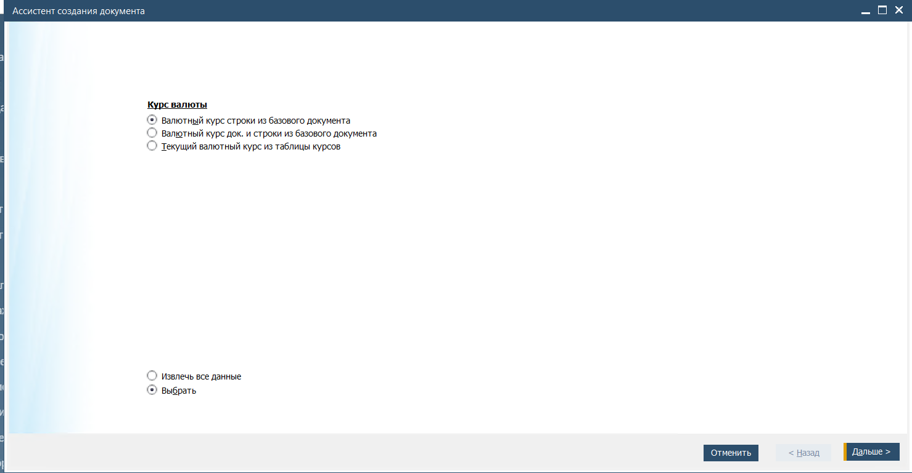
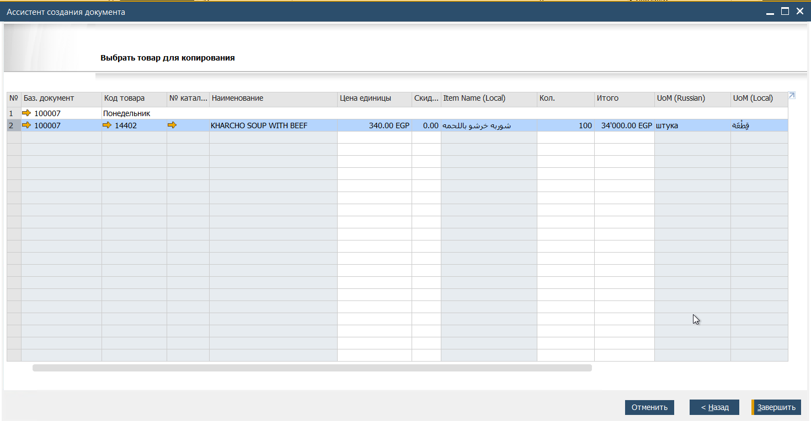
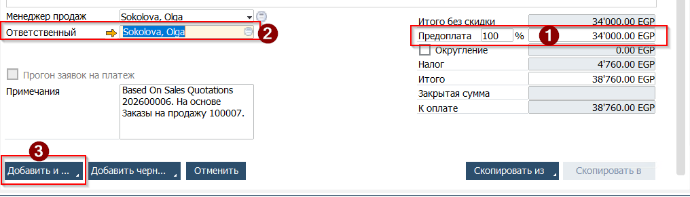
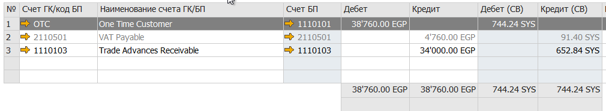
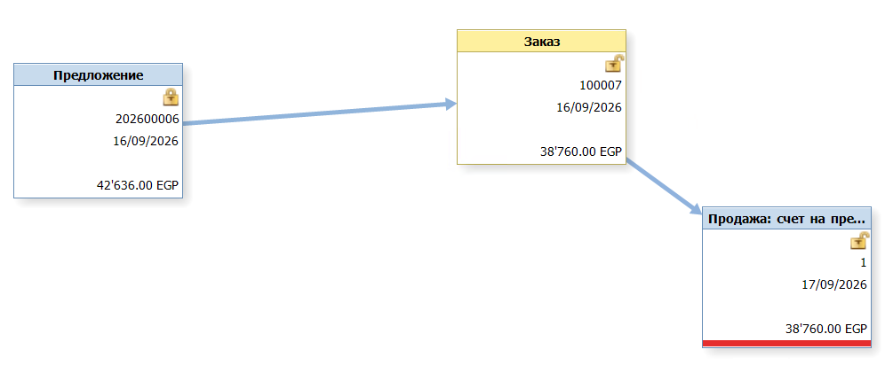
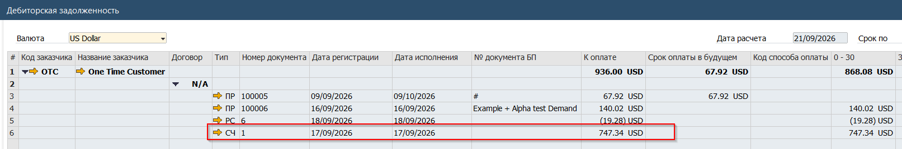

Счёт на предоплату является бухгалтерским документом, формирующим проводку по счету учёта авансов. Созданный счёт позже может быть использован для закрытия (оплаты Продажи | A/R Invoice).

## Создание СчётDа на предоплату

Создание Счёта выполняется с использованием функции Скопировать Из.  
Для создания нового счёта, необходимо:

1. Открыть документ из Главного меню →Продажи→Продажа:Счёт на предоплату (нижний в модуле)

   
2. В открывшейся форме заполнить Заголовок документа, указав
(1) Код или Название клиента  
(2) Дату Счёта. Под датой исполнения в этом случае понимается крайняя дата оплаты по счёту

 

3. Нажать кнопку [Скопировать Из] и выбрать в выпадающем списке пункт [Заказ на продажу]

4. Будет открыт список незакрытых Заказов на продажу. Выбрать необходимые документы и нажать кнопку [Выбрать]
5. При помощи Ассистента перенести данные из Заказа в Счёт

   

6. Сверить данные в табличной части документа
7. Перейти к заполнению нижней части формы
(1) При необходимости указать частичную сумму для счёта это можно выполнить вводом % от полной суммы Заказа в поле Процент, или указав сумму для счёта в поле Сумма  
(2) В поле Ответственный выбрать свою подпись  
(3) Нажать кнопку [Добавить] для сохранения документа  

## Результат создания счёта

### Бухгалтерская операция

В результате проводки Счёта будет создана, следующая Бухгалтерская операция  
 

### Карта отношений

При просмотре Карты отношений Счёт будет сформирован с привязкой к Заказу

 

### Дебиторская задолженность

В отчёте Дебиторская задолженность Счёт будет указан как отдельный документ  
 
