Отгрузка - документ отражающий в системе движение товара при его отгрузке клиенту. Создание Отгрузки сопровождается созданием Бухгалтерской операции по счетам учёта ТМЦ. Процессный смысл Отгрузки - отразить исходящее движение готовой продукции без фактурирования. В конце финансового периода, на основе Отгрузки создаётся A/R Invoice.

Отгрузка создаётся только для процесса реализации Meals, для отражения продаж проведённых через кассу документ Отгрузка не создаётся.

## Отгрузка на основании Заказа (нескольких заказов)

Документ отгрузка создаётся с использованием функции Скоопировать из.  
Для создания документа необходимо:

1. Отрыть документ Отгрузка из Главного меню→Продажи→Отгрузка

 

2. В отрывшейся форме заполнить Заголовок

(1) Указать Код или Название клиента  
(2) Указать дату документа и дату отгрузки (по-умолчанию должны быть равны)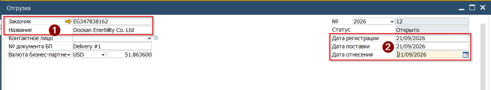  

3. Нажать кнопку [Скопировать из] и выбрать в выпадающем списке Заказ на продажу

 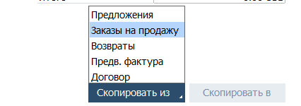

4. В открывшемся окне выбрать Заказ на продажу который будет использован в качестве базового документа. Для выбора нескольких заказов необходимо держать нажатыми клавиши [Ctrl]+[Shift]

 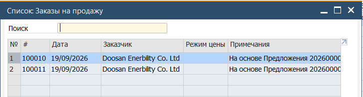

5. Система откроет Ассистент создания документа

Определить каким образом будет скопирована информация в Отгрузку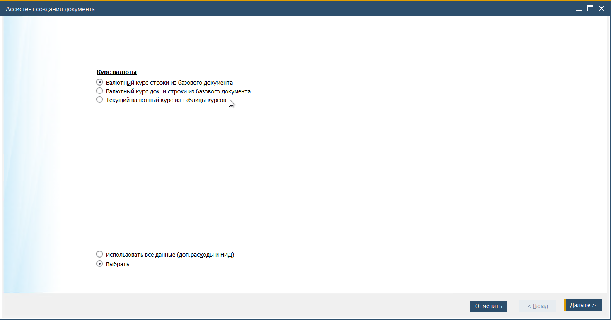

6. Нажимая кнопку [Дальше] пройти все шаги, сверяя информацию

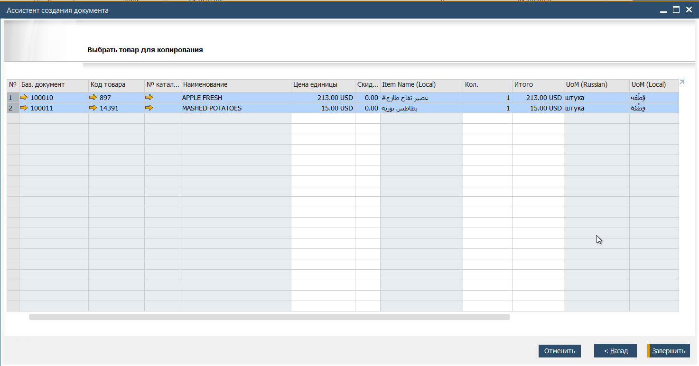

7. Данные из Заказов будут перенесены в табличную часть Отгрузки

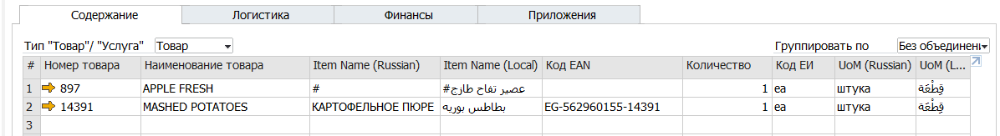

8. Проверить информацию и подписать документ, выбрав свою подпись в поле Ответственный

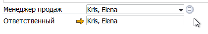

9. Нажать кнопку формы [Добавить] для проводки документа

## Результат проводки документа

### Бухгалтерская операция

В результате проводки документа в Системе будет создана следующая Бухгалтерская операция:

 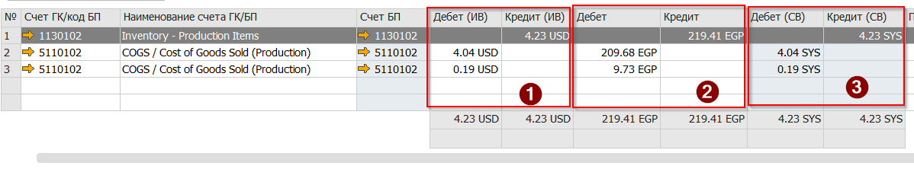

Поскольку валютой Бизнес Партнёра в данном примере был выбран USD, то проводка записана в трёх валютах  
(1) ИВ - Иностранная валюта (USD)  
(2) Локальная валюта (EGP)  
(3) CB - Системная валюта (SYS)  

### Движение товара

В результате проводки документа Отгрузка, количество товаров на складе будет уменьшено. А также будет уменьшено количество товара в информационных полях  
Продажи(Заказано)

 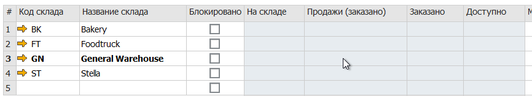

 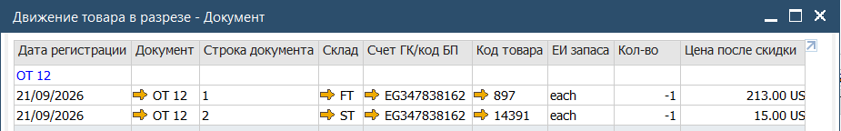

### Валовая прибыль

В результате проводки документа Отгрузка будет сделана запись с расчётом Валовой прибыли

 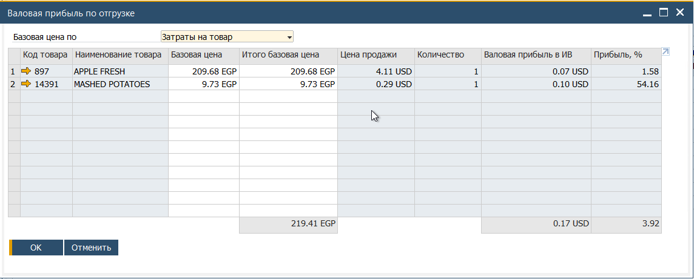
