Документ Продажа (A/R Invoice) - бухгалтерский документ, формирующий Задолженность клиента перед Компанией и отражающий выручку от продажи.

Выделяются следующие типы Продаж в зависимости от типа реализации:

| Тип продажи | Серия нумерации | Базовый документ | Особенности |
|-------------|-----------------|------------------|-------------|
| Продажа через кассу | BK26, FT26, ST26 | Заказ на продажу | Стандартный документ. ТМЦ списываются со склада.  |
| Продажа через офис | 2026            | Отгрузка         | Продажа с объединением по Документам |

## Продажа через кассу

Продажа создаётся на основании документа Заказ на продажу, предварительно подготовленного из отчёта продаж с кассы.  
Для создания документа Продажа необходимо:

1. Открыть документ Заказ на продажу из Главного меню → Продажи → Заказ на продажу

2. Переключить открывшуюся форму в режим поиска, нажав комбинацию клавиш [Ctrl]+[F]

3. Ввести в жёлтые поля критерий поиска (клиент или серию нумерации или номер заказа) и нажать кнопку [Поиск]

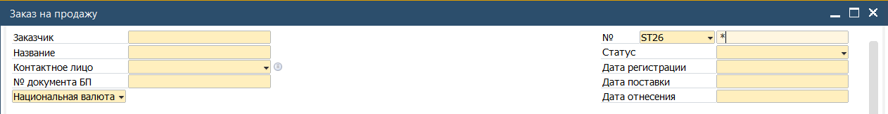

4. Выбрать искомый документ, который будет использован в качестве базового для Продажи и перейти в него двойным кликом мыши

5. Проверить открытый документ на предмет корректного указания аналитик

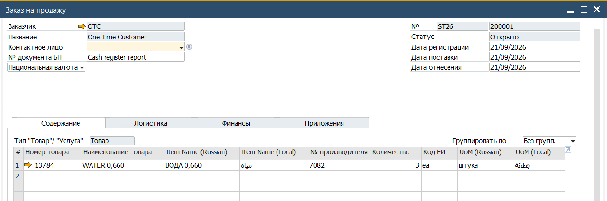

6. Нажать кнопку [Скопировать В] и выбрать в выпадающем списке пункт Продажа

 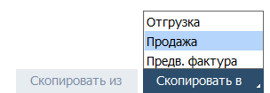

7. Система откроет форму документа Продажа и перенесёт в табличную часть данные из Заказа

8. Установить

(1) Серию нумерации, соответствующую типу продажи (Stella в данном примере)  
(2) Дату документа (для Stella, Foodtruck и Bakery указывается дата, за которую выполняется проводка)  
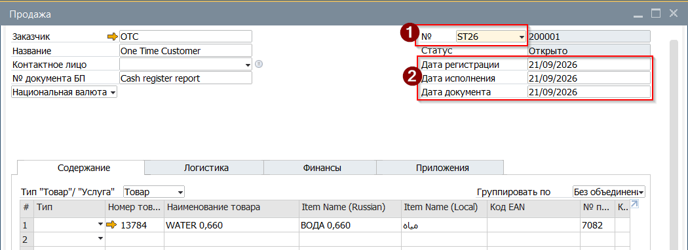

9. Выполнить предварительную проверку документа, сгенерировав предварительную бухгалтерскую проводку. Это действие запустит процесс проверки документа на соответствие правилам Системы, а также процесс проверки доступного для продажи товара на выбранном складе.

Для этого нажать кнопку на Панели инстументов [Предварительный просмотр бух.операции]  
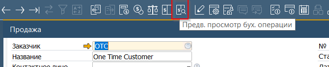

Если в ответ на это действие Система откроет форму Бухгалтерской операции, то с  
документом всё в порядке и товара на складе достаточно.

10. Проверить что для документа не установлено никаких группировок

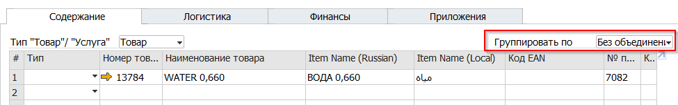

11. Подписать документ, выбрав свою подпись в поле Ответственный (1) и для отражения поступления денег в кассу, нажать кнопку (2) метод платежа

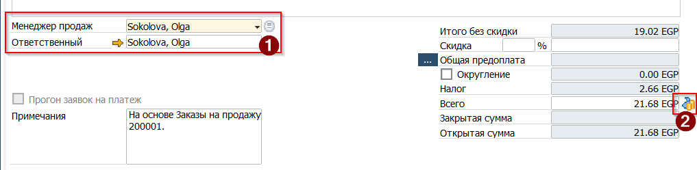

12. В открывшейся форме указать:

(1) Наличные как метод платежа  
(2) Выбрать Счёт Главной книги на который будут зачисленны деньги  
(3) Ввести Итоговую сумму, для этого нажать комбинацию клавиш [Ctrl]+[B] или сделать правый клик на поле и в выпадающем меню выбрать Скопировать сальдо к оплате  
(4) Выбрать из списка статью ДДС (Cash Flow Item)  

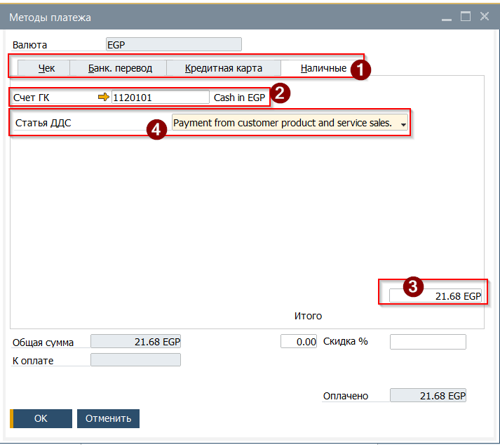

13. По окончанию заполнения Методов платежа нажать кнопку [OK] и вернувшись в документ Продажа - нажать кнопку [Добавить] для проводки документа.

### Результат проводки Продажи через кассу

В результате проводки Продажи таким образом в системе будут созданы две Бухгалтерские операции  
Продажа  
 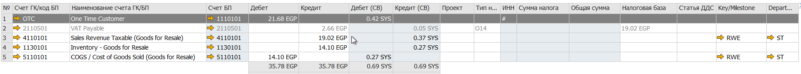

Платёж

 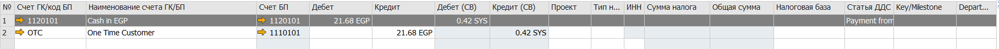

А также, поскольку не был использован базовый документ Отгрузка, то также будет отражено движение ТМЦ

 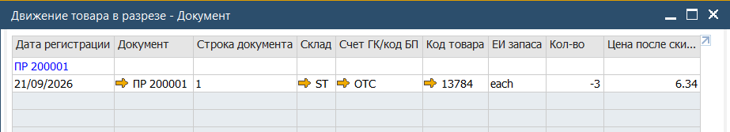

## Продажа через Офис

Продажа через офис создаётся на основании документа(документов) Отгрузка с использованием функции Скопировать Из.  
Особенности этого способа заключается в:

* отложенном (во времени) формировании Инвойса
* движение товара отражено ранее, базовым документом Отгрузка
* Продажа содержит группировку по Документам, и не отражает реализованные ТМЦ (эта особенность обусловлена спецификой связанной печатной формой

Для создания Продажи необходимо:

1. Открыть документ Продажа из Главного меню→ Продажи→ Продажа

 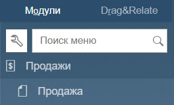

2. В открывшемся документе заполнить Заголовок

(1) Указать Код или Название клиента  
(2) Выбрать в выпадающем списке серию нумерации Офиса (2026)  
(3) Указать дату документа, Дата исполнения будет расчитана в соответствии с условиями оплаты установленными для клиента (в примере - 45 дней)  
(4) В поле [№ документа БП ] нажать на иконку лупы для генерации номера инвойса по формату  
(5) Проверить курс валюты клиента (подтягивается из таблицы курсов на дату регистрации. Внимание - валюта должна соответстовать той, что была использована в базовом документе Отгрузка  
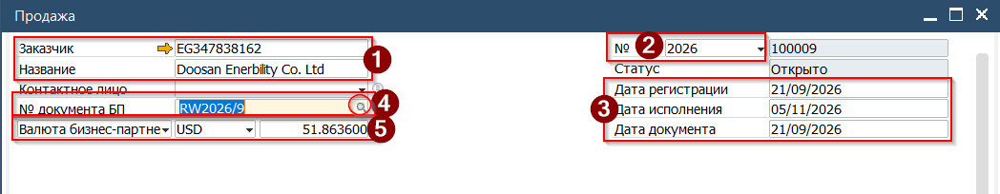

3. Нажать кнопку [Скопировать Из] и выбрать в выпадающем меню пункт Отгрузки

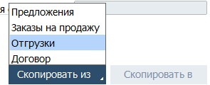

4. Система откроет список доступных базовых документов. Выбрать необходимый документ двойным кликом мыши. Для выбора нескольких документов необходимо нажать и удерживать комбинацию клавиш [Ctrl]+[Shift]

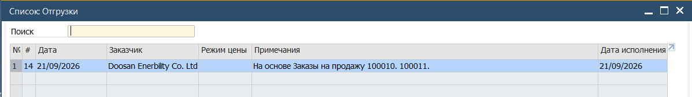

5. Система откроет Ассистент создания документа.

Выбрать подходящий способ переноса данных и правила для курса валюты  
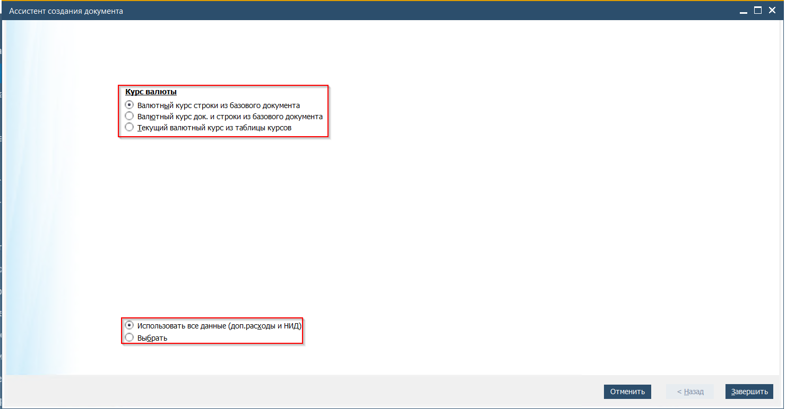

6. Нажать кнопку [Далее] \\ [Завершить]

7. Данные из базового документа будут перенесены в табличную часть документа

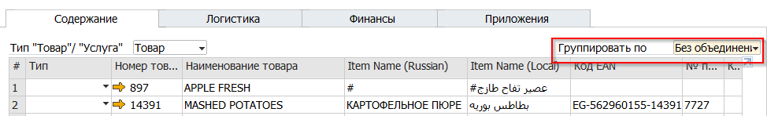

8. Установить группировку данных - По документам

Это действие объединит данные в таблице по базовым документам

 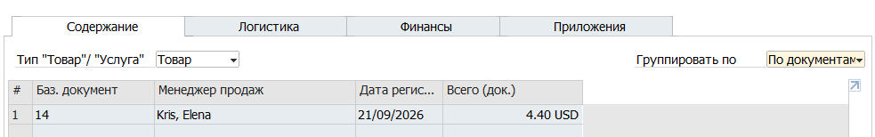

9. Подписать документ, выбрав свою подпись из списка в поле Ответственный

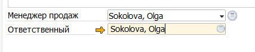

10. Выполнить предварительную проверку документа, сгенерировав предварительную бухгалтерскую проводку. Это действие запустит процесс проверки документа на соответствие правилам

Для этого нажать кнопку на Панели инстументов [Предварительный просмотр бух.операции]

 

Если в ответ на это действие Система откроет форму Бухгалтерской операции, то с  
документом всё в порядке и товара на складе достаточно.

11. Проверить корректность предварительной Бухгалтерской операции

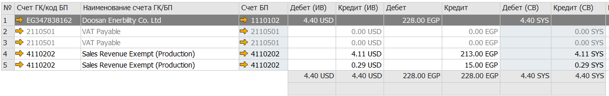

12. Вернуться в документ и нажать кнопку [Добавить] для проводки Продажи

13. При необходимости сгенерировать печатную форму Инвойса, нажать кнопку Предварительного просмотра, расположенную на Панели инструментов

 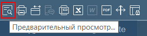

### Результат проводки Продажи через Офис

В результате проводки докумета Продажа в Системе будет создана Бухгалтерская операция:

 

А также сформирована Дебиторская задолженность клиента  
 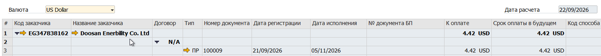
