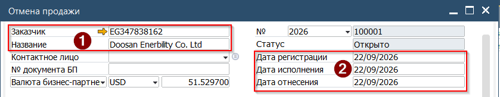
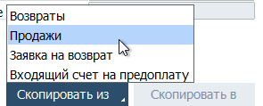
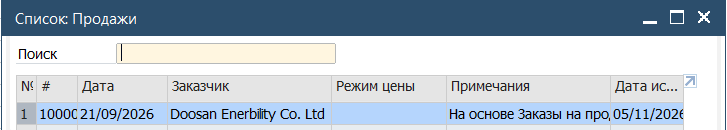
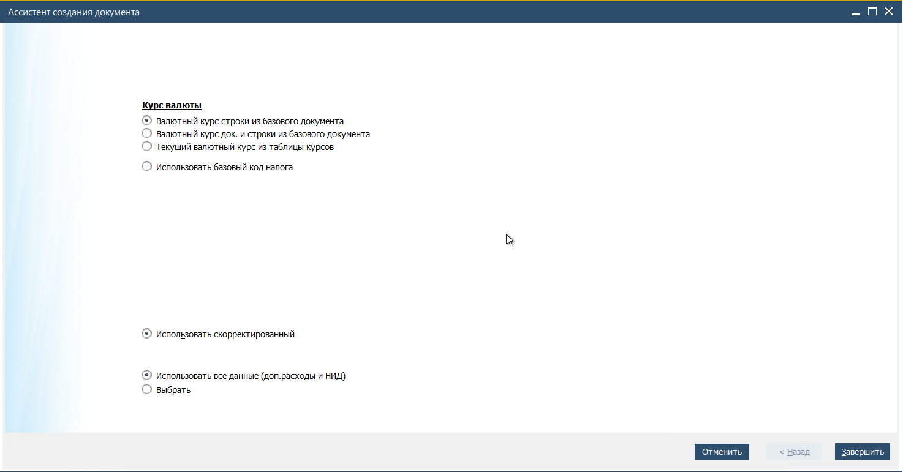
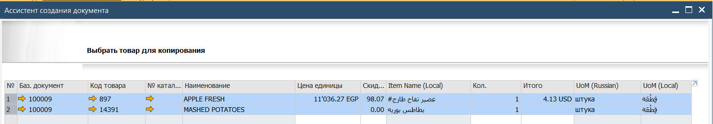
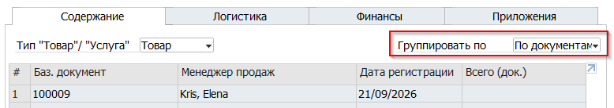
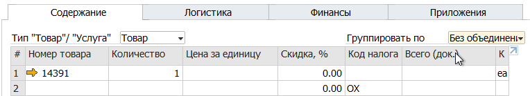
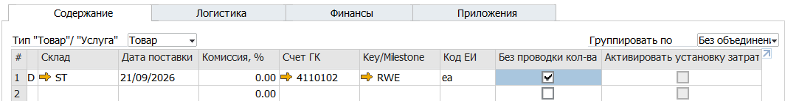

Отмена продажи или A/R Credit Memo - документ уменьшения Дебиторской задолженности, может быть создан с обратным движением товара (возврат) а также без него.
Отмена продажи может отменять Продажу целиком, или частично

Для создания Отмены продажи необходимо:

1. Открыть документ Отмена продажи из Главного меню→ Продажи → Отмена продажи

   

2. Заполнить заголовок, указав

(1) Код или Название клиента
(2) Дату проводки отмены

3. Нажать кнопку [Скопировать Из] и выбрать в выпадающем списке пункт Продажи

 

4. Система откроет список доступных базовых документов. Выбрать необходимый документ двойным кликом мыши. Для выбора нескольких документов необходимо нажать и удерживать комбинацию клавиш [Ctrl]+[Shift]

 

5. Система откроет Ассистента создания документа

6. Указать необходимые правила создания документа. Если требуется частичная корректировка Продажи, то необходимо уставить отметку напротив пункта Выбрать.

Нажать кнопку [Далее]

7. В варианте частичной корректировки выбрать строки, которые необходимо скорректировать и нажать кнопку [Завершить]

8. Если базовая Продажа имеет группировку, то в таком же виде данные будут перенесены в Отмену продажи. 

9. Снять группировку для отображения списка товаров

10. В зависимости от задачи - скорректировать данные в строке

Изменить количество для возврата товара на склад
или
Установить отметку в поле [Без проводки количества] если ТМЦ на склад возвращать не требуется и необходимо только скорректировать цену для уменьшения Дебиторской задолженности

11. Выполнить предварительную проверку документа, сгенерировав предварительную бухгалтерскую проводку. Это действие запустит процесс проверки документа на соответствие правилам Системы, а также процесс проверки доступного для продажи товара на выбранном складе.

Для этого нажать кнопку на Панели инстументов [Предварительный просмотр бух.операции]

 

Если в ответ на это действие Система откроет форму Бухгалтерской операции, то с
документом всё в порядке. Проверить корректность сформированной операции

12. Вернуться в документ и нажать кнопку [Добавить] для проводки Отмены Продажи
