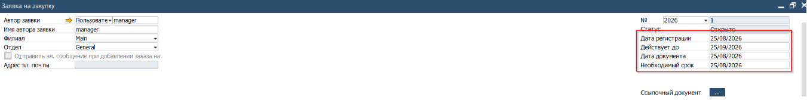
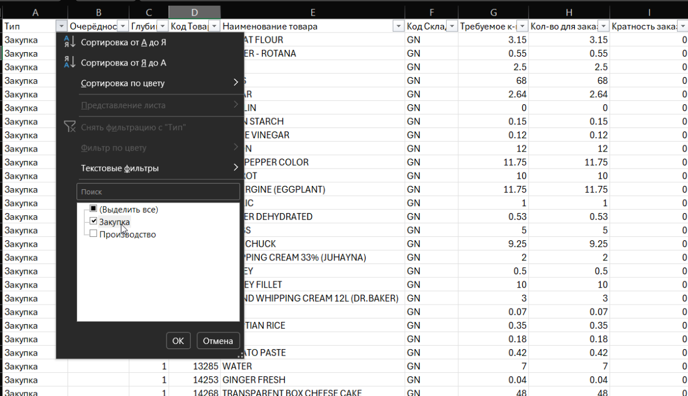
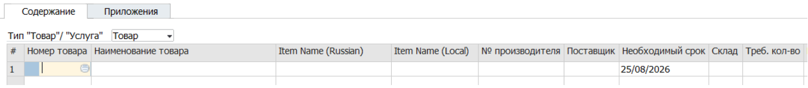
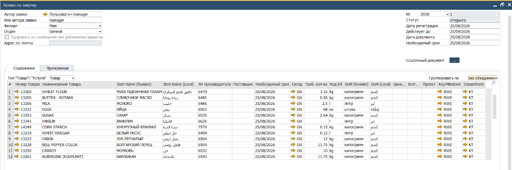
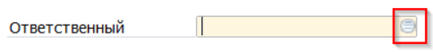

Заявка на закупку - входная точка в плановый процесс снабжения. Товары и количества указанные в Заявке не отражаются в отчётах по статусу ТМЦ. Данный документ - запрос от пользователей отделов в отдел закупок. Формализация просьбы закупить ТМЦ.

Заявка, в момент создания, не требует указания кода поставщика, эти данные в Заявку вносит сотрудник Отдела Закупок.

Ниже приведён пример оформления Заявки на закупку сырья, необходимого для обеспения Производства. Если Заявка оформляется на закупку для пополнения склада или требуется закупить ТМЦ из группы товаров для собственного потребления, то процесс необходимо начать с шага 2 и пропустить шаги работы с экпортом отчёта о потребности.

1. Сформировать отчёт о потребности и выгрузить его в Excel файл
2. Проверить и при необходимости скорректировать предлагаемое к заказу количество
3. В SAP открыть документ Заявка на закупку (из Главного Меню -> Закупки -> Заявка на закупку)
4. Заполнить Заголовок, указав необходимый срок поставки

 

5. В отчёте о потребности установить фильтр на отображение закупаемых компонентов

 

6. Скопировать в буфер обмена колонку Код товара (без заголовка)
При большом количестве строк использовать [Ctrl]+[Shift]+[стрелка вниз] и затем [Ctrl]+[C]  
7. Вернутся в SAP. Установить курсор на первую строку в поле Код товара

8. Нажать комбинацию клавиш [Ctrl]+[V]

 

     Повторить операцию для переноса данных о необходимом количестве:

 9. Вернуться в Excel, скопировать в буфер обмена колонку Количество для заказа
10. Перейти в SAP и установив курсов в колонку **[Треб кол-во]**, в первой строке Заявки - нажать [Ctrl]+[V]
11. Проверить заполнение колонок:
(1) Информация о закупаемых товарах

    (2) Заполнить колонку Key\\Milestone. Ключ к которой относится закупка  
(3) Заполнить колонку Department. Департамент Компании к которому относится закупка  
Для их заполнения указать значение в колонке в первой строке документа, затем установить курсор во вторую строку и нажать комбинацию [Ctrl]+[Стрелка вверх]. Повторить для всех строк Заявки  
12. Заполнить поле Ответственный для подписи Заявки. Для этого нажать кнопку вызова списка и выбрать в нём свою подпись
13. 
14. Нажать кнопку [Добавить] для сохранения Заявки

Добавленная заявка становится доступной для обработки Отделом Закупок
