В системе настроена процедура уведомления ответственных сотрудников о наличии документов для обработки.
Менеджеру по закупкам с периодичностью в Х минут, на втреннюю почту SAP поступает уведомление о наличии открытых (необработанных) Заявках на закупку.

 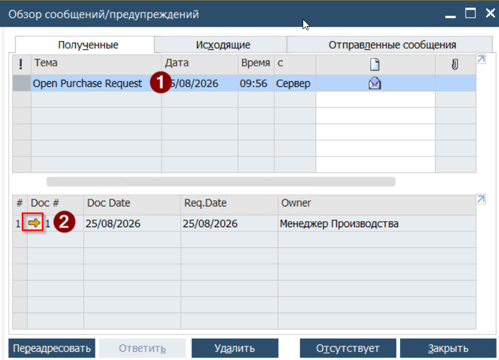

1. Для ознакомления с содержанием Заявки необходимо выбрать сообщение в верхней части формы. При этом в нижней части формы будет отражено содержание сообщения.
2. Для перехода в Заявку необходимо нажать на Золотую стрелку, размещённую в колонке Doc #
3. Будет открыта форма документа Заявка на Закупку

 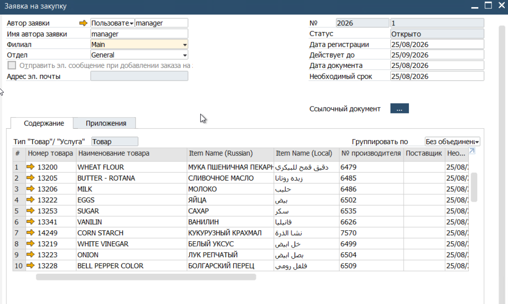Данная Заявка является заданием на подбор Поставщика и согласование сроков поставки и цен. Факт подбора Поставщика и согласование поставки отражается в Заявкe заполнением поля [Поставщик]

## Создание Заказа из Заявки

В момент, когда заказ размещён у поставщика и дальнейших изменений не будет из Заявки создаётся Заказ.

1. Открыть Заказ на Закупку. Из Главного Меню -> Закупки -> Заказ на закупку

 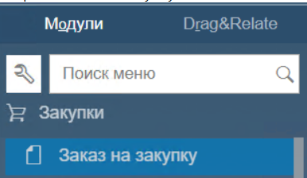

2. В открывшемся окне заполнить реквизиты Бизнес-Партнёра, дату согласованной поставки и, при наличии - номер заказа в системе Поставщика

 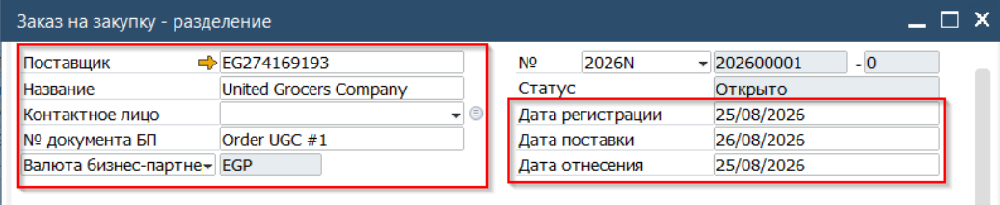

3. Перейти к переносу данных. Для этого нажать кнопку [Скопировать Из], расположенную в нижней части формы. В выпадающем списке выбрать Заявку на закупку

 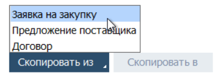

4. Система откроет список активных Заявок на закупку

 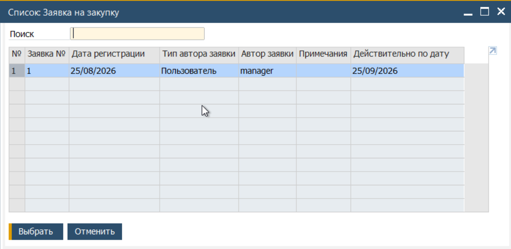

5. В открывшемся окне выбрать необходимую заявку и нажать кнопку формы [Выбрать]
Примечание: в данном окне воможен множественный выбор. Для этого необходимо держать нажатыми клавиши [Ctrl]+[Shift] а выбор делать нажатием кнопки мыши
6. Будет открыт Ассистент создания документа

 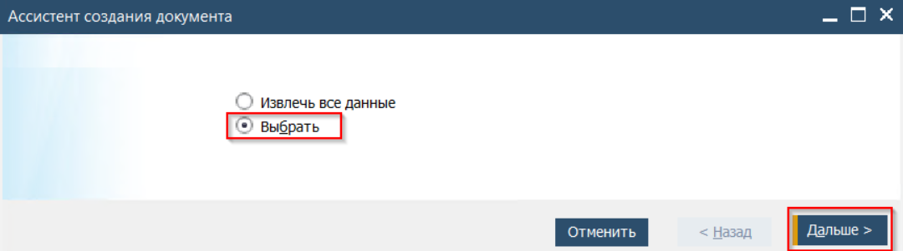

7. В открывшемся окне выбрать пункт [Выбрать] и нажать кнопку [Дальше]
8. Будет открыто окно выбора строк для переноса из Заявки в Заказ
9. Выбор необходимых строк выполняется с нажатием клавиши [Ctrl]. Синяя подсветка строки означает, что она будет скопирована в Заказ.
Источником Количества для каждого товара является Заявка. Если с Поставщиком было согласовано иное количество Заказа, то необходимо внести фактически заказанное количество в соответствующей колонке. При этом, если количество меньше изначально запрошенного, то строка в Заявке на Закупку останется открытой.

 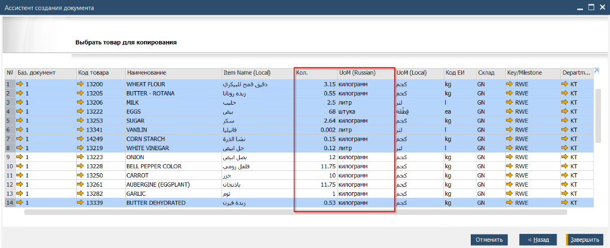

10. После проверки данных (товар, количество, единица измерения, склад для поставки и Key\\Department центров нажать кнопку [Завершить]
11. Система скопирует выбранные строки в таблицу Заказа.
12. Проверить согласованную Дату поставки и выбрать подпись в поле Ответственный

 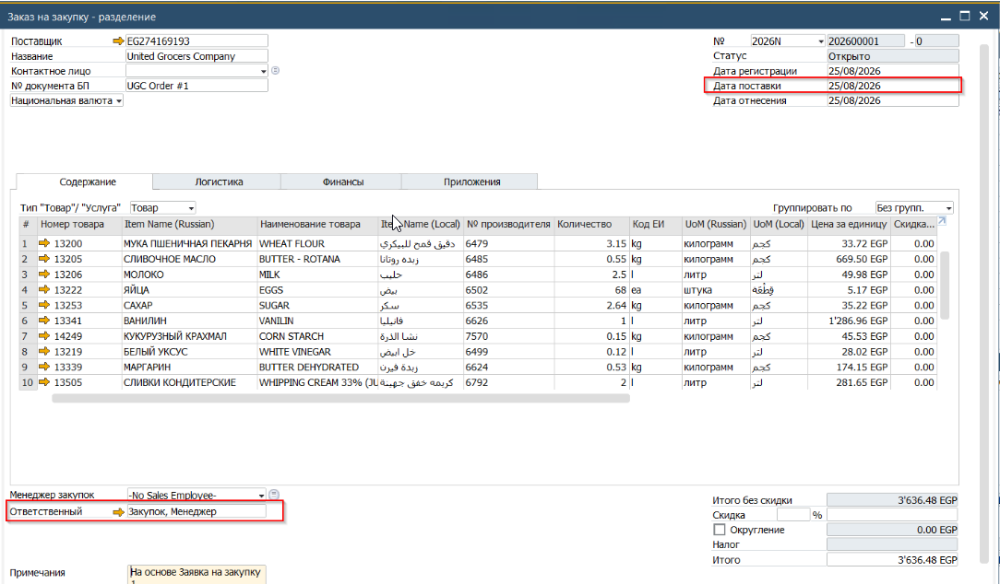

13. Проверить цены в таблице
14. Сохранить измения в документе, для этого нажать кнопку [Добавить]

## Результат создания Заказа на закупку.

После добавления документа в Систему произойдёт следующие обновления:

### **Заявка на закупку.**

Строки для которых создан Заказ на закупку в количестве товара соответстуюшем запрошенному в Заявке - строки будут закрыты. Это отражается окрашиванием строк серым цветом:

 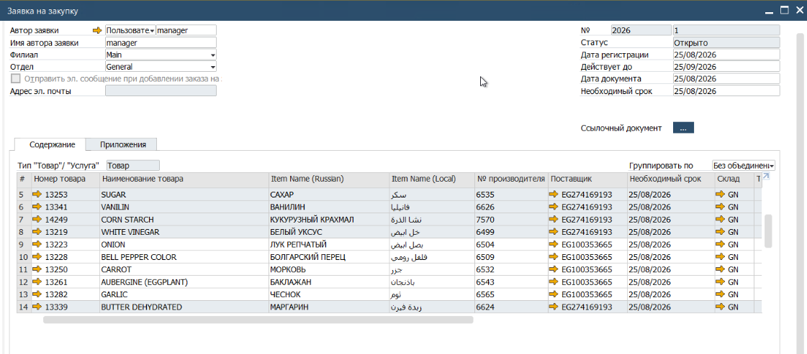

### **Складские отчёты**

Заказанное количество будет указано в складских отчётах как Закупки(заказано)

 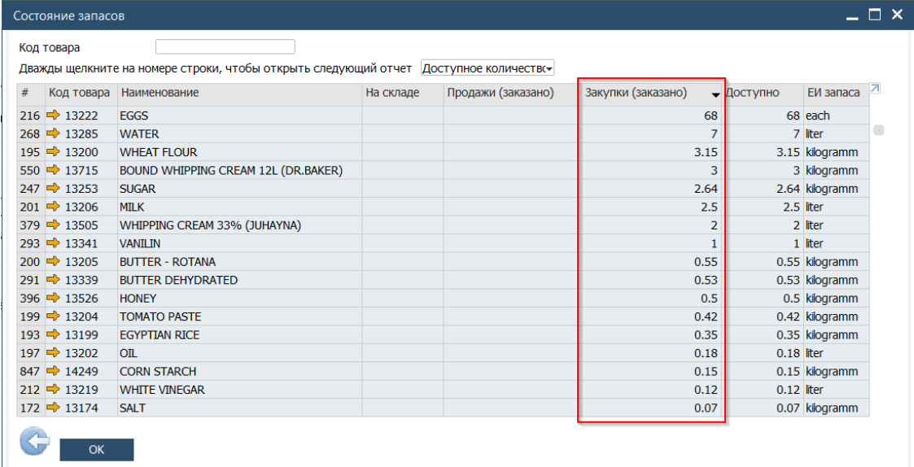

### **Уведомления**

Создателю Заявки на закупку по внутренней почте будет отправлено уведомление о копировании Заявки в Заказ

 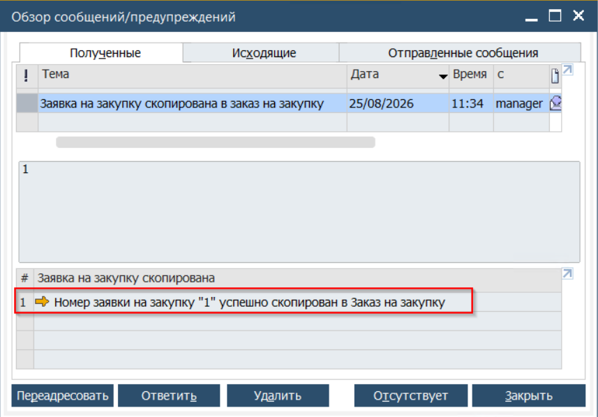
