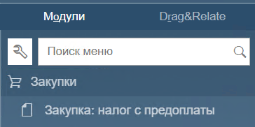
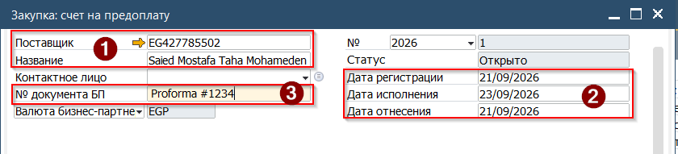
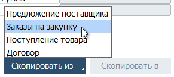
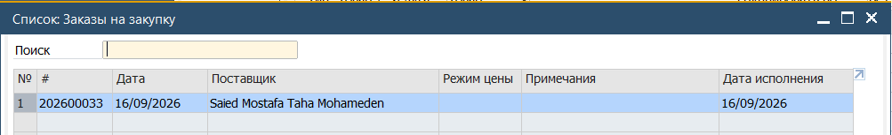
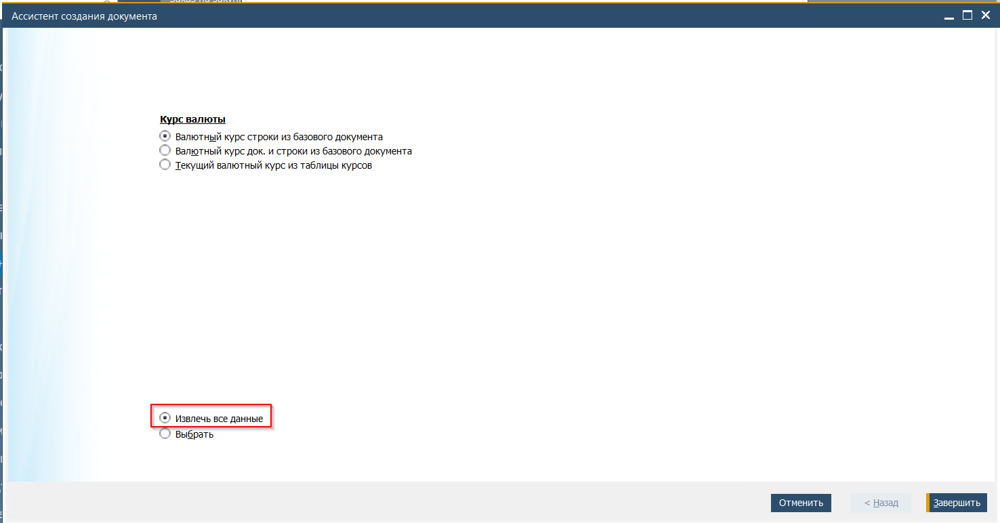
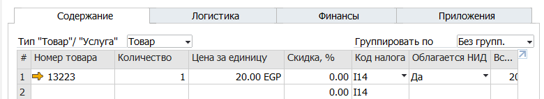
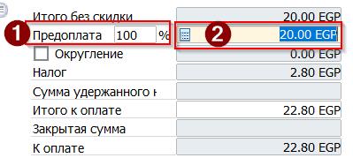
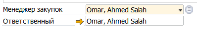
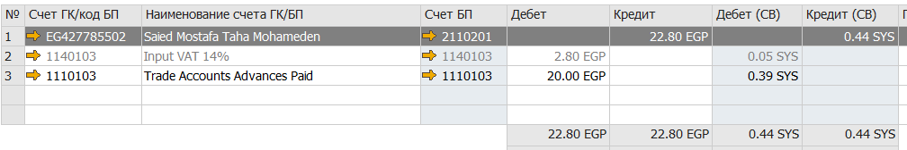

Счёт на предоплату является бухгалтерским документом, формирующим проводку по счетам Кредиторской Задолженности. Создание документа в SAP отражает получение от Заказчика счёта на предоплату. В дальнейшем этот документ подлежит оплате и может быть зачтён при создании документа Закупка.

Для создания документа Счёт на предоплату необходимо:

1. Открыть документ из Главного меню→ Закупки → Закупка: налог с предоплаты

(\* особенность перевода в русском интерфейсе, в оригинале - Downpayment Invoice)

 

2. В открывшемся документе заполнить Заголовок, указав

(1) Код или Название поставщика  
(2) Дату счёта (Дата регистрации) и Дату исполнения (Дата до которой счёт необходимо оплатить  

(3) № документа БП - номер счёта полученный от поставщика. Будет использован в дальнейшем при сверке с поставщиком  

3. Нажать кнопку [Скопировать Из] и выбрать в выпадающем списке Заказы на закупку

4. Система откроет список доступных базовых документов. Выбрать необходимый документ двойным кликом мыши. Для выбора нескольких документов необходимо нажать и удерживать комбинацию клавиш [Ctrl]+[Shift]

 

5. Система запустить Ассистента создания документов.

6. Поскольку Счёт как правило относится к Заказу целиком (а не к конкретной строке) - установить отметку Извлечь все данные. Нажать кнопку [Завершить]

   \  
   

7. Данные из Заказа на закупку будут перенесены в документ Счёт на предоплату

8. В нижней части документа указать процент требуемой предоплаты, сделать это можно введя процент(1) , или сумму (2)

 

9. Подписать документ, выбрав свою подпись в поле Ответственный.

10. Нажать кнопку [Добавить] для отражения Счёта в Системе

## Результат проводки документа Счёт на предоплату

### Бухгалтерская операция

 

### Кредиторская задолженность

 
