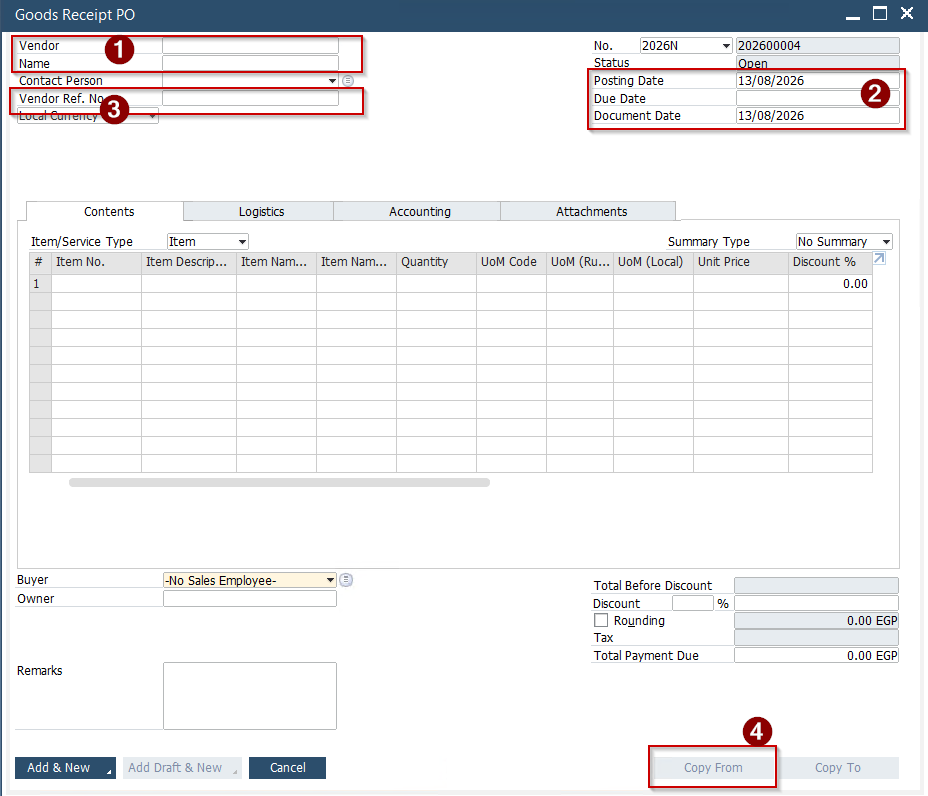
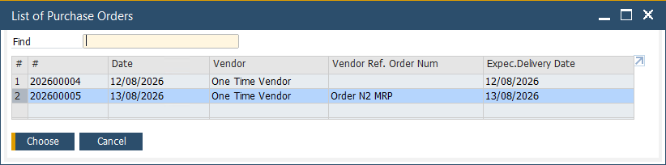
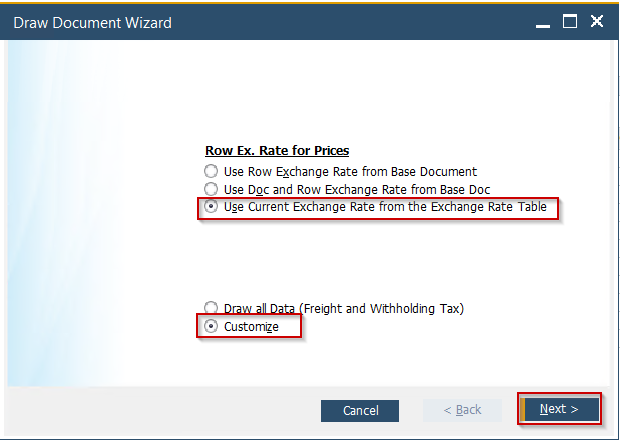
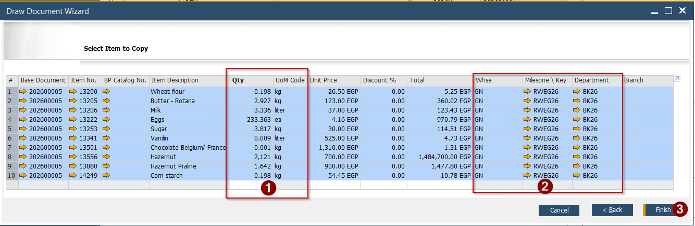
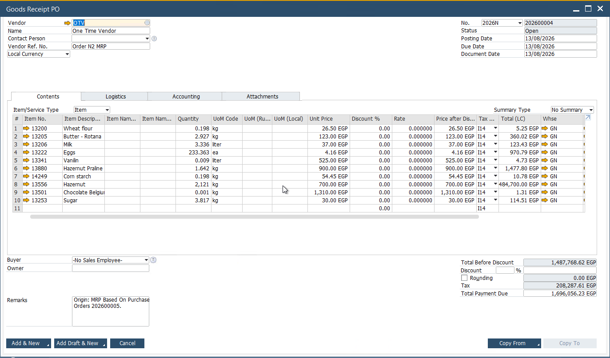
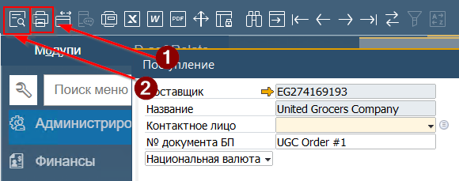
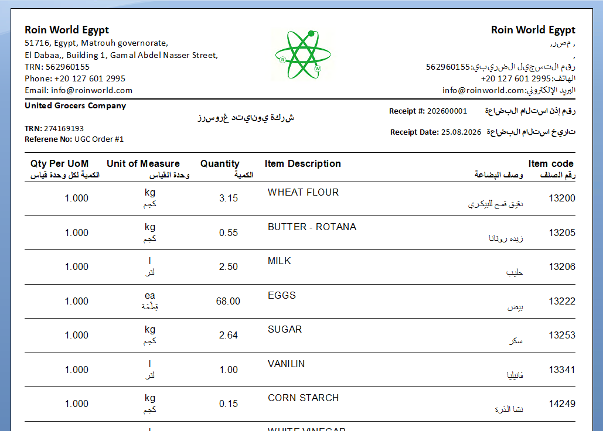

Данный шаг общего процесса закупки начинается с физического поступления ТМЦ на склад Компании.  
**Внимание: Сохранение документа Поступление формирует проводку ТМЦ на склад Компании. Также, при добавлении документа формируется бухгалтерская проводка. Это означает, что внесение изменений в проведённый документ становится невозможным. Изменение данных в документе возможно только путём создания документа Возврат (или Отмена Поступления)**

Для отражения поступления необходимо выполнить следующие шаги:

1. Открыть документ Поступление\\Goods Receipt PO. Система откроет форму документа в режиме добавления новой записи. Для этого из Главного меню-> Закупки -> Поступление
2. Заполнить Документ следующим образом:

 

(1) Вввести \\ Выбрать из списка Поставщика  
(2) Ввести дату поступления (отражение фактической даты поступления). Все три даты должны быть равны  
(3) Ввести номер накладной Поставщика (номер на который в последствии можно ссылаться при общении с  
Поставщиком)  
(4) Нажать кнопку [Copy From]

3. Система откроет список документов **открытых** Purchase Order, которые созданы для указанного Поставщика. В данном списке выбрать необходимый Заказ. И затем нажать кнопку [Choose]
(При необходимости выбрать несколько Заказов - держать нажатыми клавиши клавиатуры [Shift] + [Ctrl])

 

4. Система откроет форму выбора данных для копирования из Заказа в Goods Receipt PO

   
5. В открывшейся форме необходимо выбрать
(1) 'Use Current Exchange Rate from The Exchange Rate Table' \\ 'Использовать текущий курс валюты для проводки документа'

   (2) Выбрать 'Выбрать''Customize' для того чтобы указать фактически полученное количество ТМЦ.  
6. Система откроет окно для заполнения.
Все строки окна выделены синим - это означает, что все эти строки будут скопированы в целевой документ. Если ТМЦ по какой-то строке не поступили в полном объёме, то необходимо сбросить выделение и выбрать строки для копирования (клик левой кнопки мыши) при нажатом [Ctrl]

 

7. Внести фактические данные пересчёта поступивших ТМЦ в колонку (1) 'Количество'/'Qty', при этом обязательно сверить Единицы измерения \\ 'UoM Code'. (2) Проверить значения в колонке 'Whse' - должен быть установлен General Warehouse. (3) Проверить что колонки Key и Department заполнены. По окончания проверки нажать кнопку [Finish]
8. Система скопирует выбранные строки с указанными данными из Заказа (Заказов) в форму Goods Receipt PO

 

 9. Подписать документ, выбрав в поле Owner свою подпись
10. Нажать кнопку [Добавить][Add&View] для проводки документа. В этот момент:
    * ТМЦ будут добавлены на склад.
    * Будет создана бухгалтерская проводка ДБ Inventory On Stock \\ КТ Goods Received Not Invoiced
11. Отправить на печать форму документа, для этого:
    * нажать (1) [Печать][Print] расположенную на Панели инструментов. Эта форма является документом подтвержения прихода товара для Поставщика.
    * Для генерации печатной формы в электронном виде - нажать кнопку (2) [Предпросмотр][Preview] и затем сохранить форму как pdf файл.

      
12. Подписать распечатанный документ и передать его Поставщику

## Печатная форма Поступления

 
