Закупка \\ AP Invoice - бухгалтерский документ, формирующий в Системе проводки по счетам задолженности.

### По Типу документа Закупка может быть
* Товарной, в качестве закупаемых позиций используются Товары из Справочника товаров и Услуг. Для товарной закупки обязательным условием является наличие Заказа на закупку - базового документа процесса.
* Сервисной, в качесте закупаемой позиции используются счет Главной книги расположенный в разделе затрат. Сервисная закупка может быть создана без предшествующего Заказа на закупку

### По способу создания Закупка может быть создана
* Для складируемых товаров, на базе документа Поступление \\ GRPO. В этом случае будет создана бухгалтерская проводка
ДТ Goods Received Not Invoices  
KT Supplier Control Account  
* Для нескладируемых товаров, без базового документа Поступления \\ GRPO. В этом случае будет создана бухгалтерская проводка
ДТ Expense Account  
КТ Supplier Control Account

## Создание Закупки для нескладируемых товаров (S-item)

1. Открыть документ Закупка из Главного меню -> Закупки -> Закупка

 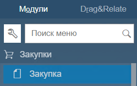

2. В открывшемся окне заполнить Заголовок

(1) Код и Название поставщика  
(2) Номер инвойса в системе Поставщика. Это поле является обязательным  
(3) Выбрать валюту документа, если она отличается от локальной (EGP)  
(4) Указать дату инвойса в поле Дата регистрации. И дату отсрочки оплаты по инвойсу в поле Дата исполнения  

 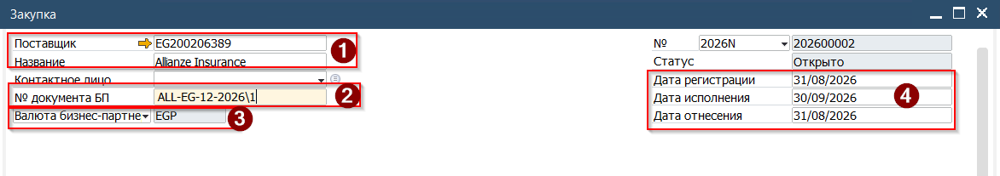

3. Заполнить таблицу документа на вкладке Содержание

(1) Выбрать из списка подходящий S-item  
(2) Указать стоимость без VAT  
(3) Проверить и изменить код применяемого VAT  

 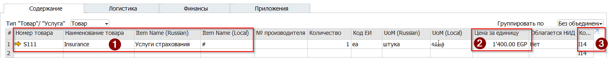

(4) Проверить и изменить склад  
(5) Проверить правильность назначенного Счёта ГК  
(6) Указать Key\\Milestone центр  
(7) Указать Department центр  

 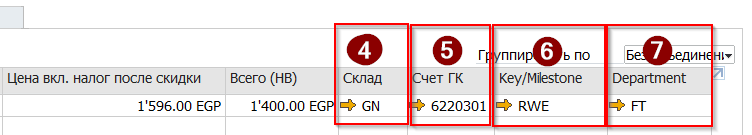

4. Перейти на вкладку Финансы

(1) Проверить и изменить Контрольный счёт который будет использован для проводки по Кредиту  
(2) Проверить и изменить условия оплаты (источник значения по-умолчанию - Карточка БП)  
(3) Проверить установленную консолидацию  

 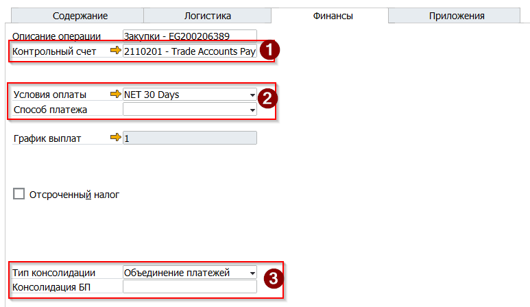

5. Выбрать свою подпись в поле Ответственный, проверить итоговые суммы документа и нажать кнопку [Добавить]

 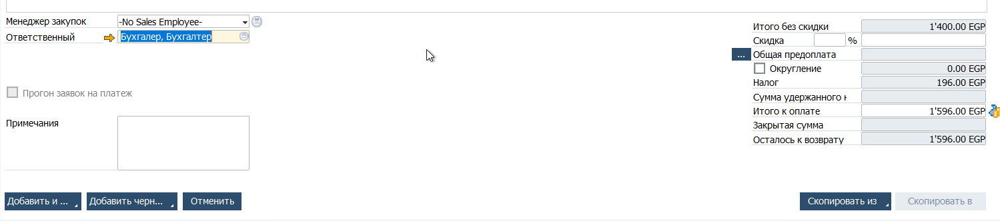

6. При добавлении документа в систему будет создана следующая бухгалтерская проводка:

 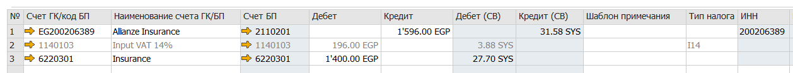

## Создание Закупки для складируемых товаров

1. Открыть документ Закупка из Главного меню -> Закупки -> Закупка

 

2. В открывшемся окне заполнить Заголовок

(1) Код и Название поставщика  
(2) Номер инвойса в системе Поставщика. Это поле является обязательным  
(3) Выбрать валюту документа, если она отличается от локальной (EGP). Важно - список документов (Поступление|GRPO), которые на следующем шаге отразит система зависит от валюты. Валюты должна совпадать, т.е. если Поступление было в EGP тогда и Закупка должна быть в EGP  
(4) Указать дату инвойса в поле Дата регистрации. И дату отсрочки оплаты по инвойсу в поле Дата исполнения  

 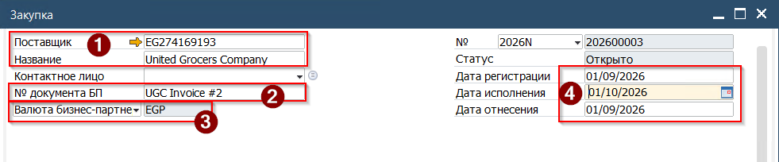

3. Для того чтобы заполнить табличную часть документа нажать кнопку [Скопировать Из], расположенную в нижней части формы и выбрать в выпадающем меню - Поступление товара

 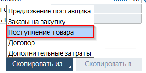

4. В открывшемся окне выбрать базовый документ Поступление, из которого будут скопированы данные. Множественный выбор также возможен - необходимо зажать клавишу [Ctrl]. По завершению отбора нажать кнопку [Выбрать]

 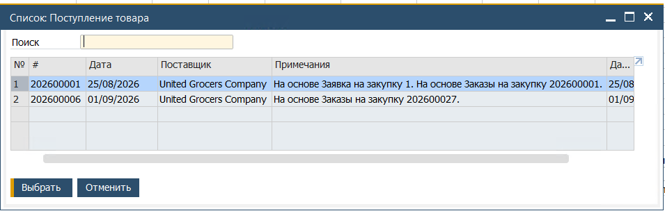

5. В новом окне Система открое Ассистент по переносу данных. На первом шаге определяется, какой курс будт использован при проводке (даже если документ в локальной валюте - любая проводка параллельно записывается в системной валюте, в качестве которой установлен USD).

 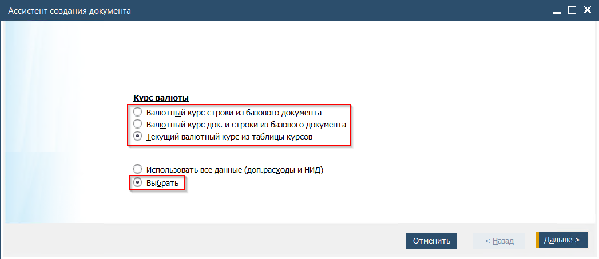

6. На следующем шаге необходимо выбрать, какие данные из Поступления будут перенесены в Закупку. Синяя подсветка строки означает, что строка будет перенесена. Для выбора\\исключения строки необходимо нажать на номер строки в колонке # (1)

(2) Сверить цены на товары указанные в инвойсе, полученном от поставщика  
(3) Сверить количество товара, указанное в инвойсе, полученном от поставщика  

 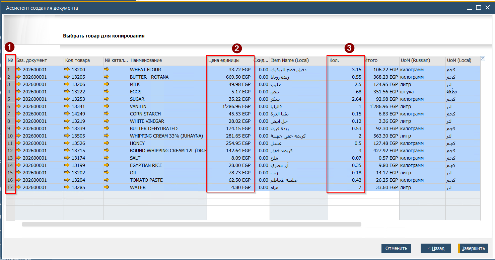

В случае наличия расхождений между данными в SAP и полученном инвойсе в первую очередь необходимо обсудить их с поставщиком. Технически, SAP позволяет скорректировать данные в Закупке относительно Поступления. Но стоит учесть следующее поведение Системы:  
**Если количество в Поступлении отличается от количества в инвойсе.**  
*Количество в Поступлении больше, чем количество в Закупке* - количество принятое на склад не изменится, но стоимость непринятого товара останется на счёте Goods Receipt Not Invoiced, а строка в Поступлении останется открытой. Оставшееся количество может быть обработано другим документом Закупка  
*Количество в Поступлении меньше, чем количество в Закупке* - система заблокирует проводку Закупки. Такая проводка технически невозможна  
**Если цена товара в Поступлении отличается от цены в инвойсе.**  
Разница расчёта стоимости товара будет отражена проводкой по счёту учёта тмц (если товар находится на складе) или по счёту COGS (если товар уже был продан)

7. После сверки данных в таблице, нажать кнопку [Завершить]

8. Ассистент перенесёт данные из Поступления в Закупку с созданием всех необходимых связей между документами

9. Сверить заполнение всех полей таблицы.

10. Перейти на вкладку Финансы и проверить (при необходимости изменить) контрольный счёт и условия оплаты

 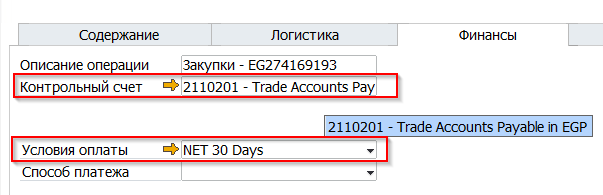

11. Для ввода информации о НИД \\ Withholding tax - Сделать клик правой кнопкой мыши на серой зоне заголовка для вызова контекстного меню. В открывшемся меню выбрать пункт [Таблица НИД]

 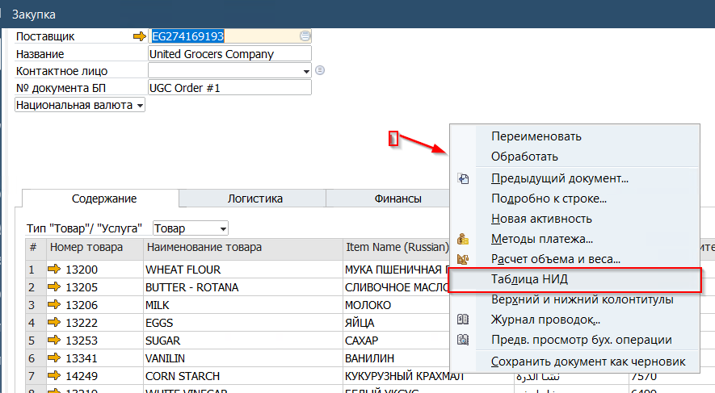

12. В открывшейся форме указать применимый WHT налог, сверить данные и нажать кнопку [Обновить]

 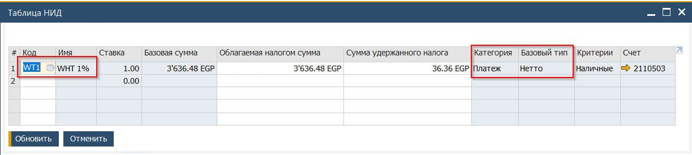

13. Вернувшись в документ Закупка, выбрать свою подпись в поле Ответственный

 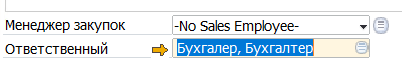

14. Запустить генерацию предпросмотра бухгалтерской операции, нажав соответствующую иконку на панели инструментов. После этого, Система запустит процесс генерации бухгалтерской проводки и проверит документ на наличие ошибок. Если в результате открылась форма превью бух.проводки - значит в документе ошибок нет

15. Проверить правильность проводок и нажать кнопку [Закрыть] для возврата в Закупку

16. Для проводки документа Закупка нажать кнопку [Добавить]

При успешном сохранении Система уведомит в строке состояния

 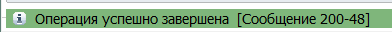

## Результат проводки Закупки

В результате проводки документа Закупка будет увеличена Кредиторская задолженность перед поставщиком, что будет отражено

1. В карточке Поставщика:

 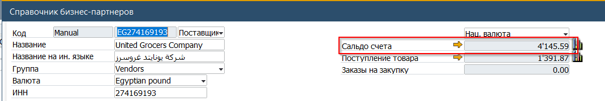

2. В отчёте по Кредиторской задолженности:

 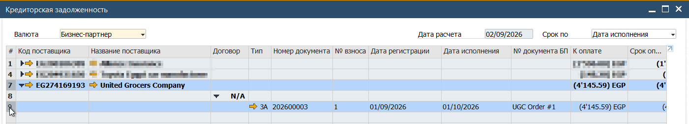

3. В балансе Контрольного счёта Главной книги:

 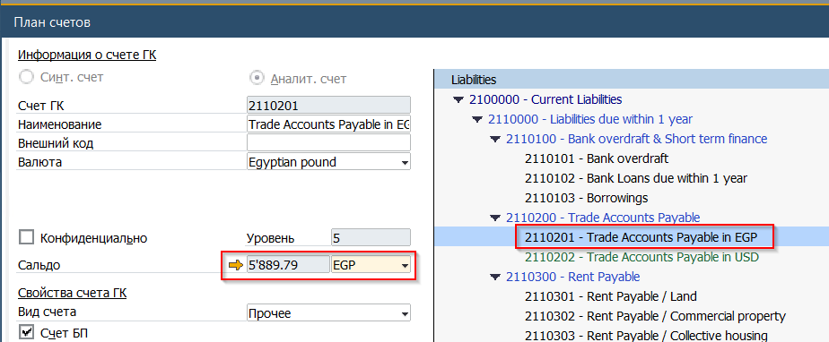
