Отражение производственных операций является обязательной частью процесса внесения фактических данных в SAP. Проводка производства обеспечивает:

* расчёт прямой себестоимости продукции (Продуктов и Полуфабрикатов)
* отражение движения складских позиций (поступление продукции и полуфабрикатов, списание ингредиентов и полуфабрикатов, генерации потребности)
* отражение движений в Бухгалтерии (изменение баланса счетов ТМЦ и затрат)

Для единичных производственных операций Производственный заказ может быть сформирован без использования Спецификации. Но в большей массе, Производственный заказ создаётся с ипользованием Спецификации. Правильно составленная Спецификация это залог правильно сформированного Производственного заказа.
В первое время использования SAP потребуется тщательно проверять и корректировать состав Спецификаций.

### Отражение процесса производства состоит из следующих этапов:

1. Генерация потребности (Заказ на продажу)

2. Генерация документов снабжения Готовой продукцией (Производственный заказ)

3. Генерация документов снабжения Полуфабрикатами (Производственный заказ)

4. Отражение поступления на склад Полуфабрикатов и списания ингредиентов (Поступление из производства и Списание в производство)

5. Отражение поступления на склад Готовой продукции (Поступление из производства и Списание в производство)

### Стадии жизни Производственного заказа:

* Запланировано. Заказ создан и доступен для редактирования. Работы по выдаче компонентов и производство невозможны.
* Отпущено (Released). Заказ запущен в работу. Доступна выдача компонентов и производство.
* Завершено. Заказ закрыт, продукция принята на склад, компоненты списаны. Себестоимость производства расчитана.

### Производственные заказы по способу создания

* Вручную. Может быть создан на основе Спецификации или без использования Спецификации. Созданные вручную производственные заказы не имеют связи с другими SAP документами, однако результат их проводки не отличается от результата проводки автоматически созданных Производственных заказов.
* Автоматически. К этой категории относятся заказы, созданные на базе Заказа на продажу, на базе Производственого заказа или с использованием Ассистента генерации документов (по потребности)

## Создание Производственного заказа
### Ручное создание Производственного заказа для позиции без Спецификации (редкий случай)

1. Открыть документ Производственный заказ из Главного меню -> Производство -> Производственный заказ

2. Заполнить заголовок Заказа следующим образом:

(1) Тип - Специальный. Этот тип позволяет создавать Производственные заказы для товаров без спецификации (разово)
(2) Указать Код\\Название готового продукта
(3) Указать Запланированное количество. Это количество которое поступит на склад в результате проводки данного Заказа. Проверить установленную единицу измерения (её источник - карточка товара). Проверить Склад, это склад для поступления результата производства
(4) Указать даты. Дата заказа - дата создания заказа. Начальная дата - дата планируемого начала производства (в примере окрашена красным, так как запланированный запуск производства просрочен). Дата исполнения - автоматически калькулируемое поле (расчёт когда продукция сможет поступить на склад)
(5) Если производственный заказ выполняется под какой-то конкретный заказ на продажу (или под другой производственный заказ) то необходимо указать ссылку на эти документы.
(6) Key\\Milestone и Department центры являются обязательными полями для заполнения. Они определяют финансовую аналитику в бухгалтерских проводках

 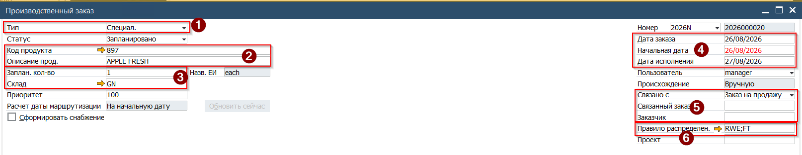

3. Перейти к заполнению вкладки Компоненты, указать?

(1) Выбрать тип строки - товар, и указать ингредиент используемый для производства
(2) Базовое количество - количество ингредиента напрямую используемого в производстве
(3) Доп.количество - количество компонента, которое идёт на весь заказ (не увеличивается при увеличении количества продукции. Например - несливаемый остаток в соковыжималке формируется один раз вне зависимости от того, сколько яблок будет обработано и сколько сока получится в итоге.
(4) Запланированное количество - количество ингредиента необходимое для производства продукции в количестве которое указано в заголовке (Базовое + Доп.количество)
(5) Склад списания ингредиентов

(6) Key\\Milestone и Departments центры которые будут использованы в проводках. Должны соответствовать складу.

 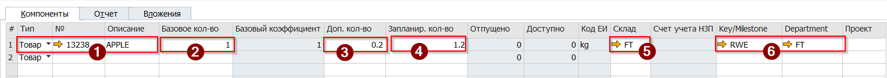

4. При необходимости повторить шаги для добавления ингредиентов.

Производственный заказ выше можно прочитать следующим образом:
Разовое производство одной порции яблочного фреша из 1.2 килограмма яблок. Для точки продаж Foodtruck.

### Ручное создание Производственного заказа для позиции со Спецификацией (редкий случай)

1. Открыть документ Производственный заказ из Главного меню -> Производство -> Производственный заказ

2. Заполнить заголовок Заказа следующим образом:

(1) Тип - Стандарт. Этот тип производственных заказов для позиций со спецификацией
(2) Указать Код\\Название готового продукта
(3) Указать Запланированное количество. Это количество которое поступит на склад в результате проводки данного Заказа. Проверить установленную единицу измерения (её источник - карточка товара). Проверить Склад, это склад для поступления результата производства
(4) Указать даты. Дата заказа - дата создания заказа. Начальная дата - дата планируемого начала производства (в примере окрашена красным, так как запланированный запуск производства просрочен). Дата исполнения - автоматически калькулируемое поле (расчёт когда продукция сможет поступить на склад)
(5) Если производственный заказ выполняется под какой-то конкретный заказ на продажу (или под другой производственный заказ) то необходимо указать ссылку на эти документы
(6) Key\\Milestone и Department центры являются обязательными полями для заполнения. Они определяют финансовую аналитику в бухгалтерских проводках.

 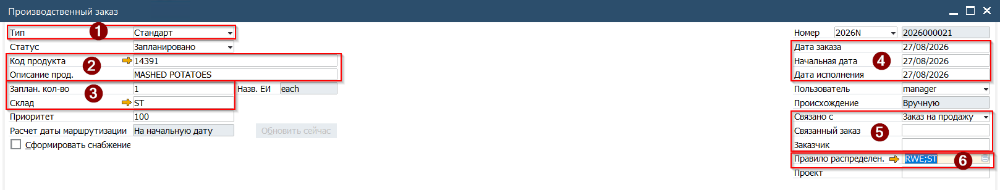

3. При создании Заказа для товара со спецификацией, после выбора продукта в заголовке в таблицу подтянется информация из спецификации. При необходимости в каждом конкретном заказе состав ингредиентов может быть скорректирован.

Проверить и скорректировать информацию в таблице:
(1) Проверить ингредиент используемый для производства
(2) Базовое количество - количество ингредиента напрямую используемого в производстве
(3) Доп.количество - количество компонента, которое идёт на весь заказ (не увеличивается при увеличении количества продукции. Например - несливаемый остаток в соковыжималке
(4) Запланированное количество - количество ингредиента необходимое для производства продукции в количестве которое указано в заголовке (Базовое + Доп.количество)
(5) Склад списания ингредиентов
(6) Key\\Milestone и Departments центры которые будут использованы в проводках. Должны соответствовать складу

 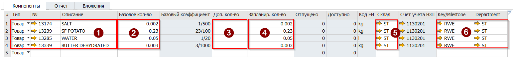

### Генерация Производственного заказа из Заказа на продажу (часто употребимый вариант)

1. Открыть Заказ на продажу (в примере использован Заказ реализации через кассу Foodtruck, но применим этот пример для склада Кухня)

2. Перейти на вкладку Логистика и установить отметку 'Закупить товары для непрямой поставки'

 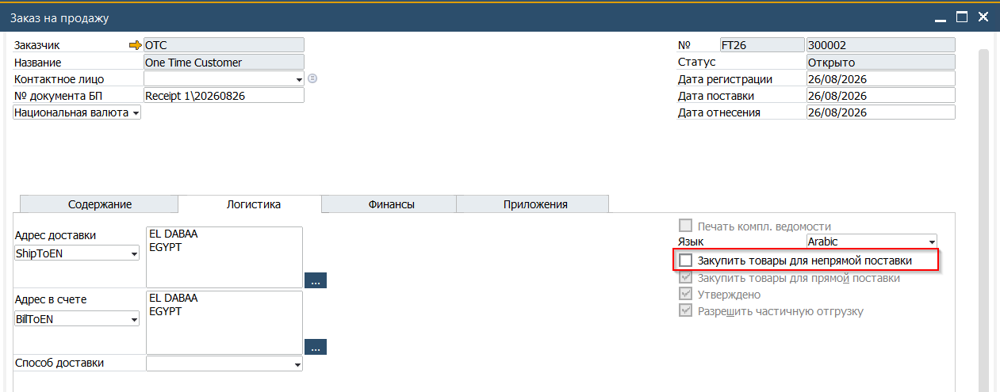

3. Система задаст вопрос о необходимости обновить строки. Нажать кнопку [Да]

 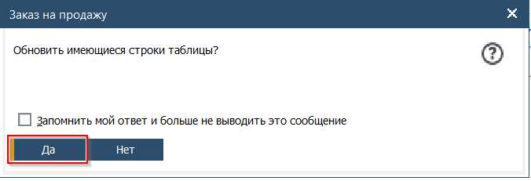

4. В Заказе на продажу сохранить изменения нажав на кнопку [Обновить]

 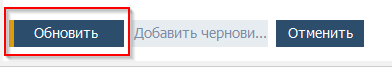

5. Система откроет окно Ассистента, где пошагово необходмо определить критерии для генерации. На первых шагах определяется источник (так как ассистент запущен из Заказа на продажу, то большинство страниц будет предзаполнено. На первом шаге определяется клиент. Для продолжения нажать кнопку [Дальше]

 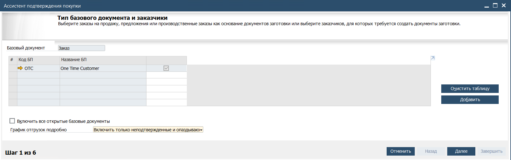

6. На втором шаге определяются базовые документы для расчёта.Для продолжения нажать кнопку [Дальше]

 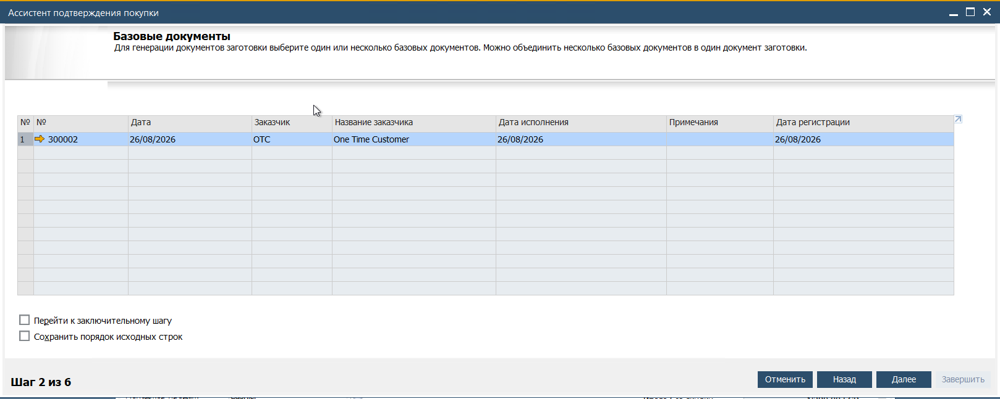

7. На третьем шаге определяются товарные позиции и тип целевого документа.

(!) Важно, проверить тип целевого документа. Должен быть Производственный заказ

 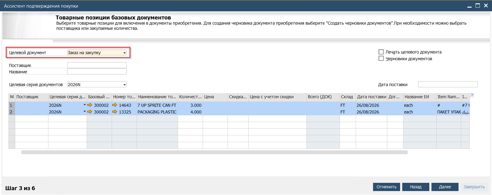

8. Изменить тип целевого Документа на Производственный заказ, при этом будет обновлён состав товаров в таблице ниже (будут отражены производимые товары)

Указать Дату поставки и нажать кнопку [Далее]

9. На следующем шаге предлагается выполнить объединения. Выбрать Без объединения и нажать кнопку [Далее]

 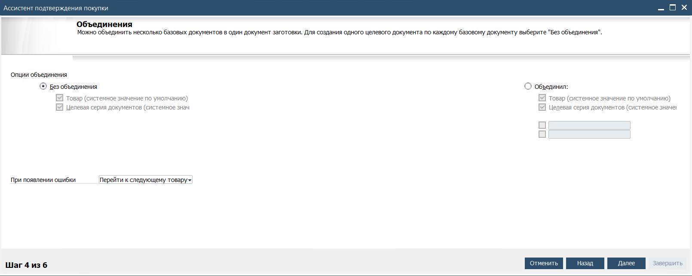

10. Последний шаг - ознакомление с предварительным результатом работы Ассистента. Сверить данные в таблице и нажать [Далее].

11. Система создаст запрошенные заказы. В случае ошибки в данной таблице будет указана причина

 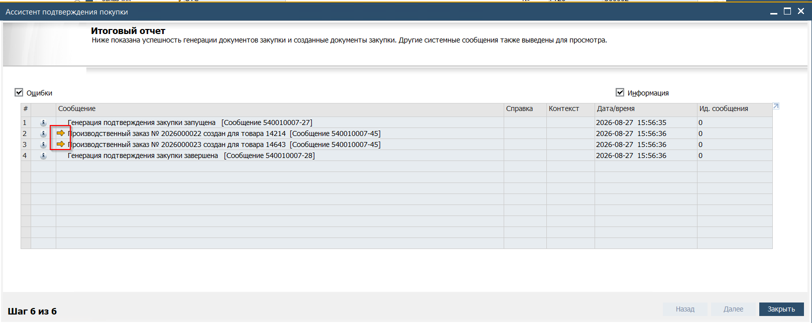

12. Для перехода в созданные заказы можно воспользоваться золотой стрелкой

В независимости от выбранного варианта в результате выполненных действий в Системе создан Производственный заказ. Заказ создаётся в статусе Запланировано и требует дальнейшей обработки.

# Обработка Производственного заказа
Процесс обработки Производственного заказа состоит из следующих шагов:

* Определение текущего статуса проводок производства
* Разузлование производственных заказов
* Проводка выдачи компонентов и поступления из производства
* Закрытие цепочек производственных заказов
* Списание (утилизация) остатков

## Определение текущего статуса
### Открытые производственные заказы (Стандартный SAP отчёт

1. Открыть из Главного меню -> Производство -> Сборочные отчёты -> Необработанные документы

 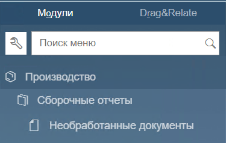

2. В открывшемся окне проверить тип отображаемых документов

 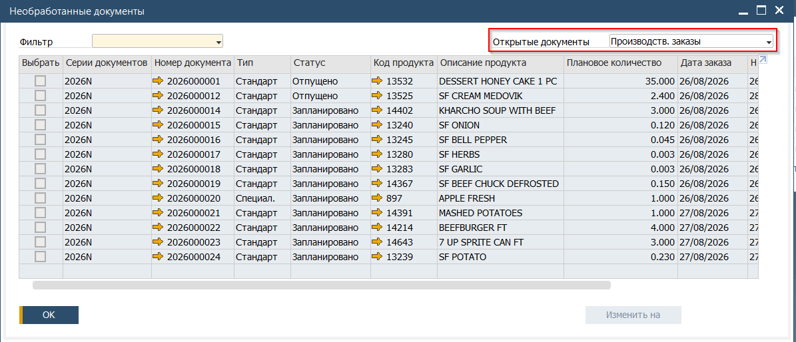

3. Установить Фильтр на отображение Отпущенных (Released) заказов

 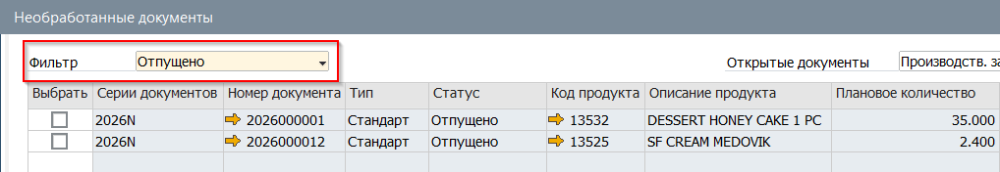

4. Обработать данные заказы.

### Отпущенные (Released) производственные заказы (Пользовательский отчёт)

1. Открыть Менеджер запросов, расположенный на Панели инструментов

 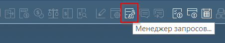

2. Выбрать категорию и запустить отчёт '202.1.3. Требуется закрытие Произв.заказов (Released)

   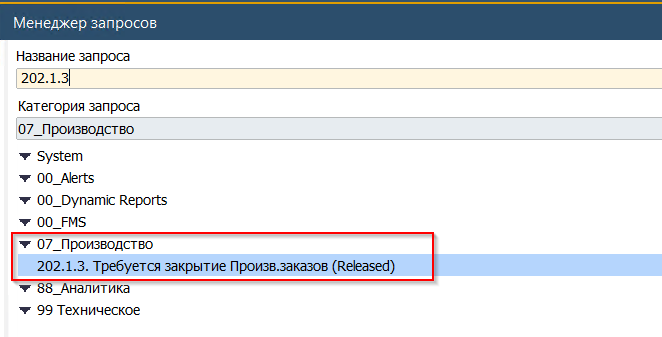

3. Ознакомиться с отчётом и обработать данные заказы

 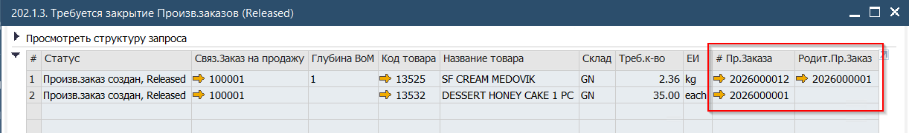

### Статус списания компонентов (Пользовательский отчёт)

1. Открыть Менеджер запросов, расположенный на Панели инструментов

 

2. Выбрать категорию и запустить отчёт '202.2.1. Статус списания полуфабрикатов

 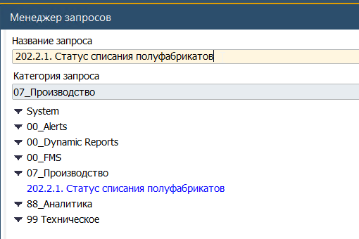

3. Ознакомиться с отчётом и обработать документы

 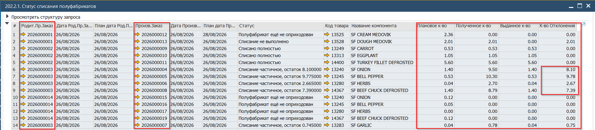

### Статус создания дочерних производственных заказов (Пользовательский отчёт)

1. Открыть Менеджер запросов, расположенный на Панели инструментов

 

2. В зависимости от ситуации запустить один из представленных отчётов

 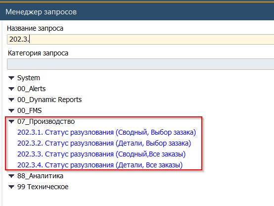

3. Ознакомиться с отчётом и обработать документы

Сводный вариант отчёта:

 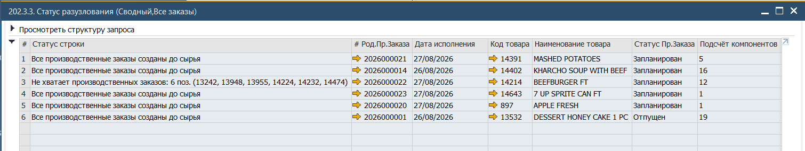

   Детальный вариант отчёта:

 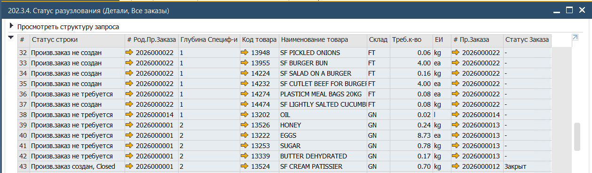

## Разузлование производственных заказов

1. Запустить отчёт используя Менеджер запросов. Для примера будет использован отчёт '202.3.4. Статус разузлования (Детали, Все заказы)'

2. В открывшемся отчёте установить фильтр для отображения только строк с несозданными заказами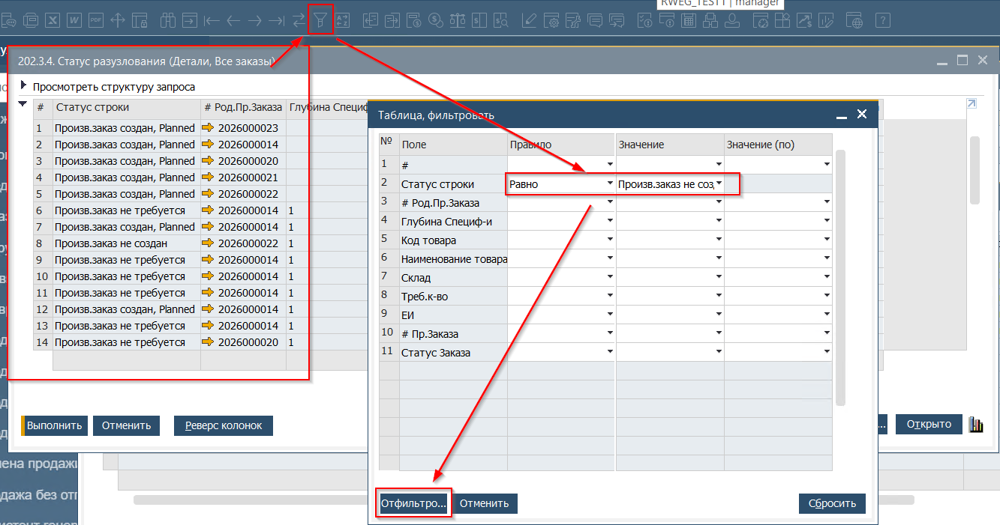

Данные в отчёте отфильтрованы

 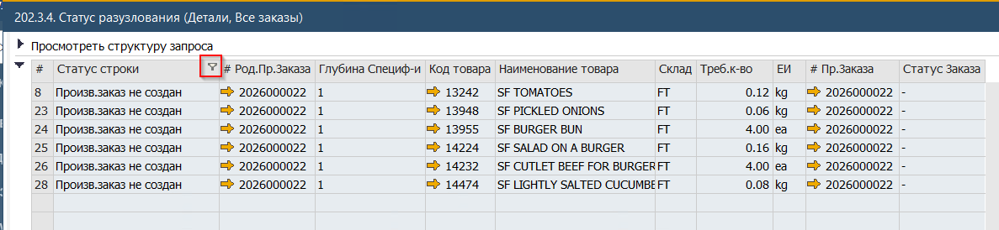

3. Перейти в Родительский производственный заказ, нажав на Золотую стрелку

4. Проверить и при необходимости скорректировать данные в Заказе

5. Установить отметку для генерации документов снабжения и нажать кнопку [Обновить] для сохраннения изменений

 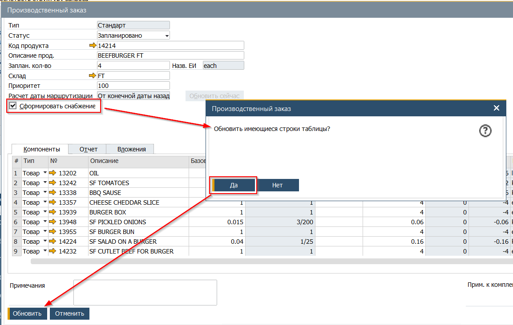

6. Система запустит Ассистент создания документов покупки. Нажать кнопку [Далее]

 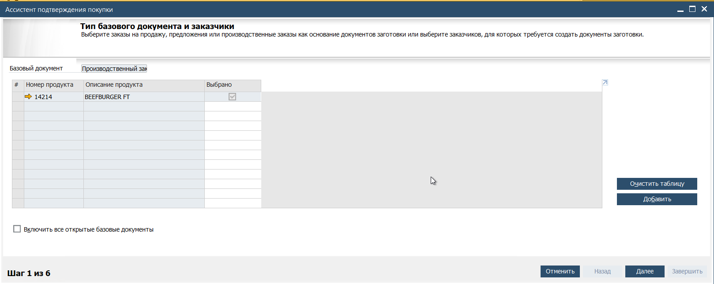

7. На следующем шаге сверить информацию о родительском товаре и нажать кнопку [Далее]

 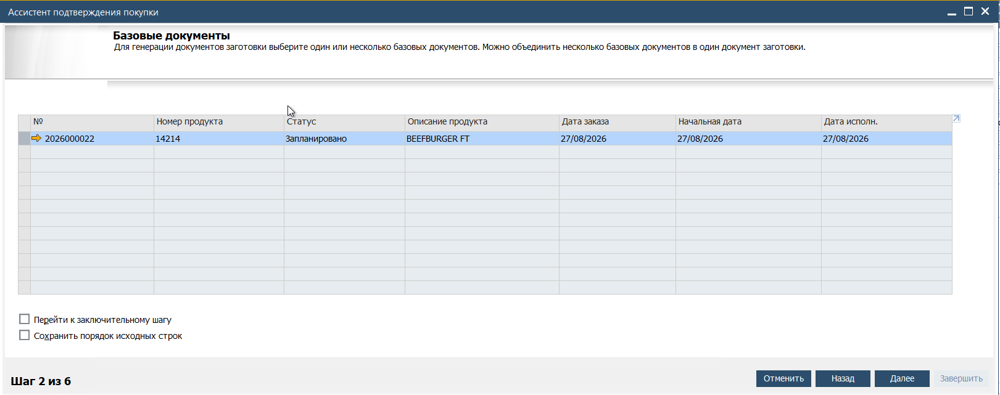

8. На следующем шаге изменить Целевой документ (установить Производственный заказ) и указать Дату поставки. В табличной части формы проверить количества, склад компонентов. При необходимости выделить\\снять выделение со строк для которых будет сгенерированы Производственные заказы. Нажать кнопку [Далее]

 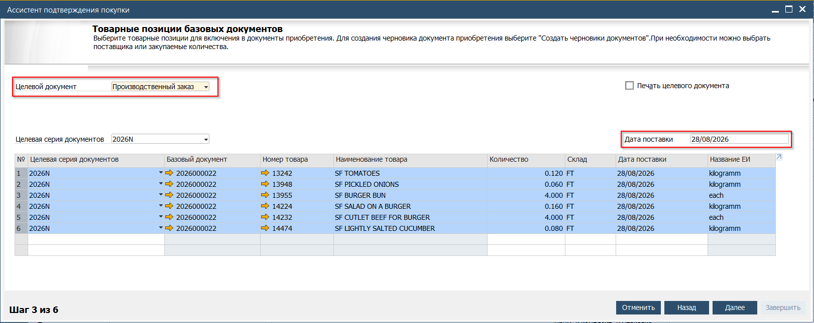

9. На следующих шагах выбрать способ генерации документов без объединения и ознакомиться с предварительным расчётом.

10. В результате обработки, в Системе будут созданы Производственные заказы на выбранные позиции

 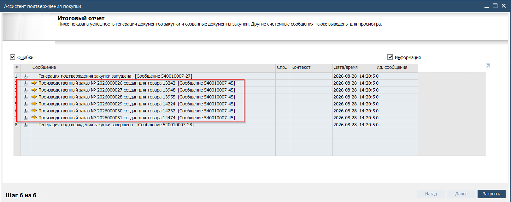

11. Следуя инструкциям выше - повторить шаги для разузлования всех полуфабрикатов до последнего уровня, содержащего только сырьё. В итоге разузлования необходимо дойти до создания производственных заказов на всех уровнях вложенности:

 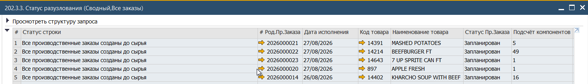

## Закрытие Производственного заказа. Проводка выдачи компонентов и поступления из производства
Проводка закрытия производственных заказов выполняется от заказов максимальной глубины вложенности к минимальной.(По мере появления полуфабрикатов на складе). При проводке выдачи компонентов к заказам на складах FT\\BK\\ST потребуется проводка Перемещения товаров между складами. Для центрального склада GN данной операции не требуется и компонены могут быть списаны непосредственно с него.

1. Запустить отчёт '202.1.3. Требуется закрытие Произв.заказов (Released)' или любым другим способом перейти в производственный заказ

 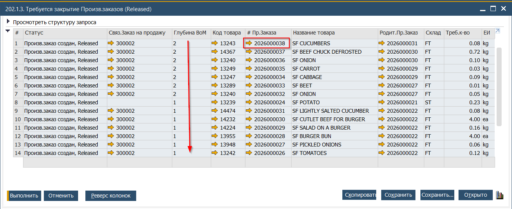

2. Для создания Перемещения вызвать Контекстное меню нажатием правой кнопки мыши и выбрать пункт Перенос компонентов

 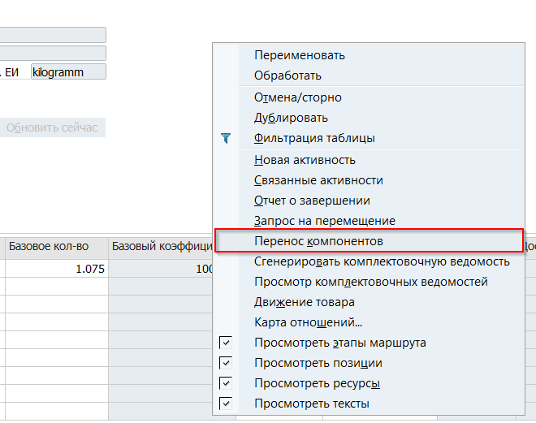

3. В открывшемся окне выбрать способ расчёта количества

* Открытое количество - количество компонента с учётом ранее выданного количества (если ранее часть компонентов уже была списана в производственном заказе
* Количество вышестоящих товаров - количество, расчитанное исходя из изначальной потребности заказа в компоненте. Без учёта ранее выданного количества.

 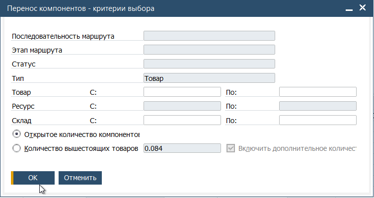

4. Проверить и скорректировать склад источник и целевой склад перемещения. В версии SAP, установленной на момент написания инструкции, наличиствует баг который заключается в том, что эти поля заполненны системным складом по-умолчанию. В такой ситуации необходмо "продёрнуть" склад в заголовке и таким образом обновить данные в таблице

 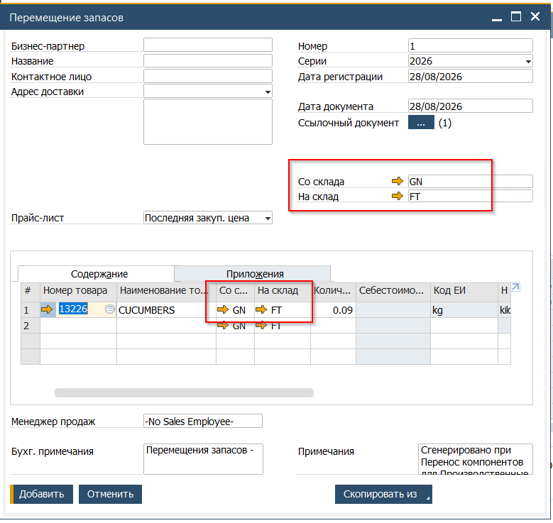

5. Для проводки перемещения - нажать кнопку [Добавить]

6. После обеспечения необходимых для проводки компонентов на складе - вызвать Контекстное меню и выбрать пункт 'Отчёт о завершении'

 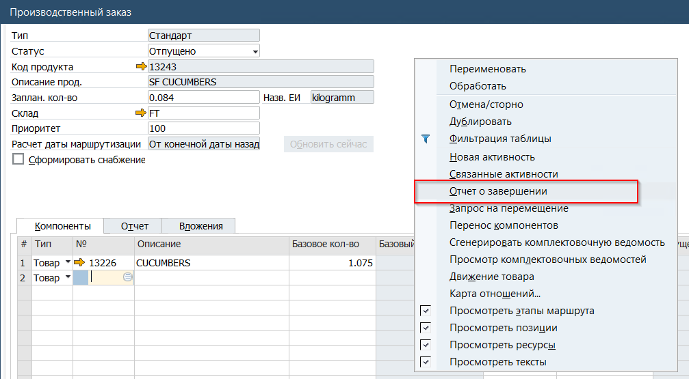

7. Система откроет форму документа Поступление из производства. Это проводка поступления полуфабриката на склад. Списание компонентов использованных в производстве будет выполнено в момент оформления прихода полуфабриката.

Проверить и скорректировать данные в таблице (склад, Key\\Milestone, Department) и нажать кнопку [Добавить]

 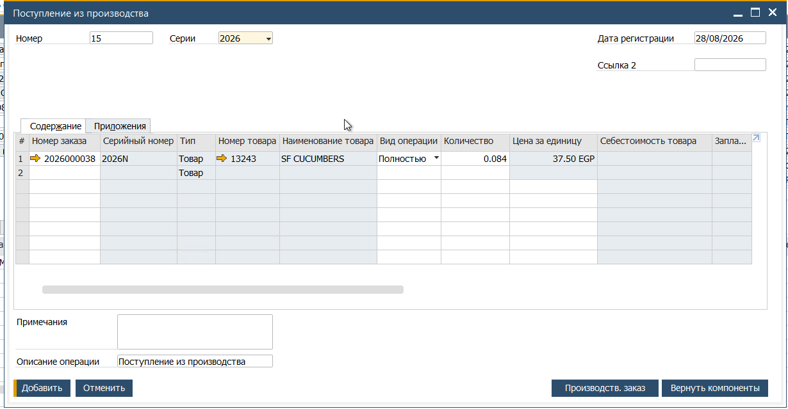

8. После списания компонентов и приёма продукта - изменить статус Заказа на 'Закрыто' и сохранить изменения.

9. Вернуться в Производственный заказ и изменить его Статус на ‘Завершено‘

10. Закрыть Производственный заказ и вернуться к шагу 1 для проверки необходимости закрытия других заказов.

## Результат проводки заказа

Строка компонента в Заказе будет закрыта для редактирования:

 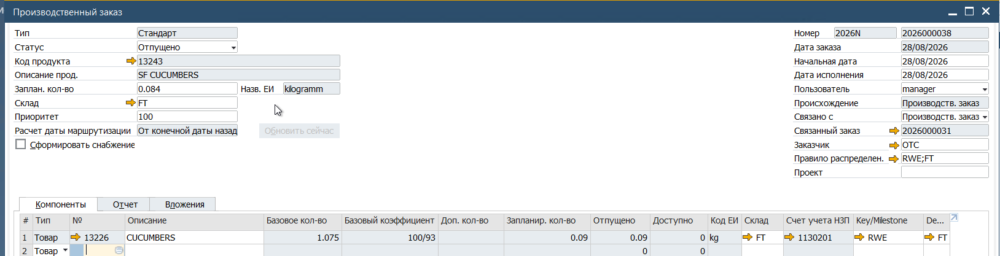

Списание компонента будет отражено складским движением и бухгалтерской проводкой:

 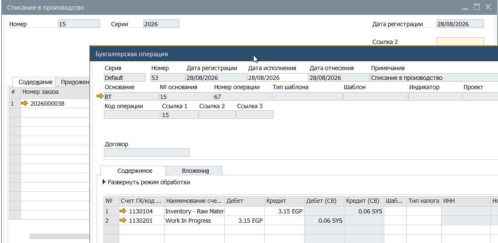

Продукт (в данном случае - полуфабрикат) будет получен на склад документом Поступление из производства, с отражением в бухгелтерской проводке

 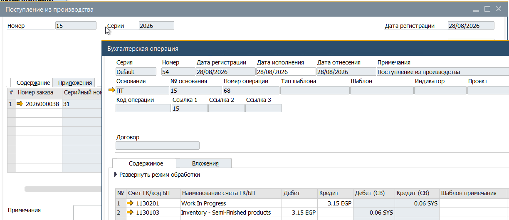
