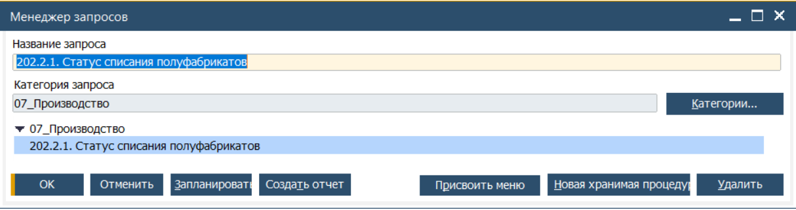
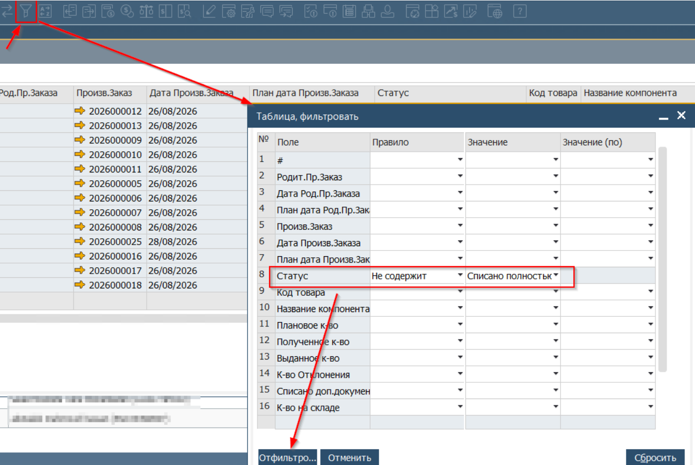
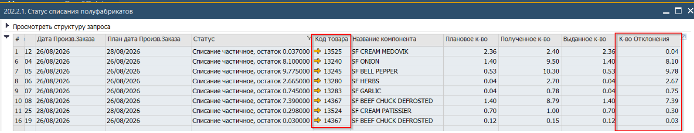
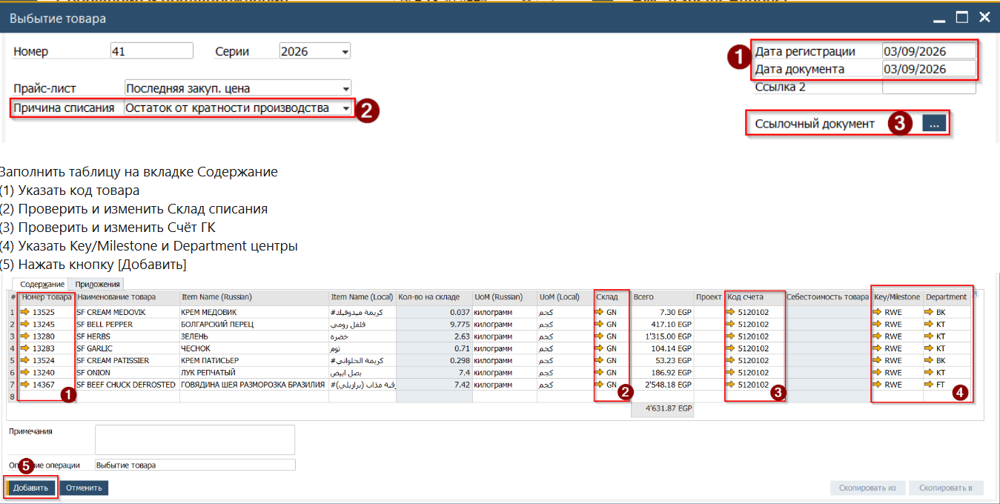

## Типы проводок списания со склада
В SAP существует три основных типа списания (складских движения) ТМЦ со склада:

* **Списание в производство**. Документ создаётся Системой с привязкой к конкретному Производственному заказу. Себестоимость списываемых таким образом ТМЦ, автоматически относится на себестоимость результата производства. В процессах Roin World документы этого типа настроены на автоматическое создание в процессе проводки Поступления из Производства. (Создание описано в разделе Проводка производства)
* **Проводка расхождения запаса**. Документ создаётся в результате проводки Инвентаризации (документ Учёт товарных запасов). Себестоимость списываемых таким образом ТМЦ проводится по счету затрат, который предустановлен для использования с данным типом докумнета (Создание описано в разделе Инвентаризация запасов). Документ создаётся в связке с инвентаризационной ведомостью, что обозначает списание как результат подсчёта складских остатков.
* **Выбытие со склада**. Документ создаётся вручную без системной связи с другими документами оснований. Из-за этого, для обеспечения наличия аналитики, указание **Причины списания** является обязательным. Себестоимость ТМЦ будет списана со счёта учёта ТМЦ на счёт затрат, указанный в строчной части документа.

## Причины списания
| Причина | Описание |
|---------|----------|
| * **Consumption\|Внутреннее потребление**. | Списание товаров, которые не участвовали в Производстве и были потреблены сотрудниками |
| * **Defective\|Поврежденныe материалы**. | * Списание товаров, повреждённых в процессе хранения. |
| * **Expired\|Истёк срок годности**. | * Списание по сроку годности. |
| * **Leftover\|Остаток от кратности производства**. | * Списание полуфабрикатов, произведённых для реализации Родительского Производственного заказа, но которые не были использованы в производстве так как фактически потребовалось меньшее количество. Указывает на неточности в Спецификациях и настройках Кратности заказа. |
| * **Shrinkage\|Усушка/ Испарение / Обрезка**. | * Списание остатков, обусловленных технологическими особенностями обработки. |
| * **Theft\|Пропажа, кража**. | * Списание по причине кражи, потери, когда это установлено не в результате периодической инвентаризации. |

## Подготовка и проводка выбытия

### Получение информации о не списанных остатках полуфабрикатов
Важно, проверка остатков для списания полуфабрикатов должна выполняться только после полного закрытия Производственных заказов.

1. Запустить отчёт, расположенный в Менеджере запросов: '202.2.1. Статус списания полуфабрикатов'

 

2. В отчёте установить фильтр на колонку Статус и выбрать Правило - Не содержит, Значению 'Списано полностью'. Таким образом под фильтр попадут значения Списано полностью и Списано полностью (Goods Issue)

 

3. В результате таблица будет отфильтрована на отражение не списанных в производство полуфабрикатов:

 

4. Экспортировать результат в Excel таблицу для удобства копирования данных.

### Проводка Выбытия со склада

1. Для проводки списания ТМЦ со склада открыть документ Выбытие со склада \\ Goods Issue, который расположен в Главном меню -> Запасы -> Операции по складу -> Выбытие товара

 

2. Заполнить Заголовок:

(1) Дата проводки списания  
(2) Причина списания, должна соответствовать счёту ГК, указанному на вкладке Содержание  
(3) Опционально - указать ссылочный документ (Заказ на продажу к которому относится списание если такая связь существует. В этом случае затрата может быть отнесена на себестоимость конкретного заказа)  

   

   \
