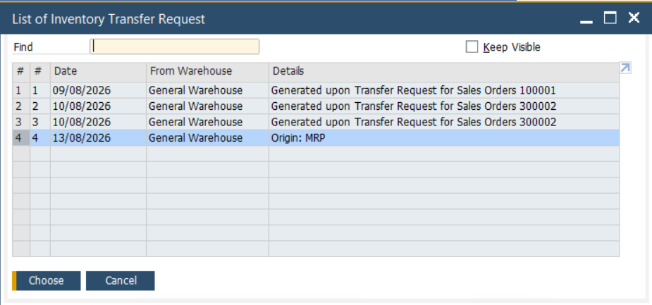
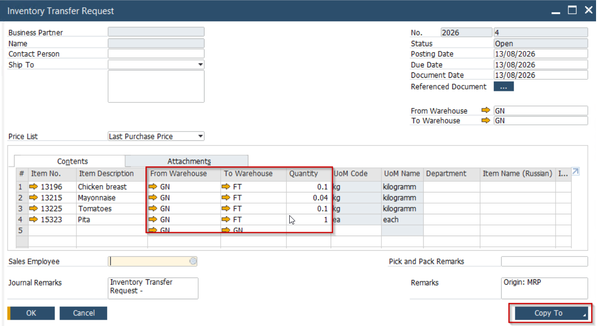
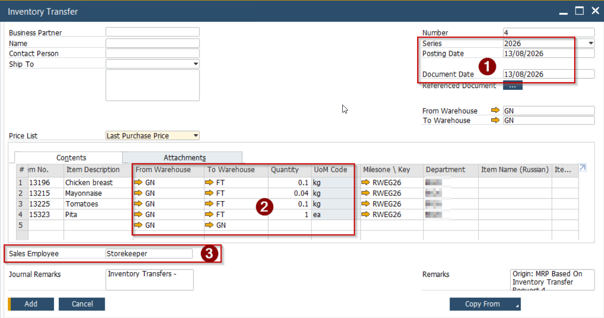

Данный шаг является частью процесса Производства.
На данном шаге выполняется отражение выдачи ТМЦ необходимых для Производства со склада ТМЦ в Производство.

1. Открыть список **открытых** Inventory Transfer Request

2. Выбирать запрошенный документ из списка и нажать кнопку [Choose]

3. Система откроет список запрошенных ТМЦ

   

4. Проверить корректность указанных складов в строках и количество. Нажать кнопку [Copy To] и выбрать [Inventory Transfer] как целевой документ

5. Система откроет форму документа Inventory Transfer и предзаполнит её данными. На этом шаге можно внести правки в документ перемещения для того чтобы отразить фактическое количество выданных ТМЦ

6. (1) Проверить и скорректировать дату документа

(2) Проверить и скорректировать колицество каждого из товаров
(3) Подписать документ, выбрать свою запись из спика
Нажать кнопку [Add] для сохранения введённых данных.
При этом:
Система выполнит движение ТМЦ между складами (в примере со склада GN на склад FT)
Будет создана бухгалтерская проводка ДТ Inventory on Stock \\ КТ Inventory on Stock

   \
   

Процесс перемещения \\ Выдачи ТМЦ в производство завершён
